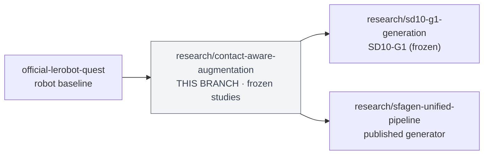

# Simulation-free augmentation: frozen study history (Gate 0 → v4B.1 → SD10)

> **Research branch (frozen evidence).** Robot setup, teleoperation, recording, training and evaluation commands are on
> [`official-lerobot-quest`](https://github.com/StanleyChueh/lerobot_openarm/tree/official-lerobot-quest#branch-map),
> together with the full branch map.
>
> **Do not change study files on this branch.** Protocols were frozen, and in some cases sealed by SHA-256, before
> results existed. The branch name is kept because those protocols and their reviews cite it. Only this README is
> updated.



## Purpose

This branch records how the project reached its current method: **few-shot, simulation-free, bimanual RGB + action
augmentation for OpenArm VLA learning**. Each study states its protocol before its results. Negative results are kept
on purpose. They are what justify the current `sfagen` design.

## Studies, in order

Every row links to the study's own results file; where it has a dedicated command section, the last column names it.
Numbers are quoted from those files.

| Study | Question | Result (verdict as recorded) | Results file | Reproduce section |
|---|---|---|---|---|
| Gate 0 | Is contact-aware generative augmentation feasible on our data? | Audit; motivation later corrected by the matched evaluation (erratum at the top) | [`GATE0_AUDIT.md`](research/contact_aware_augmentation/GATE0_AUDIT.md) | see file |
| Gate 1 | Can a CPU geometry verifier separate real from corrupted demos? | **PARTIAL**: the preregistered verifier false-rejects 2/3 real episodes | [`GATE1_RESULTS.md`](research/contact_aware_augmentation/GATE1_RESULTS.md) | see file |
| Gate 1R | Bounded recovery of that verifier | **FAIL → NO-GO**: criterion K3 (6/10-frame offsets) not met; line closed | [`GATE1R_RESULTS.md`](research/contact_aware_augmentation/GATE1R_RESULTS.md) | §7 Reproduction and tests |
| Generation feasibility | What does the old simulator generator actually vary? | Only the can start; 0/24 new hand-overs outside the source envelope | [`BASELINE_GENERATOR_AUDIT.md`](research/generation_feasibility/BASELINE_GENERATOR_AUDIT.md) | see file |
| Sim-free v1 | One-episode prototype (SAM2 + RAFT, body camera) | Works end to end on episode 0 in 136 s | [`RESULTS.md`](research/sim_free_augmentation/RESULTS.md) | §8 Reproduce |
| v2 | Matched G / P / C ablation on episodes 0/4/8 | Phase coordination adds nothing over tuned geometry (24/33 each); grasp-relative constraints matter only for regrasp (6/6 vs 0/6) | [`v2/RESULTS.md`](research/sim_free_augmentation/v2/RESULTS.md) | §13 Exact commands |
| v3 | 10 episodes, new initial can positions, SmolVLA screen | New positions work (3–6 cm shifts); 40 px coverage 62.5% → 85%; median shift 1.9 cm (fills gaps, does not extend the workspace) | [`v3/RESULTS.md`](research/sim_free_augmentation/v3/RESULTS.md) | §10 Exact commands |
| v3.1 | Why does augmentation barely help? | Grasp error −9%, handover error +11%: the gains and losses cancel; the policies do use vision | [`v3_1/RESULTS.md`](research/sim_free_augmentation/v3_1/RESULTS.md) | Commands |
| v3.2 | Three-camera generation | 37 episodes / 9,398 frames validated; wrist-mount translation not identifiable; viewpoint realism **not demonstrated** | [`v3_2/RESULTS.md`](research/sim_free_augmentation/v3_2/RESULTS.md) | Commands |
| v4B | Initial-position augmentation, SmolVLA far grasp | Primary R+Position **FAIL** (far grasp +13.2%, but handover −3.8% > 2% guardrail); secondary R+Both passes (+9.9% far grasp) | [`v4/V4B_RESULTS.md`](research/sim_free_augmentation/v4/V4B_RESULTS.md) | Reproduction |
| v4B.1 | H1 missing synthetic RGB; H2 phase-masked targets | H1 `INCREMENTAL_VALUE_NOT_ESTABLISHED` (+2.8% [−1.2, +7.3]); H2 phase masks **worsen** handover (−3.2%) | [`v4b1/V4B1_RESULTS.md`](research/sim_free_augmentation/v4b1/V4B1_RESULTS.md) | §6 Reproduction |
| SD10 selection | Pick 10 diverse sources from the 50-episode pool | SD10 = [1, 6, 7, 11, 13, 14, 27, 34, 42, 47]; covering radius 118 → 65 px | [`sd10/FULL50_EPISODE_AUDIT.md`](research/sim_free_augmentation/sd10/FULL50_EPISODE_AUDIT.md) | §7 Reproduce |
| SD10-L1 | Real-only SmolVLA: Original10 vs SD10 vs Random10 | **FAIL**; far grasp +10.2% [−9.4, +33.2]; no advantage over Random10 → stop SD10 | [`sd10/l1_exec/L1_RESULTS.md`](research/sim_free_augmentation/sd10/l1_exec/L1_RESULTS.md) | §8 Reproduce |

**Independent review status** (Codex, recorded in the project notes; most review files are kept locally, untracked):
- v4B: audited; the primary FAIL and the secondary Both candidate are kept.
- v4B.1: **MODIFY**.
- SD10 selection: **MODIFY**, not reselect.
- SD10-L1: post-training review pending.

## Reproduce

Run each study from its own folder with the commands in its results file. Common environment:

```bash
PY="env -u PYTHONPATH -u LD_LIBRARY_PATH $HOME/Stanley_ws/lerobot_openarm/.venv/bin/python"
cd research/sim_free_augmentation/v4b1     # for example; see "§6 Reproduction" in V4B1_RESULTS.md
```

**Data:**
- `ethanCSL/openarm_pringles_lerobot_real_10_v00@cebdee98` (sources).
- `ethanCSL/openarm_pringles_lerobot_real_v00@2c1bc860` (the 50-episode pool; episodes 10–49 are **reused development
  data**, not a test set).

Training studies need a GPU and their own authorization.

## Not on this branch

- **The v4A locked real-view preregistration** (`research/sim_free_augmentation/v4a/`, seal `91eea62d…`) is local and
  untracked. It is backed up in `~/Stanley_ws/backups/repro_2026-11-11`.
- **SD10-G1** is on [`research/sd10-g1-generation`](https://github.com/StanleyChueh/lerobot_openarm/tree/research/sd10-g1-generation).
- **The current generator** is on [`research/sfagen-unified-pipeline`](https://github.com/StanleyChueh/lerobot_openarm/tree/research/sfagen-unified-pipeline).
