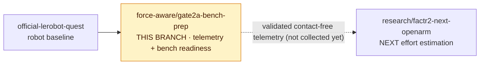

# Force-aware Gate 2A: OpenArm motor telemetry and hardware bench readiness

> **Research branch.** Robot setup, teleoperation, recording, training and evaluation commands are on
> [`official-lerobot-quest`](https://github.com/StanleyChueh/lerobot_openarm/tree/official-lerobot-quest#branch-map),
> together with the full branch map. This branch is written from the robot-connected device. Pull before committing.



## Purpose and status

**Purpose.** Log OpenArm motor telemetry next to normal LeRobot recordings, without changing the robot interface, so that
external effort can later be estimated (NEXT, battery-insertion contact).

**Status:** offline work done. **No hardware bench session has been run.** Each session needs its own explicit approval.
- Gate 2 bench: **GO only if** every prerequisite in `GATE2_HARDWARE_READINESS.md` §5 holds.
- Contact collection: **NO-GO** until a bench report says GO.

## What this branch adds

| Item | File |
|---|---|
| Read-only telemetry sidecar (receive-only CAN tap + `Motor` getters; one row per `get_observation()`; off by default, `--robot.telemetry_dir`) | `plugins/lerobot_robot_openarm_umeow/lerobot_robot_openarm_umeow/telemetry.py` |
| Telemetry contract `openarm_telemetry/1` | [`docs/force_aware/TELEMETRY_SCHEMA.md`](docs/force_aware/TELEMETRY_SCHEMA.md) |
| Hardware audit (units, caveats) | [`docs/force_aware/HARDWARE_AUDIT.md`](docs/force_aware/HARDWARE_AUDIT.md) |
| Gate-2A review + bench procedure, safety prerequisites, abort criteria | [`docs/force_aware/GATE2_HARDWARE_READINESS.md`](docs/force_aware/GATE2_HARDWARE_READINESS.md) |
| Offline bench analyzer (PASS / FAIL / UNKNOWN; exit 0 GO, 1 NO-GO, 3 incomplete) | `tools/force_aware/telemetry_check.py` |
| Battery contact-collection protocol (design only, not run) | [`docs/force_aware/BATTERY_CONTACT_COLLECTION.md`](docs/force_aware/BATTERY_CONTACT_COLLECTION.md) |
| Mock fixture and tests (fake taps, scratch folders) | `plugins/tests/{test_telemetry,test_telemetry_record,test_telemetry_fixture}.py`, `plugins/tests/fixtures/` |
| Evaluation-rate fix (`21388b0`, policy server) | `plugins/lerobot_robot_openarm_umeow/lerobot_robot_openarm_umeow/policy_server.py` |

The policy's 16-D `observation.state` / `action` and the LeRobot dataset format are **unchanged**; telemetry is a separate
Parquet sidecar.

## Reproduce the offline evidence (no robot; from `GATE2_HARDWARE_READINESS.md` §2)

```bash
R="env -u PYTHONPATH LD_LIBRARY_PATH=/usr/local/cuda/lib64 HF_HUB_OFFLINE=1 .venv/bin/python"
$R plugins/tests/test_telemetry.py <scratch>/u          # tests 1-15 Gate 1, 16-20 Gate 2A
$R plugins/tests/test_telemetry_record.py <scratch>/e2e  # official lerobot-record + analyzer on its session/dataset
$R plugins/tests/test_telemetry_fixture.py               # committed mock fixture still matches the producer
# unchanged baseline suites, re-run in Gate 2A:
$R plugins/tests/test_robot_guard.py; $R plugins/tests/test_return_lag.py; $R plugins/tests/test_quest_safety.py; $R plugins/tests/test_teleoperate_mock.py
$R plugins/tests/test_record_mock.py <scratch>/rec; $R plugins/tests/test_record_gate.py <scratch>/gate; $R plugins/tests/test_rerun_status.py <scratch>/rr
```

Run from the repository root (CPU, no robot, no CAN). `<scratch>` is any empty temporary folder. The bench session
itself (Gate 2: telemetry OFF / ON / OFF, no contact) is a hardware procedure in `GATE2_HARDWARE_READINESS.md` §6 (safety prerequisites §5, analysis §3)
that needs operator approval; it is not listed here as a command.

Analyze a real bench session (only after an approved session):

```bash
python tools/force_aware/telemetry_check.py <telemetry session> \
  --dataset <run B dataset root> --baseline-dataset <run A1 dataset root> \
  --diag <run B DIAG dir> --baseline-diag <run A1 DIAG dir> --baseline-diag <run A2 DIAG dir> \
  --json <out>/gate2_report.json
```

## Limitations

- No real telemetry has been recorded under this protocol, so timing, freshness and bus health on hardware are unknown.
- Telemetry values are motor-reported quantities, not calibrated forces or torques.
- Gate 1 (`8377bbf`) is superseded; it is preserved as tag `archive/force-aware/telemetry-gate1-2026-11-05`.
