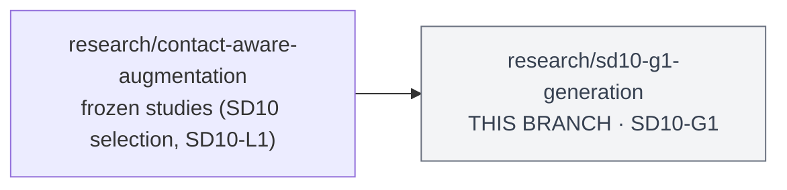

# SD10-G1: does a diverse source set give more generated demonstrations? (frozen)

> **Research branch (frozen evidence).** Robot setup, teleoperation, recording, training and evaluation commands are on
> [`official-lerobot-quest`](https://github.com/StanleyChueh/lerobot_openarm/tree/official-lerobot-quest#branch-map),
> together with the full branch map. The study files are sealed; only this README is updated.



## Purpose and status

**Purpose.** This study tests generation utility. With the same 100 locked target can poses, the same G+ planner and the
same gates, it asks whether the diverse ten sources (SD10) give more complete geometric demonstrations than the original
ten or a fixed random ten.

**Status:** executed 2026-11-08, pending independent review.
- **Registered decision: G1-A INCONCLUSIVE.**
- **G1-B (RGB): not run.**

Full report: [`research/sim_free_augmentation/sd10/g1_exec/SD10_G1_RESULTS.md`](research/sim_free_augmentation/sd10/g1_exec/SD10_G1_RESULTS.md).
Contract: `sd10/generation_v1/`, seal `2dd6ad94…8e9a`, Codex pre-execution GO.

## Results (quoted from `SD10_G1_RESULTS.md`)

| | Original10 | SD10 | Random10 |
|---|---|---|---|
| Complete geometric yield (300 primary attempts, 100 per arm) | 0/100 | 0/100 | 0/100 |

**Why every arm is at the floor:** the floor is set by reconstruction, not by source choice, so the screen cannot rank the
source sets.
- The frozen reconstruction's standing-can pose and giver-hold pose disagree by 9–96 mm (median 40 mm) at the
  table→giver switch, against a 5 mm gate.
- Reconstructed lid heights are 0.417–0.481 m, against the registered 0.32 m candidate plane, so every attempt also
  moves the can about 13 cm down.
- The frozen HSV lid tracker loses the can in SD10 sources 11, 42 and 47. That lost 29 SD10 targets to preparation
  failures.

**Consequence recorded at the time:**
- Stop SD10-specific generation work.
- Fix the source reconstruction and calibration first.

The later `sfagen` pipeline does this with a grasp-constrained object fit, a fitted camera and table height, and no HSV
tracker; see [`research/sfagen-unified-pipeline`](https://github.com/StanleyChueh/lerobot_openarm/tree/research/sfagen-unified-pipeline).

## Reproduce (from `research/sim_free_augmentation/sd10/g1_exec`)

```bash
PY="env -u PYTHONPATH -u LD_LIBRARY_PATH HF_HUB_OFFLINE=1 $HOME/Stanley_ws/lerobot_openarm/.venv/bin/python -B"
CUDA_VISIBLE_DEVICES=0 $PY preprocess_g1.py   # requires an empty store (cold cache)
$PY conformance_g1.py 6
CUDA_VISIBLE_DEVICES= $PY run_geometry.py
$PY score_g1.py; $PY diagnose_floor.py; $PY figures_g1.py; $PY manifest_g1.py
```

**Data and storage:**
- Data: pool `ethanCSL/openarm_pringles_lerobot_real_v00@2c1bc860`, body camera only.
- Large arrays live outside git in `~/Stanley_ws/sd10_g1_store` (hashed in `outputs/store_manifest.json`). They are backed
  up as `~/Stanley_ws/backups/repro_2026-11-11/sd10_g1_store.tar`.
