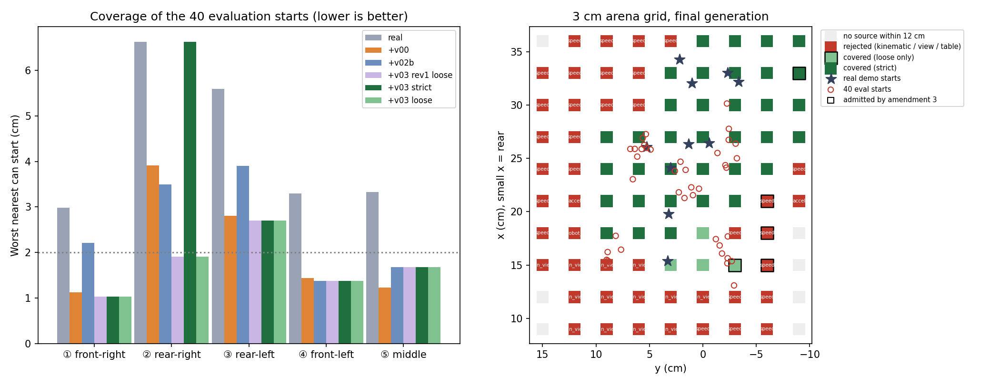
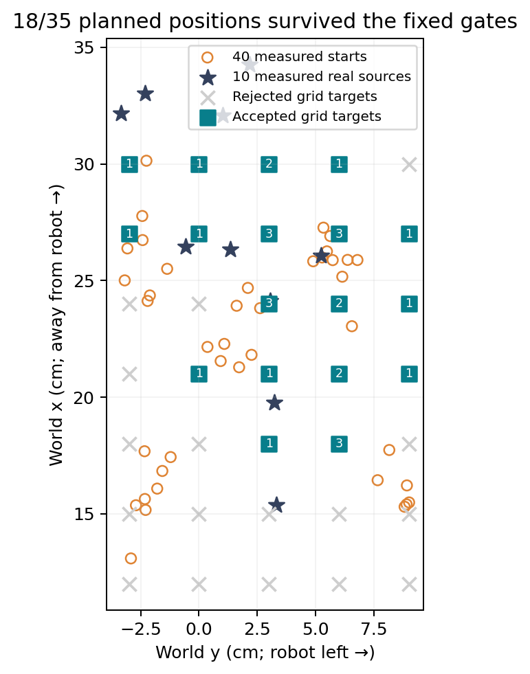
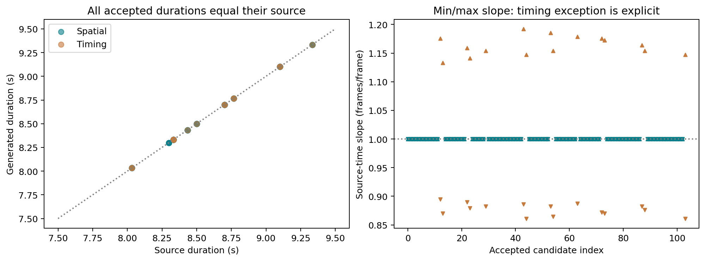

# sfagen main pipeline: simulation-free data augmentation for bimanual robots (OpenArm + RoboTwin 2.0)

> **Main pipeline branch** (`main-pipeline`). Robot setup, teleoperation, recording, training and evaluation commands
> are on [`official-lerobot-quest`](https://github.com/StanleyChueh/lerobot_openarm/tree/official-lerobot-quest#branch-map).
> Older research branches are kept under `archive/*`.

sfagen turns ~10 real demos into many synthetic demos **without a physics simulator**: it reconstructs the scene from the
demo videos, moves the object (or the hand-over), re-plans the arm with IK from the robot URDF, re-renders the camera,
and keeps only candidates that pass kinematic/visual gates. Every synthetic episode keeps its source demo's length and
speed. Adapting to a new robot/task needs the URDF + the source demos (plus the task's object list).

## Current version: pipeline v1 + v04 even spread (2026-11-16)
| change | what | report |
|---|---|---|
| joint-space fallback | v0 Cartesian blend first; if that candidate fails a gate, a joint-space transit blend with exact IK only near the grasp (fixes near-singular start poses, e.g. RoboTwin's folded arms) | [R02](research/sim_free_augmentation/simbench/results/reports/R02_blend_space_pipeline_v1.md) |
| targets from the demos | `positions_xy_m: auto` = 3 cm lattice within 12 cm of the source object positions; the object must be visibly in view (partial OK) | [R03](research/sim_free_augmentation/simbench/results/reports/R03_targets_from_source_demos.md) |
| even spread | exactly **100 synthetic episodes** per dataset, filled cell by cell (emptiest 3 cm cell first, real demos count as occupied, farthest point, least-used source) so no table area is over-represented | [R04](research/sim_free_augmentation/simbench/results/reports/R04_even_position_quota.md) |
OpenArm guard: every episode the v0 pipeline produced is bit-identical under v1 (163/163); 62 unit tests pass.

### Published datasets (LeRobot v3.0, load with `revision="v3.0"`)
| robot / task | synthetic only | 10 real + synthetic | 10 source demos |
|---|---|---|---|
| OpenArm Pringles hand-over (**v04**) | [`openarm_pringles_lerobot_real_to_sim_10_3cam_v04`](https://huggingface.co/datasets/ethanCSL/openarm_pringles_lerobot_real_to_sim_10_3cam_v04) (100) | [`…_real_and_sim_10_3cam_v04`](https://huggingface.co/datasets/ethanCSL/openarm_pringles_lerobot_real_and_sim_10_3cam_v04) (110) | [`openarm_pringles_lerobot_real_10_v00`](https://huggingface.co/datasets/ethanCSL/openarm_pringles_lerobot_real_10_v00) |
| RoboTwin 2.0 `place_empty_cup` | [`robotwin_place_empty_cup_lerobot_sim_aug_10`](https://huggingface.co/datasets/ethanCSL/robotwin_place_empty_cup_lerobot_sim_aug_10) (100) | [`…_source_and_sim_aug_10`](https://huggingface.co/datasets/ethanCSL/robotwin_place_empty_cup_lerobot_source_and_sim_aug_10) (110) | [`…_source_10`](https://huggingface.co/datasets/ethanCSL/robotwin_place_empty_cup_lerobot_source_10) |
| RoboTwin 2.0 `stack_blocks_two` | [`robotwin_stack_blocks_two_lerobot_sim_aug_10`](https://huggingface.co/datasets/ethanCSL/robotwin_stack_blocks_two_lerobot_sim_aug_10) (100) | [`…_source_and_sim_aug_10`](https://huggingface.co/datasets/ethanCSL/robotwin_stack_blocks_two_lerobot_source_and_sim_aug_10) (110) | [`…_source_10`](https://huggingface.co/datasets/ethanCSL/robotwin_stack_blocks_two_lerobot_source_10) |
| RoboTwin 2.0 `handover_block` | [`robotwin_handover_block_lerobot_sim_aug_10`](https://huggingface.co/datasets/ethanCSL/robotwin_handover_block_lerobot_sim_aug_10) (100) | [`…_source_and_sim_aug_10`](https://huggingface.co/datasets/ethanCSL/robotwin_handover_block_lerobot_source_and_sim_aug_10) (110) | [`…_source_10`](https://huggingface.co/datasets/ethanCSL/robotwin_handover_block_lerobot_source_10) |
RoboTwin repos keep their first release at tag `r03` (128/195/155 synthetic episodes, uneven).

### Key results
- **OpenArm training density** near the evaluation starts (episodes within 4 cm; front-right / front-left / middle /
  rear-right / rear-left): v03 rev 2 loose 22.0 / 22.8 / 24.2 / 4.5 / 4.0 (6.1x) -> **v04 16.0 / 11.6 / 13.2 / 10.2 / 9.7
  (1.7x)**. The real-robot v03 model failed sometimes at the rear; v04 is the data-side fix (evaluation pending).
- **RoboTwin yield** (object-position candidates passing every gate): place_empty_cup 0 % (v0) -> 29 %,
  stack_blocks_two 63 %, handover_block 36 % (v0: 0 block-position episodes).
- **Image quality (honest):** OpenArm good (faint smudge at the old can position); RoboTwin stack good, cup mediocre,
  handover block-position poor (camera fit still 16-35 px off; tall-block proxy). Next fix: camera fit.

### Reproduce
```bash
PY="env -u PYTHONPATH -u LD_LIBRARY_PATH HF_HUB_OFFLINE=1 .venv/bin/python -B"; S=research/sim_free_augmentation/simbench
# OpenArm v04: generate (pipeline v1) -> render -> even selection -> build (+ mixed) -> verify
(cd research/sim_free_augmentation/sfagen && $PY -m sfagen generate ../simbench/configs/r03/openarm_v03r2_loose_v1.yaml && \
 $PY -m sfagen render ../simbench/configs/r03/openarm_v03r2_loose_v1.yaml)
mkdir -p RUN && ln -s <work_dir> RUN/all && $PY $S/tools/balanced_select.py RUN $S/configs/r03/openarm_v03r2_loose_v1.yaml N=100 0.03
(cd research/sim_free_augmentation/sfagen && $PY -m sfagen build ../simbench/configs/r03/openarm_v03r2_loose_v1.yaml --work-dir ../../../RUN/all_export \
   --repo-id local/v04 --mixed-repo-id local/v04_mixed && $PY -m sfagen verify ../simbench/configs/r03/openarm_v03r2_loose_v1.yaml --work-dir ../../../RUN/all_export)
# RoboTwin 2.0 (per task): subset -> configs -> calibrate/table -> generate/render -> even selection -> build -> package
$PY $S/tools/robotwin_subset.py; $PY $S/configs/robotwin/make_configs.py RUN_DIR
(cd research/sim_free_augmentation/sfagen && $PY -m sfagen calibrate ../simbench/configs/robotwin/<task>_base.yaml --search && $PY -m sfagen table ../simbench/configs/robotwin/<task>_base.yaml)
$S/tools/s1_task.sh <task> <gpu> RUN_DIR                       # positions, generate, render, build, verify
$PY $S/tools/balanced_select.py RUN_DIR2/<task> $S/configs/robotwin/<task>_<group>.yaml N=100 0.03   # RUN_DIR2/<task>/<group> -> symlinks
$PY $S/tools/package_task.py <task> RUN_DIR2 <robotwin_pilot> <out>   # source / synthetic / mixed
$PY $S/tools/density_report.py OUT_PREFIX; $PY $S/tools/dataset_distribution.py RUN_DIR DATA_DIR CONFIG_DIR OUT_PREFIX
(cd research/sim_free_augmentation/sfagen && $PY -m unittest discover -s tests)   # 62 tests
```
Plan and protocols: `research/sim_free_augmentation/sfagen/results/SIM_BENCHMARK_PLAN.md`, `simbench/results/r0{2,3,4}/PROTOCOL.md`.

---
## History: v03 (published 2026-11-14, superseded by v04 for training)

> **Research branch.** Robot setup, teleoperation, recording, training and evaluation commands are on
> [`official-lerobot-quest`](https://github.com/StanleyChueh/lerobot_openarm/tree/official-lerobot-quest#branch-map).

## v03: even arena coverage with a pre-registered distortion cap (revision 2, 2026-11-14, latest)

> **Revision 2 (Hub tag `v3.0`).** Every synthetic episode is exactly as long as its source demo (8.0–9.3 s), and the
> robot moves at the source speed. Revision 1 slowed some reaches down instead (up to 3.56× the source length, ~33 s)
> and is kept at the Hub tag `v03-rev1` as a negative result. The changes are Amendments 4–5 in the protocol.
>
> **Recommended training set:** the copied-wrist repos (every wrist camera is a real copied frame).
> `…_real_and_sim_10_3cam_v03_loose` gives the most even coverage. The `_wristrender` repos are an ablation, parked by
> user decision on 2026-11-14 until the real-robot evaluation.

**Goal:** cover the arena evenly (corners, edges, middle) instead of staying near the 10 real demos. Reject only
episodes whose body-camera distortion exceeds a threshold that was frozen before rendering.

**How the data are made** (code under `research/sim_free_augmentation/sfagen`):
1. Targets: a 3 cm grid of can start positions over x 9–36 cm, y −9 to 15 cm (90 cells).
2. Planning: for each cell, the F1W planner (`sfagen/workspace_plan.py`) re-plans the reach of every real demo
   within 12 cm:
   - no retiming: frame count == source;
   - the shift is spread over a wide blend, from the previous gripper event to just before the next one;
   - rigid near-object reach and vertical transit;
   - action-aware IK bounds;
   - kinematic, speed, view and table gates (`sfagen/checks.py`), plus `duration` (== source frames) and
     `speed_similarity` (moved-arm TCP peak and mean speed 0.8–1.25× the source).
3. Rendering: the body camera is re-rendered by forward-warping the source video (`sfagen/render.py`). The left wrist
   is copied from the source; the right wrist is either copied or rendered (`_wristrender`, an ablation).
4. Distortion score (`sfagen/distortion.py`): per frame, (missing + spilled robot/can silhouette pixels) / silhouette;
   the episode score is the 95th percentile over frames.
   - **strict** ≤ 2.289, the worst v02 episode with shift ≤ 4 cm;
   - **loose** ≤ 4.578, twice strict.
   - Each cell keeps its 2 lowest-score candidates.
5. The v02 hand-over location/timing variants are added; the result is exported as LeRobot v3.0. The 10 real demos
   are added only in the separate `real_and_sim` repos.

**Results** ([RESULTS.md](research/sim_free_augmentation/sfagen/results/v03/RESULTS.md),
[protocol + amendments](research/sim_free_augmentation/sfagen/results/v03/PROTOCOL.md)):
- **Episodes:**
  - strict 130 synthetic (71 hand-over + 59 grid, 35 cells);
  - loose 138 (71 + 67, 39 cells).
- **Duration:** length / source = 1.000 for every synthetic episode. TCP speed vs source: peak 0.86–1.16×, mean
  0.92–1.15×.
- **Coverage of the 40 eval starts** (worst nearest can start):
  - loose 2.70 cm (35/40 within 2 cm);
  - strict 6.63 cm (28/40; rear-right uncovered);
  - v00 3.91 cm (28/40).
- **Checks:** all 8 exports pass verify, quality (including duration and speed similarity) and an independent export
  check.
- **Negative findings:**
  - without slow-down, only 92/416 grid candidates pass (rev 1: 189);
  - strict cannot cover the rear-right;
  - 4 hand-over timing variants are excluded for being too slow;
  - 13 episodes (11 strict) carry small visual flags (notched can top, ghost sliver, dark lid arc).
- No policy, physics or hardware result yet.



| Hugging Face dataset | contents |
|---|---|
| [`ethanCSL/openarm_pringles_lerobot_real_to_sim_10_3cam_v03_strict`](https://huggingface.co/datasets/ethanCSL/openarm_pringles_lerobot_real_to_sim_10_3cam_v03_strict) | 130 synthetic, copied wrists |
| [`ethanCSL/openarm_pringles_lerobot_real_and_sim_10_3cam_v03_strict`](https://huggingface.co/datasets/ethanCSL/openarm_pringles_lerobot_real_and_sim_10_3cam_v03_strict) | 10 real + 130 synthetic |
| [`ethanCSL/openarm_pringles_lerobot_real_to_sim_10_3cam_wristrender_v03_strict`](https://huggingface.co/datasets/ethanCSL/openarm_pringles_lerobot_real_to_sim_10_3cam_wristrender_v03_strict) | 130 synthetic, rendered right wrist |
| [`ethanCSL/openarm_pringles_lerobot_real_and_sim_10_3cam_wristrender_v03_strict`](https://huggingface.co/datasets/ethanCSL/openarm_pringles_lerobot_real_and_sim_10_3cam_wristrender_v03_strict) | 10 real + 130, rendered right wrist |
| [`ethanCSL/openarm_pringles_lerobot_real_to_sim_10_3cam_v03_loose`](https://huggingface.co/datasets/ethanCSL/openarm_pringles_lerobot_real_to_sim_10_3cam_v03_loose) | 138 synthetic, copied wrists |
| [`ethanCSL/openarm_pringles_lerobot_real_and_sim_10_3cam_v03_loose`](https://huggingface.co/datasets/ethanCSL/openarm_pringles_lerobot_real_and_sim_10_3cam_v03_loose) | 10 real + 138 synthetic |
| [`ethanCSL/openarm_pringles_lerobot_real_to_sim_10_3cam_wristrender_v03_loose`](https://huggingface.co/datasets/ethanCSL/openarm_pringles_lerobot_real_to_sim_10_3cam_wristrender_v03_loose) | 138 synthetic, rendered right wrist |
| [`ethanCSL/openarm_pringles_lerobot_real_and_sim_10_3cam_wristrender_v03_loose`](https://huggingface.co/datasets/ethanCSL/openarm_pringles_lerobot_real_and_sim_10_3cam_wristrender_v03_loose) | 10 real + 138, rendered right wrist |

Reproduce v03 revision 2 (configs `configs/openarm_pringles_v03r2*.yaml`, written by
`results/v03/run_scripts/make_configs.py`; same environment as below). The full driver sequence is in
`results/v03/run_scripts/` (`REV=2` selects revision 2). The core steps are:
```bash
cd research/sim_free_augmentation/sfagen
P="env -u PYTHONPATH -u LD_LIBRARY_PATH HF_HUB_OFFLINE=1 /home/stanley/Stanley_ws/lerobot_openarm/.venv/bin/python -B"
$P -m sfagen generate configs/openarm_pringles_v03r2_gen.yaml         # grid candidates + checks
$P -m sfagen render configs/openarm_pringles_v03r2.yaml               # body renders + distortion diagnostics
$P -m sfagen render configs/openarm_pringles_v03r2_wristrender.yaml    # rendered right wrist
# score/threshold/selection (results/v03/thresholds.json, selection.json) then per export, e.g. strict:
$P -m sfagen build configs/openarm_pringles_v03r2_strict.yaml --repo-id <id> --mixed-repo-id <mixed id>
$P -m sfagen verify configs/openarm_pringles_v03r2_strict.yaml
$P tools/quality_report.py configs/openarm_pringles_v03r2_strict.yaml results/v03r2/quality_strict_copied
```
Selection, merge, export, timing and review helpers: `results/v03/run_scripts/` (`v03_steps.py`, `merge_v03.py`,
`make_exports.py`, `build_all.sh`, `interaction_timing.py`, `review_clips.py`). Revision-2 outputs are in `results/v03r2/`;
revision 1 is reproduced with `REV=1` and the `openarm_pringles_v03*.yaml` configs.

## v02: fixed-duration arena augmentation

This research branch implements the approved Step 2 batch from `research/sfagen-wrist-render@77e52d4`.
It adds absolute can targets and v00-style ±10-frame handover timing, keeping sfagen F1/F2 geometry and the body renderer.

**Current result:** 104/189 candidates passed generation: 29/89 positions, 60/80 handover locations, 15/20 timing variants.
Only **18/35 target positions** survived. This batch does not achieve full rear-arena coverage and is not a validated
policy improvement. Both matched synthetic-only and mixed exports pass local verification and the frozen quality gates (53 CPU tests). The existing wrist fidelity limitation and visible image artifacts remain. No training, robot operation or publication.

[Visual evidence](research/sim_free_augmentation/sfagen/results/v02/index.html) ·
[Frozen protocol](research/sim_free_augmentation/sfagen/results/v02/PROTOCOL.md) ·
[Exact input/code hashes](research/sim_free_augmentation/sfagen/results/v02/FREEZE.json) ·
[Step 1 diagnosis](research/sim_free_augmentation/sfagen/results/eval_v00/index.html)





## Reproduce locally

Use the existing main-checkout `.venv`, clear `PYTHONPATH` and `LD_LIBRARY_PATH`, and set `HF_HUB_OFFLINE=1`.
Source revision is `cebdee98115ab6827a4ec2655335c536b5dd085b`; cached inputs and exact paths are frozen in FREEZE.json.
The local configs point at separate output directories; choose fresh work directories for a new export. Never overwrite
an existing dataset. The current protocol is frozen: a new experiment requires a new protocol, not changing its gates.

```bash
cd research/sim_free_augmentation/sfagen
TASK_PY=/home/stanley/Stanley_ws/lerobot_openarm/.venv/bin/python
env -u PYTHONPATH -u LD_LIBRARY_PATH HF_HUB_OFFLINE=1 "$TASK_PY" -B -m unittest discover -s tests -q
env -u PYTHONPATH -u LD_LIBRARY_PATH HF_HUB_OFFLINE=1 "$TASK_PY" -B -m sfagen generate configs/openarm_pringles_v02.yaml
env -u PYTHONPATH -u LD_LIBRARY_PATH HF_HUB_OFFLINE=1 "$TASK_PY" -B -m sfagen render configs/openarm_pringles_v02.yaml
env -u PYTHONPATH -u LD_LIBRARY_PATH HF_HUB_OFFLINE=1 "$TASK_PY" -B -m sfagen render configs/openarm_pringles_v02_wristrender.yaml
# Build each condition only after every passing candidate has current raw renders.
env -u PYTHONPATH -u LD_LIBRARY_PATH HF_HUB_OFFLINE=1 "$TASK_PY" -B -m sfagen build configs/openarm_pringles_v02.yaml --repo-id local/v02-copied --mixed-repo-id local/v02-copied-mixed
env -u PYTHONPATH -u LD_LIBRARY_PATH HF_HUB_OFFLINE=1 "$TASK_PY" -B -m sfagen build configs/openarm_pringles_v02_wristrender.yaml --repo-id local/v02-right-wrist --mixed-repo-id local/v02-right-wrist-mixed
# Verify and quality-check both conditions:
env -u PYTHONPATH -u LD_LIBRARY_PATH HF_HUB_OFFLINE=1 "$TASK_PY" -B -m sfagen verify configs/openarm_pringles_v02.yaml
env -u PYTHONPATH -u LD_LIBRARY_PATH HF_HUB_OFFLINE=1 "$TASK_PY" -B tools/quality_report.py configs/openarm_pringles_v02.yaml results/v02/quality_copied
env -u PYTHONPATH -u LD_LIBRARY_PATH HF_HUB_OFFLINE=1 "$TASK_PY" -B -m sfagen verify configs/openarm_pringles_v02_wristrender.yaml
env -u PYTHONPATH -u LD_LIBRARY_PATH HF_HUB_OFFLINE=1 "$TASK_PY" -B tools/quality_report.py configs/openarm_pringles_v02_wristrender.yaml results/v02/quality_right_wrist
env -u PYTHONPATH -u LD_LIBRARY_PATH HF_HUB_OFFLINE=1 "$TASK_PY" -B tools/v02_report.py
```

The matching condition uses the same states/actions/body images, and only re-renders the right wrist. Copied wrists
carry validity flags. The existing Pringles wrist fidelity gate failed; codec quality does not fix that limitation.
Labels and mesh checks are kinematic proxies, not contact-force or physical robot validation.
