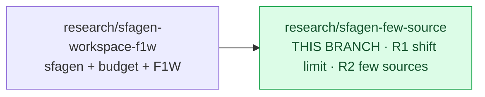

# sfagen few-source study: how far can the object move, and how few demos are enough?

> **Research branch.** Robot setup, teleoperation, recording, training and evaluation commands are on
> [`official-lerobot-quest`](https://github.com/StanleyChueh/lerobot_openarm/tree/official-lerobot-quest#branch-map),
> together with the full branch map.



## Purpose

The goal is a usable synthetic Pringles dataset from **fewer than 10 real demos**, ideally 1–2. That needs large object
shifts, and large shifts cost image quality. This branch answers two questions:

- **R1:** how far can the can move before the body-camera RGB stops being valid?
- **R2:** at that shift limit, how few source demos give good coverage?

**Status:** both executed 2026-11-12 (offline), pending independent review. No VLA training or robot evidence yet.

## Results

Full report: [`research/sim_free_augmentation/sfagen/results/RESULTS_R1_R2.md`](research/sim_free_augmentation/sfagen/results/RESULTS_R1_R2.md).

**R1: the protocol was frozen before any rendering** (`results/r1_relocation/PROTOCOL.md`, `327d38f`). The method is
cross-episode pose transfer: re-render source A with episode B's real joints and can pose, and compare with B's real
frame (90 ordered pairs).

| Can shift (cm) | 0–3 | 3–5 | 5–7 | 7–9 | 9–11 | 11–15 | 15–21 |
|---|---|---|---|---|---|---|---|
| Median PSNR (dB) | 16.43 | 16.28 | 16.28 | 15.97 | 16.01 | 15.61 | 15.34 |
| Δ vs 0–3 cm | ref | −0.16 | −0.16 | −0.47 | −0.42 | **−0.82** | **−1.09** |
| Can region (dB) | 14.9 | 14.6 | 13.6 | 13.3 | 13.3 | 12.0 | 11.5 |

- **Registered r\* = 11 cm**, which is decision A: keep wide shifts up to 11 cm, and fix the worst sub-region first.
- The can region is that worst sub-region: it degrades steadily with distance, down 3.4 dB at 15–21 cm.
- Every synthetic episode has ≥ 50 % invalid wrist-camera frames, at any shift size.

**R2:** Pringles coverage of 40 unseen real recordings (within 2 cm), from F1W candidates capped at 11 cm.

| Sources | 1 | 2 | 3 | 4 | 5 |
|---|---|---|---|---|---|
| Fixed rule (sources 0…N−1) | 10 | 16 | 21 | 28 | 28 |
| Best subset (post hoc, upper bound) | 19 | 25 | 27 | 28 | 28 |

The published 10-source dataset covers 24/40. Source placement matters more than source count. A source-only selection
rule is the next test.

## Reproduce

```bash
cd research/sim_free_augmentation/sfagen
ln -s ~/Stanley_ws/sfa_hf_export/sfagen/configs/work configs/work   # generated data (git-ignored)
ln -s ~/Stanley_ws/sfa_hf_export/sfagen/logs logs
PY="env -u PYTHONPATH -u LD_LIBRARY_PATH HF_HUB_OFFLINE=1 $HOME/Stanley_ws/lerobot_openarm/.venv/bin/python"

$PY -B -m unittest discover -s tests                                         # 32 CPU tests (~10 s)

# R1: shift limit (GPU; about 10 min of rendering on one RTX 4090; needs the cached Pringles reconstructions)
(cd tools && $PY -B xfer_bench.py run cuda:0 ../results/r1_relocation/run)
(cd tools && $PY -B xfer_bench.py summarize ../results/r1_relocation/run)    # statistics only (CPU)
(cd tools && $PY -B xfer_bench.py wrist ../results/r1_relocation)            # wrist validity vs shift (CPU)

# R2: few-source coverage at the 11 cm cap (CPU; reads the existing F1W candidates)
$PY -B tools_workspace_budget.py configs/openarm_pringles_handover_workspace.yaml \
   --pool-data ~/.cache/huggingface/hub/datasets--ethanCSL--openarm_pringles_lerobot_real_v00/snapshots/2c1bc860347c44fc0fbae7567469d36ee49baa8d/data \
   --exclude 0,1,2,3,4,5,6,7,8,9 --pool-revision 2c1bc860347c44fc0fbae7567469d36ee49baa8d \
   --comparison-work configs/work/openarm_pringles_handover_dense --max-shift-cm 11 \
   --out results/r2_fewsource/source_budget_cap11.json
```

**Data:**
- `ethanCSL/openarm_pringles_lerobot_real_10_v00@cebdee98` (sources).
- `ethanCSL/openarm_pringles_lerobot_real_v00@2c1bc860` (pool; episodes 10–49 are reused development data).

**Earlier work:** everything from `research/sfagen-workspace-f1w` is included (published-dataset provenance, F1W, tests);
see that branch's README for those commands.

## Limitations

- Sources and pool are development data, not a held-out test.
- Can poses are reconstructions, and coverage positions are FK proxies.
- The R1 reference bin has 5 unordered pairs, so the CIs are wide.
- PSNR and coverage are proxies. VLA usefulness needs a separately authorized SmolVLA screen.
