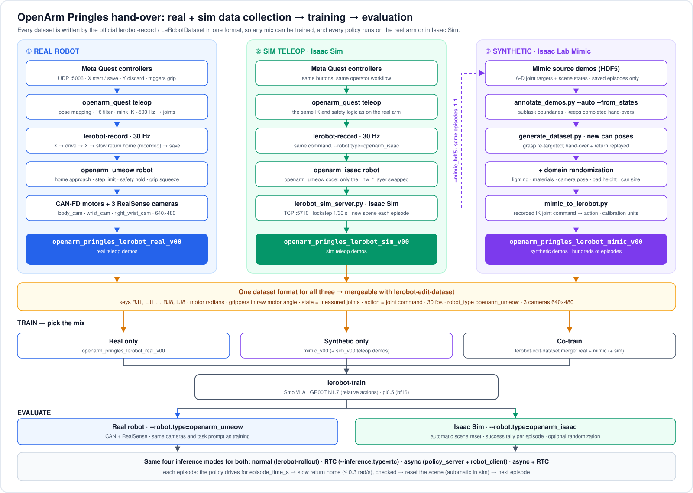

# This is the LeRobot-compatible VLA Training Pipeline



Collect data on the real robot (Steps 0-5) or in Isaac Sim ([Sim Steps 1-6](#isaac-sim---robottypeopenarm_isaac)),
train, then evaluate on the real arm or in sim.

```
Quest app (UDP :5006) -> openarm_quest teleop (mink IK) -> lerobot-record (30 Hz) -> openarm_umeow robot -> CAN
```

> ⚠️ Do **not** use the official `--robot.type=openarm_follower` / `lerobot-calibrate` on this robot: its
> calibration writes a new zero into the motors and breaks `calibration.json`.

### Step 0. One-time setup

```bash
cd ~/Stanley_ws/lerobot_openarm
git checkout official-lerobot-quest
uv sync                      # installs lerobot, both plugins and the IK libraries
```

### Step 1. CAN-FD links up (once per boot)

```bash
cd ~/Stanley_ws/openarm_can/setup && sudo ./my_arm
```

### Step 2. Teleoperate the real arm (no recording)

```bash
cd ~/Stanley_ws/lerobot_openarm
source .venv/bin/activate
unset PYTHONPATH
export LD_LIBRARY_PATH=/usr/local/cuda/lib64
lerobot-teleoperate \
  --robot.type=openarm_umeow \
  --robot.right_port=can0 --robot.left_port=can1 \
  --teleop.type=openarm_quest \
  --fps=30
```

Type `YES` (the arms go home), press **X** in the headset to start, **Ctrl-C** to stop.

### Step 3. Record a dataset

```bash
cd ~/Stanley_ws/lerobot_openarm
source .venv/bin/activate
unset PYTHONPATH
export LD_LIBRARY_PATH=/usr/local/cuda/lib64
lerobot-record \
  --robot.type=openarm_umeow --robot.right_port=can0 --robot.left_port=can1 \
  --robot.cameras="{body_cam: {type: opencv, index_or_path: /dev/rs_body, width: 640, height: 480, fps: 30}, wrist_cam: {type: opencv, index_or_path: /dev/rs_wrist_left, width: 640, height: 480, fps: 30}, right_wrist_cam: {type: opencv, index_or_path: /dev/rs_wrist_right, width: 640, height: 480, fps: 30}}" \
  --teleop.type=openarm_quest \
  --dataset.repo_id=ethanCSL/openarm_pringles_lerobot_real_v00 --dataset.no_stamp=true \
  --dataset.single_task="Pick up the Pringles can with the right arm, hand it to the left arm" \
  --dataset.num_episodes=50 --dataset.fps=30 \
  --dataset.episode_time_s=120 --dataset.reset_time_s=15 \
  --dataset.streaming_encoding=true --dataset.encoder_threads=2 \
  --display_data=true
```

Run the same command again to continue the local dataset (only a local copy is continued, never the Hub's). `--dataset.num_episodes` is the total to reach: with 21 episodes recorded, `--dataset.num_episodes=40` records 19 more. `--dataset.push_to_hub=false` keeps it local.

### Quest controls

| Quest | state | what happens |
|---|---|---|
| **1st X** | `HELD` | start recording (`LIVE`) |
| **2nd X** | `LIVE` | return home slowly, then save the episode |
| **Y** | `LIVE` / `PAUSED` / `HELD` (episode open) | discard the episode and return home |
| **Triggers** | `LIVE` | close the grippers |

Check the recorded data:

```bash
cd ~/Stanley_ws/lerobot_openarm
source .venv/bin/activate
unset PYTHONPATH
export LD_LIBRARY_PATH=/usr/local/cuda/lib64
lerobot-dataset-viz --repo-id ethanCSL/openarm_pringles_lerobot_real_v00 --episode-index 0
```

### Step 4. Train

Training runs on the training machine with the lerobot fork
[`StanleyChueh/lerobot`](https://github.com/StanleyChueh/lerobot), branch `update_dev` (commit `1e5f2049e`)
or `update_dev_v2`; this machine runs collection and evaluation with official lerobot `3f2c29ef` (`.venv`).
The training branch decides the evaluation venv: see [Step 5](#which-venv).
On a 16 GB GPU, SmolVLA needs `--batch_size=32 --steps=40000` (batch 64 runs out of memory).
`--dataset.image_transforms.enable=true` turns on image augmentation.

**SmolVLA**:

```bash
lerobot-train \
  --policy.path=lerobot/smolvla_base \
  --dataset.repo_id=ethanCSL/openarm_pringles_lerobot_real_v00 \
  --rename_map='{"observation.images.right_wrist_cam": "observation.images.camera1", "observation.images.wrist_cam": "observation.images.camera2", "observation.images.body_cam": "observation.images.camera3"}' \
  --policy.repo_id=ethanCSL/openarm_pringles_lerobot_real_smolvla_v00 \
  --batch_size=64 --steps=20000 --policy.device=cuda \
  --output_dir=outputs/train/openarm_pringles_lerobot_real_smolvla_v00 \
  --job_name=openarm_pringles_lerobot_real_smolvla_v00 \
  --wandb.enable=true --dataset.image_transforms.enable=true --dataset.image_transforms.random_order=true --dataset.image_transforms.max_num_transforms=6
```

**GR00T N1.7** (does not fit a 16 GB GPU):

```bash
lerobot-train --policy.type=groot --policy.base_model_path=nvidia/GR00T-N1.7-3B \
  --policy.chunk_size=16 --policy.n_action_steps=16 \
  --policy.use_relative_actions=true --policy.relative_exclude_joints='["LJ8", "RJ8"]' \
  --dataset.repo_id=ethanCSL/openarm_pringles_lerobot_real_v00 \
  --policy.repo_id=ethanCSL/openarm_pringles_lerobot_real_gr00t_v00 \
  --batch_size=64 --steps=20000 --policy.device=cuda \
  --output_dir=outputs/train/openarm_pringles_lerobot_real_gr00t_v00 --job_name=openarm_pringles_lerobot_real_gr00t_v00 \
  --wandb.enable=true --dataset.image_transforms.enable=true --dataset.image_transforms.random_order=true --dataset.image_transforms.max_num_transforms=6
```

**pi0.5**:

```bash
PYTORCH_CUDA_ALLOC_CONF=expandable_segments:True lerobot-train \
  --policy.path=lerobot/pi05_base \
  --dataset.repo_id=ethanCSL/openarm_pringles_lerobot_real_v00 \
  --rename_map='{"observation.images.body_cam": "observation.images.base_0_rgb", "observation.images.wrist_cam": "observation.images.left_wrist_0_rgb", "observation.images.right_wrist_cam": "observation.images.right_wrist_0_rgb"}' \
  --policy.dtype=bfloat16 --policy.gradient_checkpointing=true \
  --policy.repo_id=ethanCSL/openarm_pringles_lerobot_real_pi05_v00 \
  --batch_size=32 --steps=30000 --policy.device=cuda \
  --output_dir=outputs/train/openarm_pringles_lerobot_real_pi05_v00 --job_name=openarm_pringles_lerobot_real_pi05_v00 \
  --wandb.enable=true --dataset.image_transforms.enable=true --dataset.image_transforms.random_order=true --dataset.image_transforms.max_num_transforms=6
```

### Step 5. Evaluate on the real robot: normal, RTC, async, async + RTC

| mode | tool |
|---|---|
| normal | `lerobot-rollout` |
| RTC | `lerobot-rollout --inference.type=rtc` |
| async | `policy_server` + `robot_client` |
| async + RTC | `policy_server --rtc=true` + `robot_client` |

Models: SmolVLA `ethanCSL/openarm_pringles_lerobot_real_smolvla_v00`, GR00T N1.7
`ethanCSL/openarm_pringles_lerobot_real_gr00t_v00`, pi0.5 `ethanCSL/openarm_pringles_lerobot_real_pi05_v00`.

During an episode: **Enter** ends it, **Left arrow** reruns it, **Esc** stops. `--display_data=false` turns
off the rerun window.

Every evaluation command below (real arm and Isaac) records the episodes as a LeRobot dataset and pushes it to the
Hugging Face Hub (log in once with `hf auth login`):

| mode | dataset flag | name | pushed |
|---|---|---|---|
| normal, RTC (`lerobot-rollout`, native) | `--dataset.repo_id=<user>/rollout_<name> --dataset.push_to_hub=true` | must start with `rollout_` (lerobot's rule); a date-time suffix is added, so every run is a new dataset | when the run ends, also after Esc |
| async, async + RTC (`robot_client`, ours) | `--record_repo_id=<user>/eval_<name>` | must start with `eval_`; a rerun replaces it (`--resume=true` adds to it) | only once all `--num_episodes` episodes have run; stopped early, it stays local |

Details of `--record_repo_id`: [Recording the evaluation](#recording-the-evaluation).

<a id="which-venv"></a>
#### Which venv: the lerobot branch the model was trained on

All four modes use the same commands for both. Only the `source` line differs:

| trained on | `source` line |
|---|---|
| `update_dev` | `source .venv/bin/activate` |
| `update_dev_v2` | `source .venv-v2/bin/activate` |

`.venv-v2` has the fork (`~/Stanley_ws/lerobot_experiment/lerobot`, branch `update_dev_v2`) installed editable,
plus both plugins. Never run `uv sync` / `uv run` in it. Run the policy server and the robot client in the same venv.

#### Normal

`--dataset.repo_id` must start with `rollout_`; `--dataset.push_to_hub=true` pushes it when the run ends.

```bash
# SmolVLA
lerobot-rollout --strategy.type=episodic \
  --policy.path=ethanCSL/openarm_pringles_lerobot_real_smolvla_v00 \
  --robot.type=openarm_umeow --robot.right_port=can0 --robot.left_port=can1 \
  --robot.cameras="{body_cam: {type: opencv, index_or_path: /dev/rs_body, width: 640, height: 480, fps: 30}, wrist_cam: {type: opencv, index_or_path: /dev/rs_wrist_left, width: 640, height: 480, fps: 30}, right_wrist_cam: {type: opencv, index_or_path: /dev/rs_wrist_right, width: 640, height: 480, fps: 30}}" \
  --rename_map='{"observation.images.right_wrist_cam": "observation.images.camera1", "observation.images.wrist_cam": "observation.images.camera2", "observation.images.body_cam": "observation.images.camera3"}' \
  --task="Pick up the Pringles can with the right arm, hand it to the left arm" \
  --dataset.repo_id=ethanCSL/rollout_openarm_pringles_lerobot_real_smolvla_v00 --dataset.push_to_hub=true \
  --dataset.single_task="Pick up the Pringles can with the right arm, hand it to the left arm" \
  --dataset.num_episodes=100 --dataset.episode_time_s=15 --dataset.reset_time_s=5 \
  --display_data=true

# GR00T N1.7
lerobot-rollout --strategy.type=episodic \
  --policy.path=ethanCSL/openarm_pringles_lerobot_real_gr00t_v00 \
  --robot.type=openarm_umeow --robot.right_port=can0 --robot.left_port=can1 \
  --robot.cameras="{body_cam: {type: opencv, index_or_path: /dev/rs_body, width: 640, height: 480, fps: 30}, wrist_cam: {type: opencv, index_or_path: /dev/rs_wrist_left, width: 640, height: 480, fps: 30}, right_wrist_cam: {type: opencv, index_or_path: /dev/rs_wrist_right, width: 640, height: 480, fps: 30}}" \
  --task="Pick up the Pringles can with the right arm, hand it to the left arm" \
  --dataset.repo_id=ethanCSL/rollout_openarm_pringles_lerobot_real_gr00t_v00 --dataset.push_to_hub=true \
  --dataset.single_task="Pick up the Pringles can with the right arm, hand it to the left arm" \
  --dataset.num_episodes=100 --dataset.episode_time_s=15 --dataset.reset_time_s=5 \
  --display_data=true

# pi0.5
lerobot-rollout --strategy.type=episodic \
  --policy.path=ethanCSL/openarm_pringles_lerobot_real_pi05_v00 \
  --robot.type=openarm_umeow --robot.right_port=can0 --robot.left_port=can1 \
  --robot.cameras="{body_cam: {type: opencv, index_or_path: /dev/rs_body, width: 640, height: 480, fps: 30}, wrist_cam: {type: opencv, index_or_path: /dev/rs_wrist_left, width: 640, height: 480, fps: 30}, right_wrist_cam: {type: opencv, index_or_path: /dev/rs_wrist_right, width: 640, height: 480, fps: 30}}" \
  --rename_map='{"observation.images.body_cam": "observation.images.base_0_rgb", "observation.images.wrist_cam": "observation.images.left_wrist_0_rgb", "observation.images.right_wrist_cam": "observation.images.right_wrist_0_rgb"}' \
  --task="Pick up the Pringles can with the right arm, hand it to the left arm" \
  --dataset.repo_id=ethanCSL/rollout_openarm_pringles_lerobot_real_pi05_v00 --dataset.push_to_hub=true \
  --dataset.single_task="Pick up the Pringles can with the right arm, hand it to the left arm" \
  --dataset.num_episodes=100 --dataset.episode_time_s=15 --dataset.reset_time_s=5 \
  --display_data=true
```

#### RTC

pi0.5 on the real arm: use async + RTC instead (here it gets no actions through).

```bash
# SmolVLA
cd ~/Stanley_ws/lerobot_openarm
source .venv/bin/activate
unset PYTHONPATH
export LD_LIBRARY_PATH=/usr/local/cuda/lib64
lerobot-rollout --strategy.type=episodic \
  --inference.type=rtc --inference.rtc.mode=guided \
  --inference.rtc.execution_horizon=10 --inference.rtc.max_guidance_weight=10.0 \
  --policy.path=ethanCSL/openarm_pringles_lerobot_real_smolvla_v00 \
  --robot.type=openarm_umeow --robot.right_port=can0 --robot.left_port=can1 \
  --robot.cameras="{body_cam: {type: opencv, index_or_path: /dev/rs_body, width: 640, height: 480, fps: 30}, wrist_cam: {type: opencv, index_or_path: /dev/rs_wrist_left, width: 640, height: 480, fps: 30}, right_wrist_cam: {type: opencv, index_or_path: /dev/rs_wrist_right, width: 640, height: 480, fps: 30}}" \
  --rename_map='{"observation.images.right_wrist_cam": "observation.images.camera1", "observation.images.wrist_cam": "observation.images.camera2", "observation.images.body_cam": "observation.images.camera3"}' \
  --task="Pick up the Pringles can with the right arm, hand it to the left arm" \
  --dataset.repo_id=ethanCSL/rollout_smolvla_rtc_pringles_v00 --dataset.push_to_hub=true \
  --dataset.single_task="Pick up the Pringles can with the right arm, hand it to the left arm" \
  --dataset.num_episodes=10 --dataset.episode_time_s=60 --dataset.reset_time_s=60 \
  --display_data=true

# GR00T N1.7
cd ~/Stanley_ws/lerobot_openarm
source .venv/bin/activate
unset PYTHONPATH
export LD_LIBRARY_PATH=/usr/local/cuda/lib64
lerobot-rollout --strategy.type=episodic \
  --inference.type=rtc --inference.rtc.mode=guided \
  --inference.rtc.execution_horizon=8 --inference.rtc.max_guidance_weight=10.0 \
  --inference.queue_threshold=8 \
  --policy.path=ethanCSL/openarm_pringles_lerobot_real_gr00t_v00 \
  --robot.type=openarm_umeow --robot.right_port=can0 --robot.left_port=can1 \
  --robot.cameras="{body_cam: {type: opencv, index_or_path: /dev/rs_body, width: 640, height: 480, fps: 30}, wrist_cam: {type: opencv, index_or_path: /dev/rs_wrist_left, width: 640, height: 480, fps: 30}, right_wrist_cam: {type: opencv, index_or_path: /dev/rs_wrist_right, width: 640, height: 480, fps: 30}}" \
  --task="Pick up the Pringles can with the right arm, hand it to the left arm" \
  --dataset.repo_id=ethanCSL/rollout_groot_rtc_pringles_v00 --dataset.push_to_hub=true \
  --dataset.single_task="Pick up the Pringles can with the right arm, hand it to the left arm" \
  --dataset.num_episodes=10 --dataset.episode_time_s=60 --dataset.reset_time_s=60 \
  --display_data=true

# pi0.5
cd ~/Stanley_ws/lerobot_openarm
source .venv/bin/activate
unset PYTHONPATH
export LD_LIBRARY_PATH=/usr/local/cuda/lib64
lerobot-rollout --strategy.type=episodic \
  --inference.type=rtc --inference.rtc.mode=guided \
  --inference.rtc.execution_horizon=20 --inference.rtc.max_guidance_weight=10.0 \
  --policy.path=ethanCSL/openarm_pringles_lerobot_real_pi05_v00 \
  --robot.type=openarm_umeow --robot.right_port=can0 --robot.left_port=can1 \
  --robot.cameras="{body_cam: {type: opencv, index_or_path: /dev/rs_body, width: 640, height: 480, fps: 30}, wrist_cam: {type: opencv, index_or_path: /dev/rs_wrist_left, width: 640, height: 480, fps: 30}, right_wrist_cam: {type: opencv, index_or_path: /dev/rs_wrist_right, width: 640, height: 480, fps: 30}}" \
  --rename_map='{"observation.images.body_cam": "observation.images.base_0_rgb", "observation.images.wrist_cam": "observation.images.left_wrist_0_rgb", "observation.images.right_wrist_cam": "observation.images.right_wrist_0_rgb"}' \
  --task="Pick up the Pringles can with the right arm, hand it to the left arm" \
  --dataset.repo_id=ethanCSL/rollout_pi05_rtc_pringles_v00 --dataset.push_to_hub=true \
  --dataset.single_task="Pick up the Pringles can with the right arm, hand it to the left arm" \
  --dataset.num_episodes=10 --dataset.episode_time_s=60 --dataset.reset_time_s=60 \
  --display_data=true
```

#### Async

Terminal 1, the policy server (keep it running across episodes and evaluations):

```bash
cd ~/Stanley_ws/lerobot_openarm
source .venv/bin/activate
unset PYTHONPATH
export LD_LIBRARY_PATH=/usr/local/cuda/lib64
python -m lerobot_robot_openarm_umeow.policy_server --host=127.0.0.1 --port=8080
```

Terminal 2, the robot client:

```bash
# SmolVLA
cd ~/Stanley_ws/lerobot_openarm
source .venv/bin/activate
unset PYTHONPATH
export LD_LIBRARY_PATH=/usr/local/cuda/lib64
python -m lerobot_robot_openarm_umeow.robot_client \
  --server_address=127.0.0.1:8080 \
  --robot.type=openarm_umeow --robot.right_port=can0 --robot.left_port=can1 \
  --robot.cameras="{body_cam: {type: opencv, index_or_path: /dev/rs_body, width: 640, height: 480, fps: 30}, wrist_cam: {type: opencv, index_or_path: /dev/rs_wrist_left, width: 640, height: 480, fps: 30}, right_wrist_cam: {type: opencv, index_or_path: /dev/rs_wrist_right, width: 640, height: 480, fps: 30}}" \
  --task="Pick up the Pringles can with the right arm, hand it to the left arm" \
  --policy_type=smolvla --pretrained_name_or_path=ethanCSL/openarm_pringles_lerobot_real_smolvla_v00 \
  --policy_device=cuda --actions_per_chunk=50 --chunk_size_threshold=0.5 \
  --aggregate_fn_name=weighted_average --fps=30 \
  --num_episodes=10 --episode_time_s=60 --reset_time_s=60 \
  --record_repo_id=ethanCSL/eval_openarm_pringles_real_async_smolvla_v00

# GR00T N1.7
cd ~/Stanley_ws/lerobot_openarm
source .venv/bin/activate
unset PYTHONPATH
export LD_LIBRARY_PATH=/usr/local/cuda/lib64
python -m lerobot_robot_openarm_umeow.robot_client \
  --server_address=127.0.0.1:8080 \
  --robot.type=openarm_umeow --robot.right_port=can0 --robot.left_port=can1 \
  --robot.cameras="{body_cam: {type: opencv, index_or_path: /dev/rs_body, width: 640, height: 480, fps: 30}, wrist_cam: {type: opencv, index_or_path: /dev/rs_wrist_left, width: 640, height: 480, fps: 30}, right_wrist_cam: {type: opencv, index_or_path: /dev/rs_wrist_right, width: 640, height: 480, fps: 30}}" \
  --task="Pick up the Pringles can with the right arm, hand it to the left arm" \
  --policy_type=groot --pretrained_name_or_path=ethanCSL/openarm_pringles_lerobot_real_gr00t_v00 \
  --policy_device=cuda --actions_per_chunk=16 --chunk_size_threshold=0.5 \
  --aggregate_fn_name=weighted_average --fps=30 \
  --num_episodes=10 --episode_time_s=60 --reset_time_s=60 \
  --record_repo_id=ethanCSL/eval_openarm_pringles_real_async_groot_v00

# pi0.5
cd ~/Stanley_ws/lerobot_openarm
source .venv/bin/activate
unset PYTHONPATH
export LD_LIBRARY_PATH=/usr/local/cuda/lib64
python -m lerobot_robot_openarm_umeow.robot_client \
  --server_address=127.0.0.1:8080 \
  --robot.type=openarm_umeow --robot.right_port=can0 --robot.left_port=can1 \
  --robot.cameras="{body_cam: {type: opencv, index_or_path: /dev/rs_body, width: 640, height: 480, fps: 30}, wrist_cam: {type: opencv, index_or_path: /dev/rs_wrist_left, width: 640, height: 480, fps: 30}, right_wrist_cam: {type: opencv, index_or_path: /dev/rs_wrist_right, width: 640, height: 480, fps: 30}}" \
  --task="Pick up the Pringles can with the right arm, hand it to the left arm" \
  --policy_type=pi05 --pretrained_name_or_path=ethanCSL/openarm_pringles_lerobot_real_pi05_v00 \
  --policy_device=cuda --actions_per_chunk=50 --chunk_size_threshold=0.5 \
  --aggregate_fn_name=weighted_average --fps=30 \
  --num_episodes=10 --episode_time_s=60 --reset_time_s=60 \
  --record_repo_id=ethanCSL/eval_openarm_pringles_real_async_pi05_v00
```

Use our `lerobot_robot_openarm_umeow.policy_server` / `robot_client`, not lerobot's own.

#### Async + RTC

Terminal 1:

```bash
# SmolVLA
cd ~/Stanley_ws/lerobot_openarm
source .venv/bin/activate
unset PYTHONPATH
export LD_LIBRARY_PATH=/usr/local/cuda/lib64
python -m lerobot_robot_openarm_umeow.policy_server --host=127.0.0.1 --port=8080 \
  --rtc=true --rtc_execution_horizon=10 --rtc_max_guidance_weight=10.0 --rtc_prefix_attention_schedule=EXP

# GR00T N1.7
cd ~/Stanley_ws/lerobot_openarm
source .venv/bin/activate
unset PYTHONPATH
export LD_LIBRARY_PATH=/usr/local/cuda/lib64
python -m lerobot_robot_openarm_umeow.policy_server --host=127.0.0.1 --port=8080 \
  --rtc=true --rtc_execution_horizon=8 --rtc_max_guidance_weight=10.0 --rtc_prefix_attention_schedule=EXP

# pi0.5
cd ~/Stanley_ws/lerobot_openarm
source .venv/bin/activate
unset PYTHONPATH
export LD_LIBRARY_PATH=/usr/local/cuda/lib64
python -m lerobot_robot_openarm_umeow.policy_server --host=127.0.0.1 --port=8080 \
  --rtc=true --rtc_execution_horizon=20 --rtc_max_guidance_weight=10.0 --rtc_prefix_attention_schedule=EXP
```

Terminal 2:

```bash
# SmolVLA
cd ~/Stanley_ws/lerobot_openarm
source .venv/bin/activate
unset PYTHONPATH
export LD_LIBRARY_PATH=/usr/local/cuda/lib64
python -m lerobot_robot_openarm_umeow.robot_client \
  --server_address=127.0.0.1:8080 \
  --robot.type=openarm_umeow --robot.right_port=can0 --robot.left_port=can1 \
  --robot.cameras="{body_cam: {type: opencv, index_or_path: /dev/rs_body, width: 640, height: 480, fps: 30}, wrist_cam: {type: opencv, index_or_path: /dev/rs_wrist_left, width: 640, height: 480, fps: 30}, right_wrist_cam: {type: opencv, index_or_path: /dev/rs_wrist_right, width: 640, height: 480, fps: 30}}" \
  --task="Pick up the Pringles can with the right arm, hand it to the left arm" \
  --policy_type=smolvla --pretrained_name_or_path=ethanCSL/openarm_pringles_lerobot_real_smolvla_v00 \
  --policy_device=cuda --actions_per_chunk=50 --chunk_size_threshold=0.5 \
  --aggregate_fn_name=latest_only --fps=30 \
  --num_episodes=10 --episode_time_s=60 --reset_time_s=60 \
  --record_repo_id=ethanCSL/eval_openarm_pringles_real_async_rtc_smolvla_v00

# GR00T N1.7
cd ~/Stanley_ws/lerobot_openarm
source .venv/bin/activate
unset PYTHONPATH
export LD_LIBRARY_PATH=/usr/local/cuda/lib64
python -m lerobot_robot_openarm_umeow.robot_client \
  --server_address=127.0.0.1:8080 \
  --robot.type=openarm_umeow --robot.right_port=can0 --robot.left_port=can1 \
  --robot.cameras="{body_cam: {type: opencv, index_or_path: /dev/rs_body, width: 640, height: 480, fps: 30}, wrist_cam: {type: opencv, index_or_path: /dev/rs_wrist_left, width: 640, height: 480, fps: 30}, right_wrist_cam: {type: opencv, index_or_path: /dev/rs_wrist_right, width: 640, height: 480, fps: 30}}" \
  --task="Pick up the Pringles can with the right arm, hand it to the left arm" \
  --policy_type=groot --pretrained_name_or_path=ethanCSL/openarm_pringles_lerobot_real_gr00t_v00 \
  --policy_device=cuda --actions_per_chunk=16 --chunk_size_threshold=0.5 \
  --aggregate_fn_name=latest_only --fps=30 \
  --num_episodes=10 --episode_time_s=60 --reset_time_s=60 \
  --record_repo_id=ethanCSL/eval_openarm_pringles_real_async_rtc_groot_v00

# pi0.5
cd ~/Stanley_ws/lerobot_openarm
source .venv/bin/activate
unset PYTHONPATH
export LD_LIBRARY_PATH=/usr/local/cuda/lib64
python -m lerobot_robot_openarm_umeow.robot_client \
  --server_address=127.0.0.1:8080 \
  --robot.type=openarm_umeow --robot.right_port=can0 --robot.left_port=can1 \
  --robot.cameras="{body_cam: {type: opencv, index_or_path: /dev/rs_body, width: 640, height: 480, fps: 30}, wrist_cam: {type: opencv, index_or_path: /dev/rs_wrist_left, width: 640, height: 480, fps: 30}, right_wrist_cam: {type: opencv, index_or_path: /dev/rs_wrist_right, width: 640, height: 480, fps: 30}}" \
  --task="Pick up the Pringles can with the right arm, hand it to the left arm" \
  --policy_type=pi05 --pretrained_name_or_path=ethanCSL/openarm_pringles_lerobot_real_pi05_v00 \
  --policy_device=cuda --actions_per_chunk=50 --chunk_size_threshold=0.5 \
  --aggregate_fn_name=latest_only --fps=30 \
  --num_episodes=10 --episode_time_s=60 --reset_time_s=60 \
  --record_repo_id=ethanCSL/eval_openarm_pringles_real_async_rtc_pi05_v00
```

#### Timing report

Every evaluation saves a timing report to `outputs/eval_logs/<date>_<mode>_<policy>/` (table + `report.png`).
Compare runs:

```bash
python -m lerobot_robot_openarm_umeow.eval_report              # latest run of each mode and policy
python -m lerobot_robot_openarm_umeow.eval_report outputs/eval_logs/RUN_A outputs/eval_logs/RUN_B
```

#### Recording the evaluation

The async / async + RTC commands above carry `--record_repo_id=<user>/eval_<name>` (it needs `--num_episodes`):
every evaluation episode is saved as a LeRobot dataset (same features as lerobot-record's), pushed to the Hub once
all episodes have run. The name must start with `eval_`, so a training dataset is never written over. If that eval dataset already exists:

- `--resume=true` adds `--num_episodes` more episodes to it (from the local copy, or downloaded from the Hub);
  a local copy with fewer episodes than the Hub's is refused as stale, and so is a run whose cameras/joints/fps differ.
- without it, a fresh evaluation replaces it: the local copy is deleted at start, the Hub copy only when the new one
  is pushed (it is kept if the run stops early).

A rerun episode (Left arrow) is discarded; a run stopped early stays local, not pushed (`--resume=true` continues
it). `meta/openarm_eval.json` lists each episode's outcome (in Isaac, the task success condition).
`--record_root=<dir>` (named `eval_...`) stores it outside `~/.cache/huggingface/lerobot`. On the real arm,
recording reads the robot every tick (36-53 ms), which slows the control loop; in Isaac the read is free.
`--push_to_hub=false` records locally only (the Hub is neither checked nor written).

**Matched evaluation (Isaac only).** To compare policies on the same can poses for the same simulated time, replace
`--episode_time_s` with `--episode_steps=330 --poses=<poses.json> --results_dir=<dir>`: trial i places the can at
`poses[i]` (checked against the simulator's ground truth; a pose that cannot be applied stops the run), the policy
runs exactly 330 simulation steps, and `<dir>/trials.jsonl` gets each trial's any-step success, stable hand-over and
holding-at-the-end, measured before the return home (`matched_eval.py`). An existing `<dir>` needs `--resume=true`,
which runs only the trials not yet complete. Needs `lerobot_sim_server.py` with its `handover` reply. Example:
`research/generated_data_diagnosis/matched_evaluation/run_eval.sh`.

## Isaac Sim (`--robot.type=openarm_isaac`)

Same commands as the real arm, with `--robot.type=openarm_isaac` in place of
`--robot.type=openarm_umeow --robot.right_port=can0 --robot.left_port=can1 --robot.cameras=...`.
No CAN step, no `YES`.

### Sim Step 1. Start the simulator (terminal 1, keep it running)

```bash
cd ~/Stanley_ws/IsaacLab
conda activate env_isaaclab
./isaaclab.sh -p scripts/tools/lerobot_sim_server.py --enable_cameras --headless \
  --task Isaac-PickUp-RedCube-OpenArm-IK-Abs-v1 --task_mode handover \
  --domain_randomization none \
  --mimic_hdf5 logs/demos/pringles_sim_src_v00.hdf5
```

Wait for `[lerobot_sim_server] ready on 127.0.0.1:5710`. Leave out `--mimic_hdf5` for teleoperation and
evaluation.

### Sim Step 2. Teleoperate in sim (no recording)

```bash
cd ~/Stanley_ws/lerobot_openarm
source .venv/bin/activate
unset PYTHONPATH
export LD_LIBRARY_PATH=/usr/local/cuda/lib64
lerobot-teleoperate \
  --robot.type=openarm_isaac \
  --teleop.type=openarm_quest \
  --fps=30 --display_data=true
```

### Sim Step 3. Record sim demos (lerobot dataset + Mimic source demos)

```bash
cd ~/Stanley_ws/lerobot_openarm
source .venv/bin/activate
unset PYTHONPATH
export LD_LIBRARY_PATH=/usr/local/cuda/lib64
lerobot-record \
  --robot.type=openarm_isaac \
  --teleop.type=openarm_quest \
  --dataset.repo_id=ethanCSL/openarm_pringles_lerobot_sim_v00 --dataset.no_stamp=true \
  --dataset.single_task="Pick up the Pringles can with the right arm, hand it to the left arm" \
  --dataset.num_episodes=20 --dataset.fps=30 \
  --dataset.episode_time_s=120 --dataset.reset_time_s=1 \
  --dataset.streaming_encoding=true --dataset.encoder_threads=2 \
  --display_data=true
```

End each demo with the can in the LEFT hand, then press X.
If the arm stops with `SAFETY HOLD` in sim, add `--robot.max_tracking_error=1.0`.

### Sim Step 4. Generate a synthetic dataset with Isaac Lab Mimic

Stop the sim server first (Ctrl-C), then:

```bash
cd ~/Stanley_ws/IsaacLab && conda activate env_isaaclab

# 4a. Annotate
./isaaclab.sh -p scripts/imitation_learning/isaaclab_mimic/annotate_demos.py \
  --task Isaac-PickUp-RedCube-OpenArm-IK-Abs-Mimic-v1 \
  --task_mode handover --auto --from_states \
  --enable_cameras --headless \
  --input_file logs/demos/pringles_sim_src_v00.hdf5 \
  --output_file logs/demos/pringles_sim_src_v00_annotated.hdf5

# 4b. Generate (with domain randomization)
./isaaclab.sh -p scripts/imitation_learning/isaaclab_mimic/generate_dataset.py \
  --task Isaac-PickUp-RedCube-OpenArm-IK-Abs-Mimic-v1 --task_mode handover \
  --input_file logs/demos/pringles_sim_src_v00_annotated.hdf5 \
  --output_file logs/demos/pringles_sim_mimic_v00.hdf5 \
  --generation_num_trials 500 --num_envs 4 --enable_cameras --headless \
  --enable_domain_randomization --domain_randomization_profile visual

# 4c. Check for jolts no source demo has (~15% of episodes), then run the remove command it prints
./isaaclab.sh -p scripts/tools/check_mimic_demos.py --dataset_file logs/demos/pringles_sim_mimic_v00.hdf5
```

Convert to a lerobot dataset (if 4c flagged nothing, use `pringles_sim_mimic_v00.hdf5`):

```bash
cd ~/Stanley_ws/lerobot_openarm
source .venv/bin/activate
unset PYTHONPATH
export LD_LIBRARY_PATH=/usr/local/cuda/lib64
python mimic_to_lerobot.py \
  --hdf5 ~/Stanley_ws/IsaacLab/logs/demos/pringles_sim_mimic_v00_clean.hdf5 \
  --repo_id ethanCSL/openarm_pringles_lerobot_mimic_v00 --push_to_hub
```

If the push fails or you stop it, push the converted dataset again without converting:

```bash
python mimic_to_lerobot.py --repo_id ethanCSL/openarm_pringles_lerobot_mimic_v00 --push_only
```

### Sim Step 5. Train: synthetic only, or co-train sim + real

```bash
# merge real + synthetic (+ sim teleop)
lerobot-edit-dataset --operation.type=merge \
  --operation.repo_ids='["ethanCSL/openarm_pringles_lerobot_real_v00", "ethanCSL/openarm_pringles_lerobot_mimic_v00", "ethanCSL/openarm_pringles_lerobot_sim_v00"]' \
  --new_repo_id=ethanCSL/openarm_pringles_lerobot_real_mimic_v00 --push_to_hub=true

# SmolVLA
lerobot-train \
  --policy.path=lerobot/smolvla_base \
  --dataset.repo_id=ethanCSL/openarm_pringles_lerobot_real_mimic_v00 \
  --rename_map='{"observation.images.right_wrist_cam": "observation.images.camera1", "observation.images.wrist_cam": "observation.images.camera2", "observation.images.body_cam": "observation.images.camera3"}' \
  --policy.repo_id=ethanCSL/openarm_pringles_lerobot_real_mimic_smolvla_v00 \
  --batch_size=64 --steps=20000 --policy.device=cuda \
  --output_dir=outputs/train/openarm_pringles_lerobot_real_mimic_smolvla_v00 \
  --job_name=openarm_pringles_lerobot_real_mimic_smolvla_v00 \
  --wandb.enable=true

# GR00T N1.7
lerobot-train --policy.type=groot --policy.base_model_path=nvidia/GR00T-N1.7-3B \
  --policy.chunk_size=16 --policy.n_action_steps=16 \
  --policy.use_relative_actions=true --policy.relative_exclude_joints='["LJ8", "RJ8"]' \
  --dataset.repo_id=ethanCSL/openarm_pringles_lerobot_real_mimic_v00 \
  --policy.repo_id=ethanCSL/openarm_pringles_lerobot_real_mimic_gr00t_v00 \
  --batch_size=64 --steps=20000 --policy.device=cuda \
  --output_dir=outputs/train/openarm_pringles_lerobot_real_mimic_gr00t_v00 --job_name=openarm_pringles_lerobot_real_mimic_gr00t_v00 \
  --wandb.enable=true

# pi0.5
PYTORCH_CUDA_ALLOC_CONF=expandable_segments:True lerobot-train \
  --policy.path=lerobot/pi05_base \
  --dataset.repo_id=ethanCSL/openarm_pringles_lerobot_real_mimic_v00 \
  --rename_map='{"observation.images.body_cam": "observation.images.base_0_rgb", "observation.images.wrist_cam": "observation.images.left_wrist_0_rgb", "observation.images.right_wrist_cam": "observation.images.right_wrist_0_rgb"}' \
  --policy.dtype=bfloat16 --policy.gradient_checkpointing=true \
  --policy.repo_id=ethanCSL/openarm_pringles_lerobot_real_mimic_pi05_v00 \
  --batch_size=32 --steps=30000 --policy.device=cuda \
  --output_dir=outputs/train/openarm_pringles_lerobot_real_mimic_pi05_v00 --job_name=openarm_pringles_lerobot_real_mimic_pi05_v00 \
  --wandb.enable=true
```

### Sim Step 6. Evaluate in sim: normal, RTC, async, async + RTC

The simulator from Sim Step 1 (without `--mimic_hdf5`) in terminal 1, then the commands below. Models trained on
`update_dev_v2`: the same commands in `.venv-v2` ([which venv](#which-venv)).

Every command records the evaluation and pushes it to the Hub, as on the real arm (see the table in Step 5). In
Isaac, the `robot_client` dataset's `meta/openarm_eval.json` also stores each episode's task success.

**Normal**:

```bash
# SmolVLA
lerobot-rollout --strategy.type=episodic \
  --policy.path=ethanCSL/openarm_pringles_lerobot_real_smolvla_v00 \
  --robot.type=openarm_isaac \
  --rename_map='{"observation.images.right_wrist_cam": "observation.images.camera1", "observation.images.wrist_cam": "observation.images.camera2", "observation.images.body_cam": "observation.images.camera3"}' \
  --task="Pick up the Pringles can with the right arm, hand it to the left arm" \
  --dataset.repo_id=ethanCSL/rollout_smolvla_pringles_sim_v00 --dataset.push_to_hub=true \
  --dataset.single_task="Pick up the Pringles can with the right arm, hand it to the left arm" \
  --dataset.num_episodes=10 --dataset.episode_time_s=60 --dataset.reset_time_s=1 \
  --display_data=true

# GR00T N1.7
lerobot-rollout --strategy.type=episodic \
  --policy.path=ethanCSL/openarm_pringles_lerobot_real_gr00t_v00 \
  --robot.type=openarm_isaac \
  --task="Pick up the Pringles can with the right arm, hand it to the left arm" \
  --dataset.repo_id=ethanCSL/rollout_groot_pringles_sim_v00 --dataset.push_to_hub=true \
  --dataset.single_task="Pick up the Pringles can with the right arm, hand it to the left arm" \
  --dataset.num_episodes=10 --dataset.episode_time_s=60 --dataset.reset_time_s=1 \
  --display_data=true

# pi0.5
lerobot-rollout --strategy.type=episodic \
  --policy.path=ethanCSL/openarm_pringles_lerobot_real_pi05_v00 \
  --robot.type=openarm_isaac \
  --rename_map='{"observation.images.body_cam": "observation.images.base_0_rgb", "observation.images.wrist_cam": "observation.images.left_wrist_0_rgb", "observation.images.right_wrist_cam": "observation.images.right_wrist_0_rgb"}' \
  --task="Pick up the Pringles can with the right arm, hand it to the left arm" \
  --dataset.repo_id=ethanCSL/rollout_pi05_pringles_sim_v00 --dataset.push_to_hub=true \
  --dataset.single_task="Pick up the Pringles can with the right arm, hand it to the left arm" \
  --dataset.num_episodes=10 --dataset.episode_time_s=60 --dataset.reset_time_s=1 \
  --display_data=true
```

**RTC**:

```bash
# SmolVLA
lerobot-rollout --strategy.type=episodic \
  --inference.type=rtc --inference.rtc.mode=guided \
  --inference.rtc.execution_horizon=10 --inference.rtc.max_guidance_weight=10.0 \
  --policy.path=ethanCSL/openarm_pringles_lerobot_real_smolvla_v00 \
  --robot.type=openarm_isaac \
  --rename_map='{"observation.images.right_wrist_cam": "observation.images.camera1", "observation.images.wrist_cam": "observation.images.camera2", "observation.images.body_cam": "observation.images.camera3"}' \
  --task="Pick up the Pringles can with the right arm, hand it to the left arm" \
  --dataset.repo_id=ethanCSL/rollout_smolvla_rtc_pringles_sim_v00 --dataset.push_to_hub=true \
  --dataset.single_task="Pick up the Pringles can with the right arm, hand it to the left arm" \
  --dataset.num_episodes=10 --dataset.episode_time_s=60 --dataset.reset_time_s=1 \
  --display_data=true

# GR00T N1.7
lerobot-rollout --strategy.type=episodic \
  --inference.type=rtc --inference.rtc.mode=guided \
  --inference.rtc.execution_horizon=8 --inference.rtc.max_guidance_weight=10.0 \
  --inference.queue_threshold=8 \
  --policy.path=ethanCSL/openarm_pringles_lerobot_real_gr00t_v00 \
  --robot.type=openarm_isaac \
  --task="Pick up the Pringles can with the right arm, hand it to the left arm" \
  --dataset.repo_id=ethanCSL/rollout_groot_rtc_pringles_sim_v00 --dataset.push_to_hub=true \
  --dataset.single_task="Pick up the Pringles can with the right arm, hand it to the left arm" \
  --dataset.num_episodes=10 --dataset.episode_time_s=60 --dataset.reset_time_s=1 \
  --display_data=true

# pi0.5
lerobot-rollout --strategy.type=episodic \
  --inference.type=rtc --inference.rtc.mode=guided \
  --inference.rtc.execution_horizon=20 --inference.rtc.max_guidance_weight=10.0 \
  --policy.path=ethanCSL/openarm_pringles_lerobot_real_pi05_v00 \
  --robot.type=openarm_isaac \
  --rename_map='{"observation.images.body_cam": "observation.images.base_0_rgb", "observation.images.wrist_cam": "observation.images.left_wrist_0_rgb", "observation.images.right_wrist_cam": "observation.images.right_wrist_0_rgb"}' \
  --task="Pick up the Pringles can with the right arm, hand it to the left arm" \
  --dataset.repo_id=ethanCSL/rollout_pi05_rtc_pringles_sim_v00 --dataset.push_to_hub=true \
  --dataset.single_task="Pick up the Pringles can with the right arm, hand it to the left arm" \
  --dataset.num_episodes=10 --dataset.episode_time_s=60 --dataset.reset_time_s=1 \
  --display_data=true
```

**Async**: terminal 2, the policy server:

```bash
python -m lerobot_robot_openarm_umeow.policy_server --host=127.0.0.1 --port=8080
```

Terminal 3, the robot client:

```bash
# SmolVLA
python -m lerobot_robot_openarm_umeow.robot_client \
  --server_address=127.0.0.1:8080 \
  --robot.type=openarm_isaac \
  --task="Pick up the Pringles can with the right arm, hand it to the left arm" \
  --policy_type=smolvla --pretrained_name_or_path=ethanCSL/openarm_pringles_lerobot_real_smolvla_v00 \
  --policy_device=cuda --actions_per_chunk=50 --chunk_size_threshold=0.5 \
  --aggregate_fn_name=weighted_average --fps=30 \
  --num_episodes=10 --episode_time_s=60 --reset_time_s=1 \
  --record_repo_id=ethanCSL/eval_openarm_pringles_sim_async_smolvla_v00

# GR00T N1.7
python -m lerobot_robot_openarm_umeow.robot_client \
  --server_address=127.0.0.1:8080 \
  --robot.type=openarm_isaac \
  --task="Pick up the Pringles can with the right arm, hand it to the left arm" \
  --policy_type=groot --pretrained_name_or_path=ethanCSL/openarm_pringles_lerobot_real_gr00t_v00 \
  --policy_device=cuda --actions_per_chunk=16 --chunk_size_threshold=0.5 \
  --aggregate_fn_name=weighted_average --fps=30 \
  --num_episodes=10 --episode_time_s=60 --reset_time_s=1 \
  --record_repo_id=ethanCSL/eval_openarm_pringles_sim_async_groot_v00

# pi0.5
python -m lerobot_robot_openarm_umeow.robot_client \
  --server_address=127.0.0.1:8080 \
  --robot.type=openarm_isaac \
  --task="Pick up the Pringles can with the right arm, hand it to the left arm" \
  --policy_type=pi05 --pretrained_name_or_path=ethanCSL/openarm_pringles_lerobot_real_pi05_v00 \
  --policy_device=cuda --actions_per_chunk=50 --chunk_size_threshold=0.5 \
  --aggregate_fn_name=weighted_average --fps=30 \
  --num_episodes=10 --episode_time_s=60 --reset_time_s=1 \
  --record_repo_id=ethanCSL/eval_openarm_pringles_sim_async_pi05_v00
```

**Async + RTC**: terminal 2, the policy server:

```bash
# SmolVLA
python -m lerobot_robot_openarm_umeow.policy_server --host=127.0.0.1 --port=8080 \
  --rtc=true --rtc_execution_horizon=10 --rtc_max_guidance_weight=10.0 --rtc_prefix_attention_schedule=EXP

# GR00T N1.7
python -m lerobot_robot_openarm_umeow.policy_server --host=127.0.0.1 --port=8080 \
  --rtc=true --rtc_execution_horizon=8 --rtc_max_guidance_weight=10.0 --rtc_prefix_attention_schedule=EXP

# pi0.5
python -m lerobot_robot_openarm_umeow.policy_server --host=127.0.0.1 --port=8080 \
  --rtc=true --rtc_execution_horizon=20 --rtc_max_guidance_weight=10.0 --rtc_prefix_attention_schedule=EXP
```

Terminal 3, the robot client:

```bash
# SmolVLA
python -m lerobot_robot_openarm_umeow.robot_client \
  --server_address=127.0.0.1:8080 \
  --robot.type=openarm_isaac \
  --task="Pick up the Pringles can with the right arm, hand it to the left arm" \
  --policy_type=smolvla --pretrained_name_or_path=ethanCSL/openarm_pringles_lerobot_real_smolvla_v00 \
  --policy_device=cuda --actions_per_chunk=50 --chunk_size_threshold=0.5 \
  --aggregate_fn_name=latest_only --fps=30 \
  --num_episodes=10 --episode_time_s=60 --reset_time_s=1 \
  --record_repo_id=ethanCSL/eval_openarm_pringles_sim_async_rtc_smolvla_v00

# GR00T N1.7
python -m lerobot_robot_openarm_umeow.robot_client \
  --server_address=127.0.0.1:8080 \
  --robot.type=openarm_isaac \
  --task="Pick up the Pringles can with the right arm, hand it to the left arm" \
  --policy_type=groot --pretrained_name_or_path=ethanCSL/openarm_pringles_lerobot_real_gr00t_v00 \
  --policy_device=cuda --actions_per_chunk=16 --chunk_size_threshold=0.5 \
  --aggregate_fn_name=latest_only --fps=30 \
  --num_episodes=10 --episode_time_s=60 --reset_time_s=1 \
  --record_repo_id=ethanCSL/eval_openarm_pringles_sim_async_rtc_groot_v00

# pi0.5
python -m lerobot_robot_openarm_umeow.robot_client \
  --server_address=127.0.0.1:8080 \
  --robot.type=openarm_isaac \
  --task="Pick up the Pringles can with the right arm, hand it to the left arm" \
  --policy_type=pi05 --pretrained_name_or_path=ethanCSL/openarm_pringles_lerobot_real_pi05_v00 \
  --policy_device=cuda --actions_per_chunk=50 --chunk_size_threshold=0.5 \
  --aggregate_fn_name=latest_only --fps=30 \
  --num_episodes=10 --episode_time_s=60 --reset_time_s=1 \
  --record_repo_id=ethanCSL/eval_openarm_pringles_sim_async_rtc_pi05_v00
```
