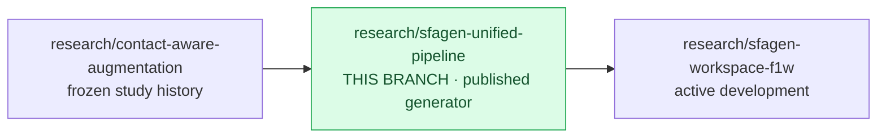

# sfagen: the simulation-free generator behind the published OpenArm datasets

> **Research branch.** Robot setup, teleoperation, recording, training and evaluation commands are on
> [`official-lerobot-quest`](https://github.com/StanleyChueh/lerobot_openarm/tree/official-lerobot-quest#branch-map),
> together with the full branch map.



## Purpose

`sfagen` turns about 10 real bimanual OpenArm demonstrations into about 100 new, replay-checked demonstrations per task.
It uses no simulator, no generative image model and no manual labels:
- **Trajectories** are kinematic edits of the recorded ones: the object moves and the grasping arm follows, or the whole
  hand-over/insertion moves.
- **The body camera** is real pixels re-projected with the robot model.
- **The wrist cameras** keep the real frames, with validity flags.

One config-driven pipeline produces both tasks.

- **Full method:** [`research/sim_free_augmentation/sfagen/PIPELINE.md`](research/sim_free_augmentation/sfagen/PIPELINE.md).
- **Handoff:** [`HANDOFF.md`](research/sim_free_augmentation/sfagen/HANDOFF.md).
- **Novelty check:** [`NOVELTY.md`](research/sim_free_augmentation/sfagen/NOVELTY.md).
- **Visual walkthrough:** [`research/sim_free_augmentation/sfagen_visual_guide/`](research/sim_free_augmentation/sfagen_visual_guide/STAGE_BY_STAGE_VISUAL_GUIDE.md).

**Status:** published 2026-11-09; independent review pending. No VLA-training, hardware-replay or real-robot evidence yet.

## Published datasets (Hugging Face, tag `v3.0`)

All four were generated by the `sfagen/` code of commit **`50832b3`**. Every uploaded code file is byte-identical to that
commit (checked 2026-11-11; see `results/hub_provenance.json` on
[`research/sfagen-workspace-f1w`](https://github.com/StanleyChueh/lerobot_openarm/tree/research/sfagen-workspace-f1w)).

| Dataset | Content | Hub commit |
|---|---|---|
| `ethanCSL/openarm_pringles_lerobot_real_to_sim_10_3cam_v00` | 96 synthetic episodes, 24,645 frames | `30533e67` |
| `ethanCSL/openarm_pringles_lerobot_real_and_sim_10_3cam_v00` | 10 real + 96 synthetic, `is_synthetic` flag | `9f5ed124` |
| `ethanCSL/openarm_insertbattery_lerobot_real_to_sim_10_3cam_v00` | 114 synthetic episodes, 84,690 frames | `c3c571d0` |
| `ethanCSL/openarm_insertbattery_lerobot_real_and_sim_10_3cam_v00` | 10 real + 114 synthetic | `2de75e9f` |

**Sources:**
- Pringles: `ethanCSL/openarm_pringles_lerobot_real_10_v00@cebdee98`.
- Battery: `ethanCSL/openarm_insertbattery_lerobot_real_10_v02@a1c29d77`.

Older revisions are kept under tags in each repo.

## Results (from `HANDOFF.md` §5; held-out episodes, 95% episode-bootstrap CI)

**Body-camera renderer fidelity** (re-render real frame j+k from frame j):

| Task | Copy source frame | Previous renderer | sfagen | sfagen − previous |
|---|---:|---:|---:|---|
| Pringles (7 eps, 211 pairs) | 14.51 dB | 17.87 dB / SSIM 0.692 | **18.04 dB / 0.703** | +0.17 [−0.06, 0.41] |
| Battery (4 eps, 284 pairs) | 16.28 dB | 18.40 dB / 0.681 | **19.21 dB / 0.709** | +0.82 [0.64, 1.00] |

**Coverage:** other real recordings with a training position within 2 cm, out of 40 (Pringles) or 45 (battery).

| Position | 10 sources | Previous revision | sfagen |
|---|---:|---:|---:|
| Pringles can | 9 | 29 | 24 |
| Pringles hand-over point | 33 | 38 | 40 |
| Battery | 22 | 41 | 41 |
| Station | 16 | 29 | 31 |
| Insertion point | 34 | 34 | 43 |

## Reproduce

Run from **this tracked folder**. The old working copy `~/Stanley_ws/sfa_hf_export/sfagen` now contains later, unpublished
changes, so it no longer equals `50832b3`.

The `sfagen/` folder on this branch is identical to `50832b3`. Always pass a **fresh** `--work-dir`: the existing work
directories hold the published artifacts and must not be overwritten.

```bash
cd research/sim_free_augmentation/sfagen
PY="env -u PYTHONPATH -u LD_LIBRARY_PATH $HOME/Stanley_ws/lerobot_openarm/.venv/bin/python"
W=~/sfagen_rerun/pringles                                     # new, empty directory

$PY -m sfagen calibrate configs/openarm_pringles_handover.yaml --work-dir $W   # once per rig (body camera)
$PY -m sfagen table     configs/openarm_pringles_handover.yaml --work-dir $W   # once per rig (table height)
$PY -m sfagen run       configs/openarm_pringles_handover.yaml --work-dir $W \
    --repo-id local/pringles_syn --mixed-repo-id local/pringles_mixed        # generate + render + build
$PY -m sfagen verify    configs/openarm_pringles_handover.yaml --work-dir $W
$PY -m sfagen bench     configs/openarm_pringles_handover.yaml --work-dir $W --episodes 0,2,3,4,6,7,9
# battery: the same with configs/openarm_battery_insertion.yaml (held-out bench episodes 3,5,8,9)
```

The published run's own artifacts (calibration, caches, candidates, `verification.json`, comparison videos) are read-only
in `~/Stanley_ws/sfa_hf_export/sfagen/configs/work/openarm_{pringles_handover,battery_insertion}/`.

**Cost on one RTX 4090** (HANDOFF §6): Pringles ≈ 1.3 h, battery ≈ 3.2 h for a whole dataset.

**The results tables above.** The `tools/` scripts on this branch still point at the old external paths. Run them from a
`research/sfagen-workspace-f1w` checkout instead: its tools import the tracked code, and it has the same `sfagen/` code
plus fixes. All of these need the `configs/work` and `logs` links (see that branch's README).

```bash
cd research/sim_free_augmentation/sfagen                 # in the research/sfagen-workspace-f1w checkout
PY="env -u PYTHONPATH -u LD_LIBRARY_PATH HF_HUB_OFFLINE=1 $HOME/Stanley_ws/lerobot_openarm/.venv/bin/python"
$PY -B tools/xbench.py pringles 0,2,3,4,6,7,9 cuda:0 xbench_pringles.json   # renderer fidelity, Pringles (GPU)
$PY -B tools/xbench.py battery 3,5,8,9 cuda:0 xbench_battery.json            # renderer fidelity, battery (GPU)
$PY -B tools/coverage.py                                                     # coverage table -> logs/coverage.json (CPU)
$PY -B tools/make_cards.py pringles; $PY -B tools/make_cards.py battery      # dataset cards
DRY_RUN=1 $PY -B tools/push_unified.py                                       # publication plan only; no upload
```

None of these were re-run after publication. The published numbers are in `results/xbench_*_final.json` and
`results/coverage.json` on this branch.

## Limitations and known defects (keep these visible)

- No policy, hardware-replay or real-robot evidence.
- Translations only, up to 6 cm. Re-posed arms near the camera show artifacts. Wrist cameras are not re-rendered.
- Pringles can coverage dropped from 29 to 24/40 because of the robot-proximity rule.
- Run only on OpenArm.
- **Published-data defects** (found 2026-11-11, read-only check on `research/sfagen-workspace-f1w`,
  `results/published_check_2026-11-11/`):
  - **Clipped action labels.** 12/96 Pringles and 45/114 battery synthetic episodes have action labels clipped by
    `plan.py`: max 0.0169 / 0.057 rad, joints 10–12; the state is not clipped.
  - **Missing wrist frame.** One `wrist_cam` frame is missing in battery episode 91 (mixed: 101).
  - These need a versioned rebuild under a new tag.
