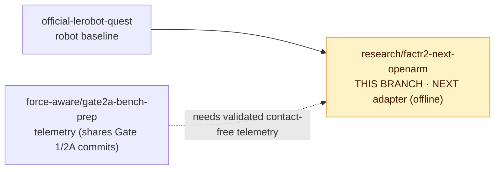

# FACTR2 / NEXT on bimanual OpenArm: offline external-effort estimation (Gate 3A)

> **Research branch.** Robot setup, teleoperation, recording, training and evaluation commands are on
> [`official-lerobot-quest`](https://github.com/StanleyChueh/lerobot_openarm/tree/official-lerobot-quest#branch-map),
> together with the full branch map. Confirm the owner before committing here.



## Purpose and status

**Question.** Can NEXT estimate contact-related external joint effort for battery insertion from the OpenArm telemetry we
already log? In that task, the left arm holds the charger and the right arm inserts the cell.

**Status: Gate 3A (offline) GO.**
- The adapter, tests and procedure are ready and verified **on mock data only**.
- Whether the estimate is useful is **UNKNOWN**: no real telemetry exists yet.
- Nothing connected to a robot, opened a CAN socket, moved a motor, ran on a GPU or uploaded data.

**Next gates, each with its own approval:**
1. Gate 2 bench (on `force-aware/gate2a-bench-prep`).
2. Gate 3B: contact-free NEXT data collection.
3. Later: CPU training on real data (3C) and contact blocks.

## What this branch adds

| Item | File |
|---|---|
| Telemetry → NEXT exporter (numpy + pandas + pyarrow; h5py only for the FACTR2 H5 view) | `tools/force_aware/next_export.py` |
| NEXT windows, normalization, official-architecture LSTM, CPU training, residual estimation, streaming estimator | `tools/force_aware/next_model.py` |
| Adaptation report (pinned official NEXT `philiphan0109/factr2_next@0df02c5`) | [`docs/force_aware/NEXT_OPENARM_ADAPTATION.md`](docs/force_aware/NEXT_OPENARM_ADAPTATION.md) |
| Data contract | [`docs/force_aware/NEXT_DATA_CONTRACT.md`](docs/force_aware/NEXT_DATA_CONTRACT.md) |
| Readiness and hardware procedure (not executed) | [`docs/force_aware/GATE3_READINESS.md`](docs/force_aware/GATE3_READINESS.md) |
| Tests | `plugins/tests/test_next_export.py`, `plugins/tests/test_next_model.py` |

Production code is unchanged: follower, wrapper, telemetry, teleop, gains, guards and the 16-D interface.

## Results (offline, `NEXT_OPENARM_ADAPTATION.md` §5)

| Suite | Result |
|---|---|
| `test_next_export.py` | 49/49 PASS. A mutation check (cmd-age rule, freshness, spacing band, NaN-as-fresh) makes it fail each time |
| `test_next_model.py` | 16/16 PASS. Official parity P0–P4: SKIP |
| `test_eval_obs_reuse.py` | 5/5 PASS |

## Reproduce

All commands run from the repository root of this branch's checkout. The source is `NEXT_OPENARM_ADAPTATION.md` §3 (pipeline) and §5 (offline results).

**Offline tests** (CPU, no robot, no Hub):

```bash
export PYTHONPATH=$PWD/plugins/lerobot_robot_openarm_umeow:$PWD/plugins/lerobot_teleoperator_openarm_quest
R="env HF_HUB_OFFLINE=1 .venv/bin/python"
$R plugins/tests/test_next_export.py      # 49 checks: exporter on the committed Gate-2A fixture + 20 corrupted copies
$R plugins/tests/test_next_model.py       # 16 checks: mock-only model smoke tests (official parity P0-P4 skipped)
$R plugins/tests/test_eval_obs_reuse.py   # 5 checks: evaluation observation reuse
```

**On real sessions** (only after a Gate-2 bench report of GO and approved Gate-3B contact-free collection):

```bash
python tools/force_aware/next_export.py <telemetry session> --out <export root> ...
python tools/force_aware/next_model.py train --arm left --exports <exp>/<s1> ... --val-sessions <sX> --out <runs>
python tools/force_aware/next_model.py estimate --run <run> --export <exp>/<s> --arm left --out residual.parquet
python tools/force_aware/next_export.py --h5 <exp>/<s1> <exp>/<s2> --arm left --out next_left_train.h5   # FACTR2 H5 view
```

The `PYTHONPATH` override is needed because the venv's editable install points at the main checkout.

## Limitations

- **Not physical units.** NEXT residuals are not calibrated forces in newtons. Do not call `tau_ext_hat` a torque or a
  force.
- **Data not yet available.** Standard OpenArm datasets do not contain the motor telemetry NEXT needs, and torque labels
  are not assumed in the Pringles or battery datasets.
- **Grippers excluded.** Never use J8 (the grippers) in an arm model.
