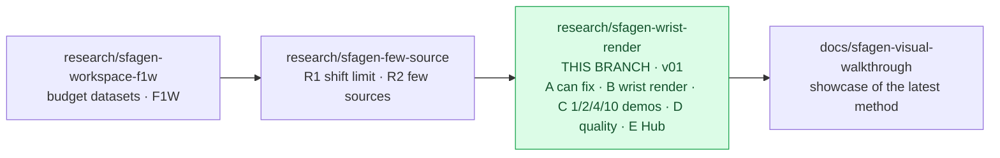
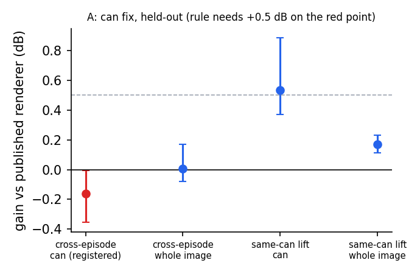
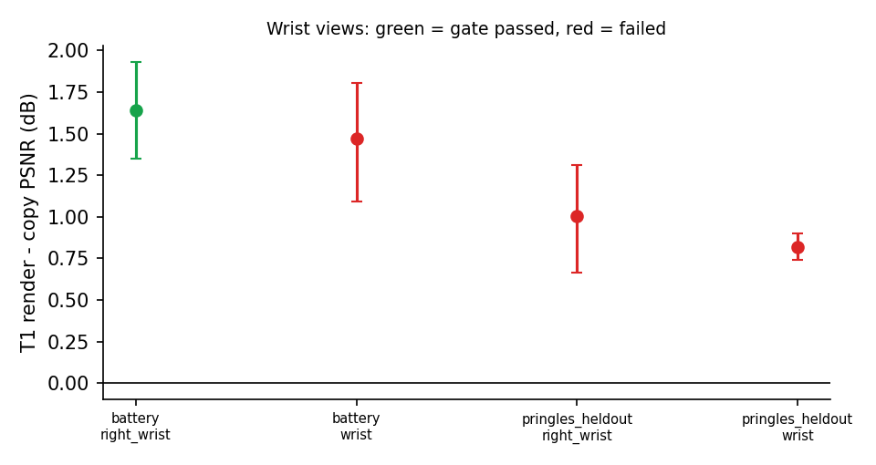
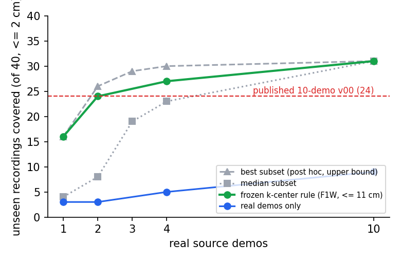

# sfagen v01: rendered wrist cameras, the can fix, and synthetic data from 1–10 real demos

> **Research branch.** Robot setup, teleoperation, recording, training and evaluation commands are on
> [`official-lerobot-quest`](https://github.com/StanleyChueh/lerobot_openarm/tree/official-lerobot-quest#branch-map),
> together with the full branch map. A visual walkthrough of this method is on
> [`docs/sfagen-visual-walkthrough`](https://github.com/StanleyChueh/lerobot_openarm/tree/docs/sfagen-visual-walkthrough).



## Purpose
Build **usable synthetic training data from fewer than 10 real demos** (OpenArm Pringles hand-over), and make the
synthetic data fit a 3-camera VLA. Each study has a protocol frozen before its test data were rendered.

| Study | Question | Registered outcome | Decision |
|---|---|---|---|
| R1 (`research/sfagen-few-source`) | How far can the object move? | r* = 11 cm | F1W shifts capped at 11 cm |
| **A** | Fix the moved can's appearance | not adopted (cross test −0.16 dB; lift test +0.53 dB) | published body renderer kept; the real limit is object **pose** (1–2 cm) |
| **B** | Render the wrist cameras for any task | T1 better than copy in 4/4 task–camera cells; the full gate passes only for the battery right wrist | v01 keeps copied wrists + flags; rendered wrists as an ablation |
| **C** | Fewest demos | the frozen k-center rule gives 16 / 24 / 27 / 31 of 40 for 1 / 2 / 4 / 10 demos | publish the 1/2/4/10-demo candidates |
| **D** | Is the data fit to train? | every hard gate recomputed from the exported files | see the table below |

**Status:** offline only (no VLA training, no robot, no physics), pending independent review.

## Results

### A: can appearance (`research/sim_free_augmentation/sfagen/results/canfix/RESULTS.md`)


- **Dev diagnosis:**
  - 86–95 % of the moved can's pixels are real warped pixels.
  - Their error comes from the reconstructed can pose: a best 2-D shift recovers +2.4 dB, and the shift is 9–16 px at
    every distance.
- **Candidates:** mask growth (removes the ghost lid), object-edge fill, and a per-point colour atlas.
- **Held-out:** cross-episode can −0.16 dB [−0.36, −0.01], so the change is **not adopted**. The same-can lift test
  gives +0.53 dB [0.37, 0.89].

### B: wrist cameras (`.../results/wrist/RESULTS.md`)


| Task / camera | T1 render − copy (same episode) | T2 0–3 cm (cross episode) | T2 3–6 cm | Gate |
|---|---|---|---|---|
| Pringles held-out / right | +1.01 [0.67, 1.31] dB | +0.19 [−1.12, 1.30] | −4.92 (10 frames) | fail |
| Pringles held-out / left | +0.82 [0.74, 0.90] | +3.40 [2.01, 4.57] | +1.27 [−0.54, 2.42] (8 frames) | fail |
| Battery (never used for design) / right | +1.64 [1.35, 1.93] | +1.60 [1.22, 1.98] | +2.12 [1.91, 2.64] | **pass** |
| Battery / left | +1.47 [1.09, 1.80] | +0.85 [−0.28, 1.98] | −3.14 [−7.02, −0.95] | fail |

**Design choices, made on dev only:**
- RAFT depth (beat Depth Anything V2 and the table plane);
- a colour test that assigns hand-rigid pixels the projections miss;
- photometric mount refinement (`calib/DECISION.md`): adopted, +0.3 / +0.5 dB on held-out.

### C: fewest demos (`.../results/fewsrc/RESULTS.md`)


### D/E: candidate datasets on the Hub (public, `v3.0` tag; `.../results/datasets_v01/*/quality_report.json`)
DATASET_TABLE

## Reproduce
All commands run from `research/sim_free_augmentation/sfagen`. Generated data lives outside Git:

```bash
ln -s ~/Stanley_ws/sfa_hf_export/sfagen/configs/work configs/work; ln -s ~/Stanley_ws/sfa_hf_export/sfagen/logs logs
PY="env -u PYTHONPATH -u LD_LIBRARY_PATH HF_HUB_OFFLINE=1 $HOME/Stanley_ws/lerobot_openarm/.venv/bin/python -B"
$PY -m unittest discover -s tests                                                     # 38 CPU tests
```

**A: can fix** (GPU, about 4 min per run):
```bash
(cd tools && C='{"object_mask_grow":60,"object_erode":3,"object_texture":true}' && \
 $PY canfix_bench.py run cuda:0 ../results/canfix/heldout_base heldout '{}' && \
 $PY canfix_bench.py run cuda:0 ../results/canfix/heldout_g60_e3_tex heldout "$C" && \
 $PY canfix_bench.py compare ../results/canfix/heldout_base ../results/canfix/heldout_g60_e3_tex --rule)
```

**B: wrist gate** (GPU). The depth choice, calibration and dev runs are in `results/wrist/RESULTS.md`.
```bash
(cd tools && $PY wrist_bench.py run cuda:0 ../results/wrist/final_pringles_heldout pringles heldout '{"depth":"raft"}' --spec configs/_openarm_wrist_cameras_refined.yaml && \
 $PY wrist_bench.py run cuda:1 ../results/wrist/final_battery battery all '{"depth":"raft"}' --spec configs/_openarm_wrist_cameras_refined.yaml)
```

**C: generation, selection and coverage** (CPU/GPU; full commands in `results/fewsrc/RESULTS.md`):
```bash
(cd tools && $PY select_sources.py configs/openarm_pringles_fewsrc.yaml ../results/fewsrc/selection.json)
$PY -m sfagen generate configs/openarm_pringles_fewsrc.yaml
$PY tools/fewsrc_build.py select
```

**Render, build, gate and publish.** Body rendering takes about 1 min per episode on an RTX 4090; wrist rendering
about 6 s per episode and camera.
```bash
tools/fewsrc_render.sh cuda:0 3 0 2 4 7 & tools/fewsrc_render.sh cuda:1 1 5 6 8 9; wait                # body
CFG=configs/openarm_pringles_fewsrc_wristrender.yaml tools/fewsrc_render.sh cuda:0 0 1 2 3 4 5 6 7 8 9  # wrist (ablation)
for n in 1 2 4 10; do
  $PY tools/fewsrc_build.py setup $n && $PY -m sfagen build configs/pringles_fewsrc$n.yaml --repo-id ethanCSL/openarm_pringles_lerobot_real_to_sim_${n}_3cam_v01
  $PY tools/fewsrc_build.py setup $n --wrist && $PY -m sfagen build configs/pringles_fewsrc${n}_wristrender.yaml --repo-id ethanCSL/openarm_pringles_lerobot_real_to_sim_${n}_3cam_wristrender_v01
  tools/fewsrc_qa.sh $n && tools/fewsrc_qa.sh $n _wristrender                 # verify + quality gate
done
$PY tools/make_cards_v01.py 1 2 4 10 1_wristrender 2_wristrender 4_wristrender 10_wristrender
(cd tools && DRY_RUN=1 $PY push_fewsrc.py 1 2 4 10 1_wristrender 2_wristrender 4_wristrender 10_wristrender)   # drop DRY_RUN to publish
$PY tools/make_figs_v01.py                                                                     # charts
```

**Data:**
- Sources: `ethanCSL/openarm_pringles_lerobot_real_10_v00@cebdee98` and `ethanCSL/openarm_insertbattery_lerobot_real_10_v02@a1c29d77`.
- Coverage pool: `ethanCSL/openarm_pringles_lerobot_real_v00@2c1bc860`, episodes 10–49, reused development data.

**Earlier work:**
- R1/R2: `results/RESULTS_R1_R2.md`.
- Everything from `research/sfagen-few-source` and `research/sfagen-workspace-f1w` is included. See those READMEs.

## Literature check (`results/LITERATURE.md`)
- **Real2Edit2Real** (CVPR 2026): 1–5 demos with a depth-conditioned video model, and its finding that depth quality
  decides output quality. It shaped our depth comparison.
- **Augmentron:** wrist rendering from FK and a table plane.
- **WristWorld:** generative wrist views. This is the fallback for the disocclusions that fail T2.
- **Bi-JCR:** markerless wrist calibration.
- **ConCent:** object shadows.
- **RoboSplat / NeRF-Aug:** dense object models. They address the object-pose limit found in A.

## Limitations
- PSNR, coverage and kinematic checks are proxies. Policy usefulness needs the SmolVLA screen, which the user runs.
- Labels are nominal kinematic labels. There is no physics, force or hardware evidence.
- Pringles demos 0–9 and the pool are reused development data. Battery is a held-out task for the wrist gate only.
- The wrist mounts are photometric consistency calibrations (some offsets at the ±3° search bound), not ChArUco.
- T2 has few frames at camera moves of 3 cm or more, because real cross-episode pairs rarely share a camera orientation.
