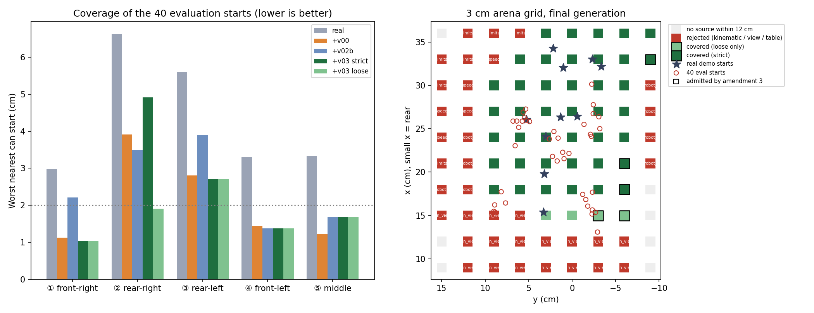
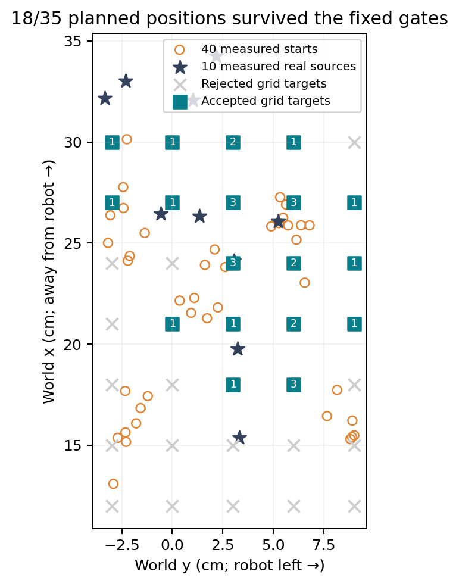
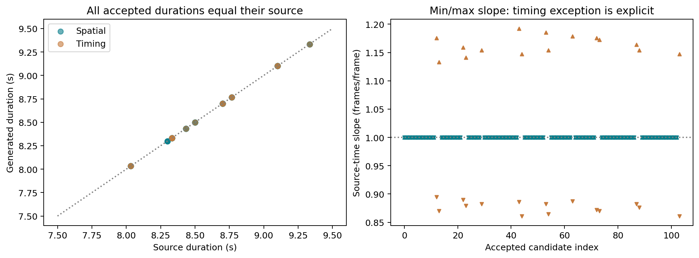

# sfagen v02 / v02b / v03: arena augmentation for the OpenArm Pringles hand-over

> **Research branch.** Robot setup, teleoperation, recording, training and evaluation commands are on
> [`official-lerobot-quest`](https://github.com/StanleyChueh/lerobot_openarm/tree/official-lerobot-quest#branch-map).

## v03: even arena coverage with a pre-registered distortion cap (2026-11-13, latest)

**Goal:** cover the arena evenly (corners, edges, middle) instead of staying near the 10 real demos. Reject only
episodes whose body-camera distortion exceeds a threshold that was frozen before rendering.

**How the data are made** (code under `research/sim_free_augmentation/sfagen`):
1. Targets: a 3 cm grid of can start positions over x 9–36 cm, y −9 to 15 cm (90 cells).
2. Planning: for each cell, the F1W planner (`sfagen/workspace_plan.py`) re-plans the reach of the 10 nearest real
   demos within 12 cm:
   - rigid near-object reach and vertical transit;
   - action-aware IK bounds;
   - kinematic, speed, view and table gates (`sfagen/checks.py`).
3. Rendering: the body camera is re-rendered by forward-warping the source video (`sfagen/render.py`). The left wrist
   is copied from the source; the right wrist is either copied or rendered (`_wristrender`, an ablation).
4. Distortion score (`sfagen/distortion.py`): per frame, (missing + spilled robot/can silhouette pixels) / silhouette;
   the episode score is the 95th percentile over frames.
   - **strict** ≤ 2.289, the worst v02 episode with shift ≤ 4 cm;
   - **loose** ≤ 4.578, twice strict.
5. The v02 hand-over location/timing variants are added; the result is exported as LeRobot v3.0. The 10 real demos
   are added only in the separate `real_and_sim` repos.

**Results** ([RESULTS.md](research/sim_free_augmentation/sfagen/results/v03/RESULTS.md),
[protocol + amendments](research/sim_free_augmentation/sfagen/results/v03/PROTOCOL.md)):
- **Episodes:** strict 149 (41 grid cells); loose 159 (45 cells).
- **Coverage of the 40 eval starts** (worst nearest can start):
  - strict 4.91 cm (31/40 within 2 cm);
  - loose 2.70 cm (36/40);
  - v00 3.91 cm (28/40).
- **Checks:** all 8 exports pass verify, quality and an independent export check.
- **Negative findings:**
  - the loose cap removed nothing;
  - loose's rear-right gain comes only from visually flagged ghost-can episodes;
  - 13 strict episodes carry visual flags, so the score misses split/duplicate cans.
- No policy, physics or hardware result yet.



| Hugging Face dataset | contents |
|---|---|
| [`ethanCSL/openarm_pringles_lerobot_real_to_sim_10_3cam_v03_strict`](https://huggingface.co/datasets/ethanCSL/openarm_pringles_lerobot_real_to_sim_10_3cam_v03_strict) | 149 synthetic, copied wrists |
| [`ethanCSL/openarm_pringles_lerobot_real_and_sim_10_3cam_v03_strict`](https://huggingface.co/datasets/ethanCSL/openarm_pringles_lerobot_real_and_sim_10_3cam_v03_strict) | 10 real + 149 synthetic |
| [`ethanCSL/openarm_pringles_lerobot_real_to_sim_10_3cam_wristrender_v03_strict`](https://huggingface.co/datasets/ethanCSL/openarm_pringles_lerobot_real_to_sim_10_3cam_wristrender_v03_strict) | 149 synthetic, rendered right wrist |
| [`ethanCSL/openarm_pringles_lerobot_real_and_sim_10_3cam_wristrender_v03_strict`](https://huggingface.co/datasets/ethanCSL/openarm_pringles_lerobot_real_and_sim_10_3cam_wristrender_v03_strict) | 10 real + 149, rendered right wrist |
| [`ethanCSL/openarm_pringles_lerobot_real_to_sim_10_3cam_v03_loose`](https://huggingface.co/datasets/ethanCSL/openarm_pringles_lerobot_real_to_sim_10_3cam_v03_loose) | 159 synthetic, copied wrists |
| [`ethanCSL/openarm_pringles_lerobot_real_and_sim_10_3cam_v03_loose`](https://huggingface.co/datasets/ethanCSL/openarm_pringles_lerobot_real_and_sim_10_3cam_v03_loose) | 10 real + 159 synthetic |
| [`ethanCSL/openarm_pringles_lerobot_real_to_sim_10_3cam_wristrender_v03_loose`](https://huggingface.co/datasets/ethanCSL/openarm_pringles_lerobot_real_to_sim_10_3cam_wristrender_v03_loose) | 159 synthetic, rendered right wrist |
| [`ethanCSL/openarm_pringles_lerobot_real_and_sim_10_3cam_wristrender_v03_loose`](https://huggingface.co/datasets/ethanCSL/openarm_pringles_lerobot_real_and_sim_10_3cam_wristrender_v03_loose) | 10 real + 159, rendered right wrist |

Reproduce v03 (configs `configs/openarm_pringles_v03*.yaml`; same environment as below):
```bash
cd research/sim_free_augmentation/sfagen
P="env -u PYTHONPATH -u LD_LIBRARY_PATH HF_HUB_OFFLINE=1 /home/stanley/Stanley_ws/lerobot_openarm/.venv/bin/python -B"
$P -m sfagen generate configs/openarm_pringles_v03_gen.yaml          # grid candidates + checks
$P -m sfagen render configs/openarm_pringles_v03.yaml                # body renders + distortion diagnostics
$P -m sfagen render configs/openarm_pringles_v03_wristrender.yaml    # rendered right wrist
# score/threshold/selection (results/v03/thresholds.json, selection.json) then per export, e.g. strict:
$P -m sfagen build configs/openarm_pringles_v03_strict.yaml --repo-id <id> --mixed-repo-id <mixed id>
$P -m sfagen verify configs/openarm_pringles_v03_strict.yaml
$P tools/quality_report.py configs/openarm_pringles_v03_strict.yaml results/v03/quality_strict_copied
```
The merge/selection helper scripts lived in the untracked run directory (`artifacts/sfagen_v03_run/`). Their outputs are
committed under `results/v03/`.

## v02: fixed-duration arena augmentation

This research branch implements the approved Step 2 batch from `research/sfagen-wrist-render@77e52d4`.
It adds absolute can targets and v00-style ±10-frame handover timing, keeping sfagen F1/F2 geometry and the body renderer.

**Current result:** 104/189 candidates passed generation: 29/89 positions, 60/80 handover locations, 15/20 timing variants.
Only **18/35 target positions** survived. This batch does not achieve full rear-arena coverage and is not a validated
policy improvement. Both matched synthetic-only and mixed exports pass local verification and the frozen quality gates (53 CPU tests). The existing wrist fidelity limitation and visible image artifacts remain. No training, robot operation or publication.

[Visual evidence](research/sim_free_augmentation/sfagen/results/v02/index.html) ·
[Frozen protocol](research/sim_free_augmentation/sfagen/results/v02/PROTOCOL.md) ·
[Exact input/code hashes](research/sim_free_augmentation/sfagen/results/v02/FREEZE.json) ·
[Step 1 diagnosis](research/sim_free_augmentation/sfagen/results/eval_v00/index.html)





## Reproduce locally

Use the existing main-checkout `.venv`, clear `PYTHONPATH` and `LD_LIBRARY_PATH`, and set `HF_HUB_OFFLINE=1`.
Source revision is `cebdee98115ab6827a4ec2655335c536b5dd085b`; cached inputs and exact paths are frozen in FREEZE.json.
The local configs point at separate output directories; choose fresh work directories for a new export. Never overwrite
an existing dataset. The current protocol is frozen: a new experiment requires a new protocol, not changing its gates.

```bash
cd research/sim_free_augmentation/sfagen
TASK_PY=/home/stanley/Stanley_ws/lerobot_openarm/.venv/bin/python
env -u PYTHONPATH -u LD_LIBRARY_PATH HF_HUB_OFFLINE=1 "$TASK_PY" -B -m unittest discover -s tests -q
env -u PYTHONPATH -u LD_LIBRARY_PATH HF_HUB_OFFLINE=1 "$TASK_PY" -B -m sfagen generate configs/openarm_pringles_v02.yaml
env -u PYTHONPATH -u LD_LIBRARY_PATH HF_HUB_OFFLINE=1 "$TASK_PY" -B -m sfagen render configs/openarm_pringles_v02.yaml
env -u PYTHONPATH -u LD_LIBRARY_PATH HF_HUB_OFFLINE=1 "$TASK_PY" -B -m sfagen render configs/openarm_pringles_v02_wristrender.yaml
# Build each condition only after every passing candidate has current raw renders.
env -u PYTHONPATH -u LD_LIBRARY_PATH HF_HUB_OFFLINE=1 "$TASK_PY" -B -m sfagen build configs/openarm_pringles_v02.yaml --repo-id local/v02-copied --mixed-repo-id local/v02-copied-mixed
env -u PYTHONPATH -u LD_LIBRARY_PATH HF_HUB_OFFLINE=1 "$TASK_PY" -B -m sfagen build configs/openarm_pringles_v02_wristrender.yaml --repo-id local/v02-right-wrist --mixed-repo-id local/v02-right-wrist-mixed
# Verify and quality-check both conditions:
env -u PYTHONPATH -u LD_LIBRARY_PATH HF_HUB_OFFLINE=1 "$TASK_PY" -B -m sfagen verify configs/openarm_pringles_v02.yaml
env -u PYTHONPATH -u LD_LIBRARY_PATH HF_HUB_OFFLINE=1 "$TASK_PY" -B tools/quality_report.py configs/openarm_pringles_v02.yaml results/v02/quality_copied
env -u PYTHONPATH -u LD_LIBRARY_PATH HF_HUB_OFFLINE=1 "$TASK_PY" -B -m sfagen verify configs/openarm_pringles_v02_wristrender.yaml
env -u PYTHONPATH -u LD_LIBRARY_PATH HF_HUB_OFFLINE=1 "$TASK_PY" -B tools/quality_report.py configs/openarm_pringles_v02_wristrender.yaml results/v02/quality_right_wrist
env -u PYTHONPATH -u LD_LIBRARY_PATH HF_HUB_OFFLINE=1 "$TASK_PY" -B tools/v02_report.py
```

The matching condition uses the same states/actions/body images, and only re-renders the right wrist. Copied wrists
carry validity flags. The existing Pringles wrist fidelity gate failed; codec quality does not fix that limitation.
Labels and mesh checks are kinematic proxies, not contact-force or physical robot validation.
