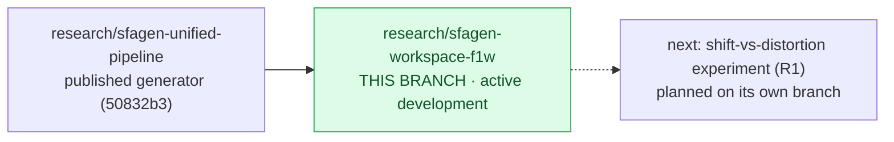

# sfagen development: few-source budget, workspace-wide object positions (F1W), provenance

> **Research branch.** Robot setup, teleoperation, recording, training and evaluation commands are on
> [`official-lerobot-quest`](https://github.com/StanleyChueh/lerobot_openarm/tree/official-lerobot-quest#branch-map),
> together with the full branch map.



## Purpose

**Research question:** can **fewer than 10** real source demonstrations give a VLA-usable synthetic dataset? With few
sources, the object must be moved far from where it was recorded. So this branch develops and measures:

1. **The source-budget study.** The same pipeline is run on the first N = 1…9 real Pringles demos. These datasets are
   published.
2. **F1W (object-position family F1, Workspace-wide).** The object can move anywhere on the visible support surface,
   instead of ±3–6 cm:
   - targets come from the estimated support region;
   - the approach and grasp move rigidly with the object, and a slower clock is used when needed;
   - the renderer and export work in continuous time.

   Not published.
3. **Reproducibility infrastructure:**
   - the tools run tracked code only;
   - safe Hub upload;
   - CPU tests;
   - dataset-to-commit provenance;
   - a read-only check of the published data.

**Status:**
- Budget datasets: published, pending review.
- F1W: engineering previews, **self-validated only**, independent review pending; not training-ready.
- Nothing here has policy or robot evidence.

## Commits on this branch

| Commit | What it is |
|---|---|
| `5d81f2f` | Exact code of the nine budget datasets (byte-identical to their Hub upload) |
| `7135527` | Two budget helpers that were never uploaded |
| `4af01a6` | F1W snapshot: matches `WORKSPACE_F1W_INSTALL_MANIFEST.json`, 25/25 files |
| `bf1cdfa` | Battery baseline renderer for the benchmark (`legacy/target`, verbatim) |
| `4389492` | The tools import tracked code; push safety; provenance guard; CPU tests |
| `c0225f0` | `results/hub_provenance.json` and `results/published_check_2026-11-11/` |

## Results

**Published source-budget datasets** `ethanCSL/openarm_pringles_lerobot_real_to_sim_{N}_3cam_v00`, N = 1…9, tag `v3.0`.
Code is `5d81f2f`: 30/30 uploaded files equal it. Sources are real demos 0…N−1. Synthetic episodes per N: 9, 20, 28,
46, 59, 69, 79, 97, 111.

Can coverage: unseen real recordings (out of 40) with a training position within 2 cm (`logs/budget/diversity.json`):

| N sources | 1 | 2 | 3 | 4 | 5 | 6 | 7 | 8 | 9 |
|---|---|---|---|---|---|---|---|---|---|
| sources only | 2 | 3 | 3 | 6 | 7 | 8 | 9 | 9 | 9 |
| sources + synthetic | 4 | 10 | 13 | 23 | 23 | 24 | 24 | 25 | 27 |

**F1W** (`WORKSPACE_F1W_RESULTS.md`; FK-proxy positions; development data):

| Object | Accepted / attempts (sources 0–4) | Max shift | Coverage ≤ 2 cm, 1 source (old → F1W) | 5 sources (old → F1W) |
|---|---|---|---|---|
| Pringles can | 171 / 240 | 15.8 cm | 4 → 22 /40 | 23 → 32 /40 |
| Battery station | 163 / 240 | 22.6 cm | 15 → 21 /45 | 39 → 44 /45 |
| Battery | 107 / 240 | 25.8 cm | 12 → 19 /45 | 38 → 34 /45 (**worse**) |

The decoded F1W frames show relocated objects, but also stretched or fragmented robot surfaces, dark fills and ghosts.
The RGB fidelity of large shifts **has not been measured**; that is the next experiment (R1). Wrist cameras are
time-remapped source frames, not new views.

**Published-data check** (`results/published_check_2026-11-11/`, read-only; the local exports equal the Hub `v3.0` files):

| Dataset | Clipped action labels (max error) | Camera frame gaps |
|---|---|---|
| Pringles real_to_sim_10 and real_and_sim_10 | 12 / 96 episodes (0.0169 rad, joint 10) | none |
| Battery real_to_sim_10 and real_and_sim_10 | 45 / 114 episodes (0.057 rad, joints 10–12) | `wrist_cam` episode 91 (mixed: 101), 1 frame |

`label_cause.py` shows that every mismatch is exactly the action clip in `plan.py` at `50832b3`. F1W's `plan.py` rejects such
candidates instead of clipping them.

## Reproduce

```bash
cd research/sim_free_augmentation/sfagen
ln -s ~/Stanley_ws/sfa_hf_export/sfagen/configs/work configs/work   # generated data, git-ignored
ln -s ~/Stanley_ws/sfa_hf_export/sfagen/logs logs
PY="env -u PYTHONPATH -u LD_LIBRARY_PATH HF_HUB_OFFLINE=1 $HOME/Stanley_ws/lerobot_openarm/.venv/bin/python"

$PY -B -m unittest discover -s tests                       # 26 CPU tests, ~10 s
$PY -B tools/xbench.py battery --imports-only              # which files the benchmark loads (CPU)
$PY -I results/hub_provenance.py /tmp/hub_provenance.json  # re-derive dataset → commit (reads the Hub)
$PY -I results/published_check_2026-11-11/published_check.py   # label + frame-span check (reads local exports)

# F1W generation (GPU). The configs' work_dir points at the existing F1W results; pass a fresh --work-dir
# (with the rig calibration/table/caches copied in) to re-run without touching them.
W=~/sfagen_rerun/pringles_workspace
$PY -m sfagen generate configs/openarm_pringles_handover_workspace.yaml --work-dir $W --episodes 0,1,2,3,4
$PY -m sfagen render   configs/openarm_pringles_handover_workspace.yaml --work-dir $W --episodes 0 --keys CAN_KEY
$PY -m sfagen build    configs/openarm_pringles_handover_workspace.yaml --work-dir $W --repo-id local/pringles_workspace
$PY -m sfagen verify   configs/openarm_pringles_handover_workspace.yaml --work-dir $W
# one-source run: configs/*_workspace_strict1.yaml

# source-budget datasets (GPU; the dense candidates feed all nine budgets)
$PY -m sfagen generate configs/openarm_pringles_handover_dense.yaml && $PY -m sfagen render configs/openarm_pringles_handover_dense.yaml  # derived from the config/work-dir names, not re-run
$PY -B tools_budget_select.py                              # -> logs/budget_selection.json
for N in 1 2 3 4 5 6 7 8 9; do
  $PY -B tools_budget_build.py $N                          # work dir + configs/pringles_src$N.yaml
  $PY -m sfagen build  configs/pringles_src$N.yaml --repo-id local/pringles_src$N   # derived from logs/budget/build_N.log, not re-run
  $PY -m sfagen verify configs/pringles_src$N.yaml
done
$PY -B tools_budget_figs.py                                # -> logs/budget/diversity.json, positions_*.png
$PY -B tools_budget_publish.py check && $PY -B tools_budget_publish.py cards   # independent re-check, dataset cards
DRY_RUN=1 $PY -B tools_budget_publish.py push              # publication plan only
$PY -B tools_source_budget.py pringles                     # coverage for all 1,023 source subsets
# F1W 1..5-source coverage (from the F1W validation notes)
$PY -B tools_workspace_budget.py configs/openarm_pringles_handover_workspace.yaml \
   --pool-data ~/.cache/huggingface/hub/datasets--ethanCSL--openarm_pringles_lerobot_real_v00/snapshots/2c1bc860347c44fc0fbae7567469d36ee49baa8d/data \
   --exclude 0,1,2,3,4,5,6,7,8,9 --pool-revision 2c1bc860347c44fc0fbae7567469d36ee49baa8d
# Renderer benchmark (GPU, not re-run since publication):
$PY -B tools/xbench.py pringles 0,2,3,4,6,7,9 cuda:0 xbench_pringles.json
```

The `published_check.py` and `label_cause.py` scripts use absolute paths of this machine; edit `REPO`/`WORK` at the top
for another clone.

## Limitations

- Coverage counts are FK proxies at gripper events, measured on reused development recordings, not untouched test data.
- F1W changes published-pipeline behaviour (checks, planner, renderer, export). Regenerating the published datasets with
  this branch gives different data; tag the old Hub revision first.
- No VLA training, hardware replay or robot run on any of this.
- The F1W evidence folder `artifacts/codex_workspace_f1w_20261110` is untracked; it is backed up in
  `~/Stanley_ws/backups/repro_2026-11-11` (SHA256SUMS).
