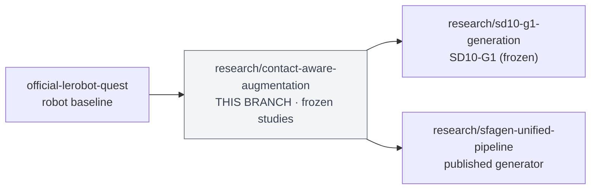

# Simulation-free augmentation: frozen study history (Gate 0 → v4B.1 → SD10)

> **Research branch (frozen evidence).** Robot setup, teleoperation, recording, training and evaluation commands are on
> [`official-lerobot-quest`](https://github.com/StanleyChueh/lerobot_openarm/tree/official-lerobot-quest#branch-map),
> together with the full branch map.
>
> **Do not change study files on this branch.** Protocols were frozen, and in some cases sealed by SHA-256, before
> results existed. The branch name is kept because those protocols and their reviews cite it. Only this README is
> updated.



## Purpose

This branch records how the project reached its current method: **few-shot, simulation-free, bimanual RGB + action
augmentation for OpenArm VLA learning**. Each study states its protocol before its results. Negative results are kept
on purpose. They are what justify the current `sfagen` design.

## Studies, in order

Every row links to the study's own results file. Its exact commands are under [Reproduce each study](#reproduce-each-study). Numbers are quoted from the results files.

| Study | Question | Result (verdict as recorded) | Results file | Commands |
|---|---|---|---|---|
| Gate 0 | Is contact-aware generative augmentation feasible on our data? | Audit; motivation later corrected by the matched evaluation (erratum at the top) | [`GATE0_AUDIT.md`](research/contact_aware_augmentation/GATE0_AUDIT.md) | below |
| Gate 1 | Can a CPU geometry verifier separate real from corrupted demos? | **PARTIAL**: the preregistered verifier false-rejects 2/3 real episodes | [`GATE1_RESULTS.md`](research/contact_aware_augmentation/GATE1_RESULTS.md) | below |
| Gate 1R | Bounded recovery of that verifier | **FAIL → NO-GO**: criterion K3 (6/10-frame offsets) not met; line closed | [`GATE1R_RESULTS.md`](research/contact_aware_augmentation/GATE1R_RESULTS.md) | below |
| Generation feasibility | What does the old simulator generator actually vary? | Only the can start; 0/24 new hand-overs outside the source envelope | [`BASELINE_GENERATOR_AUDIT.md`](research/generation_feasibility/BASELINE_GENERATOR_AUDIT.md) | below |
| Sim-free v1 | One-episode prototype (SAM2 + RAFT, body camera) | Works end to end on episode 0 in 136 s | [`RESULTS.md`](research/sim_free_augmentation/RESULTS.md) | below |
| v2 | Matched G / P / C ablation on episodes 0/4/8 | Phase coordination adds nothing over tuned geometry (24/33 each); grasp-relative constraints matter only for regrasp (6/6 vs 0/6) | [`v2/RESULTS.md`](research/sim_free_augmentation/v2/RESULTS.md) | below |
| v3 | 10 episodes, new initial can positions, SmolVLA screen | New positions work (3–6 cm shifts); 40 px coverage 62.5% → 85%; median shift 1.9 cm (fills gaps, does not extend the workspace) | [`v3/RESULTS.md`](research/sim_free_augmentation/v3/RESULTS.md) | below |
| v3.1 | Why does augmentation barely help? | Grasp error −9%, handover error +11%: the gains and losses cancel; the policies do use vision | [`v3_1/RESULTS.md`](research/sim_free_augmentation/v3_1/RESULTS.md) | below |
| v3.2 | Three-camera generation | 37 episodes / 9,398 frames validated; wrist-mount translation not identifiable; viewpoint realism **not demonstrated** | [`v3_2/RESULTS.md`](research/sim_free_augmentation/v3_2/RESULTS.md) | below |
| v4B | Initial-position augmentation, SmolVLA far grasp | Primary R+Position **FAIL** (far grasp +13.2%, but handover −3.8% > 2% guardrail); secondary R+Both passes (+9.9% far grasp) | [`v4/V4B_RESULTS.md`](research/sim_free_augmentation/v4/V4B_RESULTS.md) | below |
| v4B.1 | H1 missing synthetic RGB; H2 phase-masked targets | H1 `INCREMENTAL_VALUE_NOT_ESTABLISHED` (+2.8% [−1.2, +7.3]); H2 phase masks **worsen** handover (−3.2%) | [`v4b1/V4B1_RESULTS.md`](research/sim_free_augmentation/v4b1/V4B1_RESULTS.md) | below |
| SD10 selection | Pick 10 diverse sources from the 50-episode pool | SD10 = [1, 6, 7, 11, 13, 14, 27, 34, 42, 47]; covering radius 118 → 65 px | [`sd10/FULL50_EPISODE_AUDIT.md`](research/sim_free_augmentation/sd10/FULL50_EPISODE_AUDIT.md) | below |
| SD10-L1 | Real-only SmolVLA: Original10 vs SD10 vs Random10 | **FAIL**; far grasp +10.2% [−9.4, +33.2]; no advantage over Random10 → stop SD10 | [`sd10/l1_exec/L1_RESULTS.md`](research/sim_free_augmentation/sd10/l1_exec/L1_RESULTS.md) | below |

**Independent review status** (Codex, recorded in the project notes; most review files are kept locally, untracked):
- v4B: audited; the primary FAIL and the secondary Both candidate are kept.
- v4B.1: **MODIFY**.
- SD10 selection: **MODIFY**, not reselect.
- SD10-L1: post-training review pending.

## Reproduce each study

Commands are copied verbatim from each study's own document; the source is named under each block. They were **not re-run** for this README.

**Data:**
- Sources: `ethanCSL/openarm_pringles_lerobot_real_10_v00@cebdee98`.
- The 50-episode pool: `ethanCSL/openarm_pringles_lerobot_real_v00@2c1bc860`. Pool episodes 10–49 are reused development data, not a test set.

**Paths:** `../../../.venv` means the repository's `.venv`. Commands that start with `cd ~/Stanley_ws/lerobot_openarm` run from the repository root.

Training studies need a GPU and their own authorization. Large caches, checkpoints and datasets are local and git-ignored; each document says which.

### 1. Gate 0: data and contact-observability audit
Needs: CPU; one online Hub metadata read (GET only); needs a local battery `real_v02@ac63facb` folder. Source: `GATE0_AUDIT.md`.

```bash
cd ~/Stanley_ws/lerobot_openarm
R="env -u PYTHONPATH -u LD_LIBRARY_PATH HF_HUB_OFFLINE=1 .venv/bin/python"
P=~/.cache/huggingface/lerobot/hub/datasets--ethanCSL--openarm_pringles_lerobot_real_10_v00/snapshots/cebdee98115ab6827a4ec2655335c536b5dd085b
POOL=~/.cache/huggingface/hub/datasets--ethanCSL--openarm_pringles_lerobot_real_v00/snapshots/2c1bc860347c44fc0fbae7567469d36ee49baa8d
B=<folder with insertbattery_real_v02 @ ac63facb: meta/, data/ (+ videos/... body_cam file-000 for the phase sheets)>
env -u PYTHONPATH .venv-v2/bin/python -I research/contact_aware_augmentation/scripts/hub_metadata.py research/contact_aware_augmentation/outputs/hub_metadata.json  # online, GET only
$R research/contact_aware_augmentation/scripts/gate0_diagnostics.py --pringles-root $P --pool-root $POOL --battery-root $B \
   --hub-meta research/contact_aware_augmentation/outputs/hub_metadata.json --out research/contact_aware_augmentation/outputs
python3 research/contact_aware_augmentation/scripts/make_data_provenance.py
$R -m unittest research/contact_aware_augmentation/scripts/test_gate0_diagnostics.py -v
```

### 2. Gate 1: geometry verifier pilot
Needs: CPU (~25 s); the annotation step is a GUI and is still PENDING. Source: `GATE1_RESULTS.md`.

```bash
cd ~/Stanley_ws/lerobot_openarm
R="env -u PYTHONPATH -u LD_LIBRARY_PATH HF_HUB_OFFLINE=1 .venv/bin/python -W ignore::DeprecationWarning"
$R research/contact_aware_augmentation/gate1/run_gate1.py --out research/contact_aware_augmentation/outputs/gate1   # ~25 s, 12 workers
$R research/contact_aware_augmentation/gate1/reconcile_eval.py --out research/contact_aware_augmentation/outputs/gate1/eval_reconciliation.json
$R research/contact_aware_augmentation/gate1/annotation/annotate_gate1.py manifest --out research/contact_aware_augmentation/outputs/gate1/annotation/annotation_manifest.csv
$R research/contact_aware_augmentation/gate1/annotation/evaluate_annotations.py --annotations "research/contact_aware_augmentation/outputs/gate1/annotation/annotations_*.csv" \
   --gate1 research/contact_aware_augmentation/outputs/gate1 --out research/contact_aware_augmentation/outputs/gate1/annotation_eval.json   # exit 3 = PENDING
python3 research/contact_aware_augmentation/gate1/make_gate1_metrics.py
$R -m unittest discover -s research/contact_aware_augmentation/gate1/tests -t research/contact_aware_augmentation/gate1/tests -v
```

### 3. Gate 1R: verifier recovery
Needs: CPU (~20 s). Source: `GATE1R_RESULTS.md` §7.

```bash
cd ~/Stanley_ws/lerobot_openarm
R="env -u PYTHONPATH -u LD_LIBRARY_PATH HF_HUB_OFFLINE=1 .venv/bin/python -W ignore::DeprecationWarning"
D=research/contact_aware_augmentation
$R $D/gate1r/reproduce_failures.py --out $D/outputs/gate1r/reproduction.json
$R $D/gate1r/run_gate1r.py --out $D/outputs/gate1r        # ~20 s
python3 $D/gate1r/tabulate.py
$R -m unittest discover -s $D/gate1r/tests -t $D/gate1r/tests -v
```

**Tests** (logs in `outputs/gate1r/test_output/`), all OK:
* Gate 1R: 19, including synthetic counterexamples and the real-pilot fixture `tests/fixtures/pilot_inputs.npz`
* Gate 1: 17
* Gate 0: 11
* dataset diagnostics: 39

**Deviations after the freeze:** none to the verifier or the spec. Added afterwards, for analysis only:
`gate1r/tabulate.py` (reads `samples.jsonl`; no re-scoring). Dates in the Gate 0/1 documents were corrected from
2026-11-05 to 2026-11-04, the actual run date (Codex's provenance note).

### 4. Generation feasibility: baseline generator audit
Needs: CPU, no simulation; reads the local simulator demonstrations named in `BASELINE_GENERATOR_AUDIT.md` (IsaacLab `4aa5e026`). Source: script docstring; test command derived, not re-run.

```bash
cd ~/Stanley_ws/lerobot_openarm
env -u PYTHONPATH -u LD_LIBRARY_PATH .venv/bin/python research/generation_feasibility/scripts/run_dry_run.py   # from the script's docstring
env -u PYTHONPATH -u LD_LIBRARY_PATH .venv/bin/python -m unittest discover -s research/generation_feasibility/tests -v   # derived, not re-run
```

### 5. Sim-free v1: one-episode prototype
Needs: GPU (SAM2.1-small, RAFT-large). Source: `RESULTS.md` §8.

```bash
cd ~/Stanley_ws/lerobot_openarm
E="env -u PYTHONPATH -u LD_LIBRARY_PATH HF_HUB_OFFLINE=1"
$E .venv/bin/python research/sim_free_augmentation/scripts/run_pipeline.py --config research/sim_free_augmentation/configs/ep0.json
$E CUDA_VISIBLE_DEVICES= .venv/bin/python -m unittest discover -s research/sim_free_augmentation/tests -v   # 11 tests
```

Needs:
* the local HF cache of the dataset;
* `facebook/sam2.1-hiera-small`;
* torchvision `raft_large_C_T_SKHT_V2`;
* the Gate 1 lid track `research/contact_aware_augmentation/outputs/gate1/tracks/lid_track_ep0.npz`.

`outputs/ep0/cache/` (SAM2 masks, raw frames; 209 MB) is not committed and is regenerated by the run.

### 6. v2: matched G / P / C ablation
Needs: GPU (two lanes). Source: `v2/RESULTS.md` §13.

```bash
cd research/sim_free_augmentation/v2
PY="env -u PYTHONPATH -u LD_LIBRARY_PATH HF_HUB_OFFLINE=1 ../../../.venv/bin/python"
# per episode (dev 0, then test 4 and 8 with the frozen config); here run concurrently on two GPUs
$PY scripts/run_episode.py --config configs/frozen_v2.json --episode 0 --workers 7 --device cuda:0
$PY scripts/run_episode.py --config configs/frozen_v2.json --episode 4 --workers 7 --device cuda:1
$PY scripts/run_episode.py --config configs/frozen_v2.json --episode 8 --workers 7 --device cuda:0
$PY scripts/make_figures.py --episodes 0 4 8
for c in C G P; do $PY scripts/export_dataset.py --episodes 0 4 8 --condition $c; done
CUDA_VISIBLE_DEVICES= $PY -m unittest discover -s tests -v
```

Development-only steps (episode 0, before the freeze): G's σ grid, the joint-fit weight comparison, and the two fixes that followed visual inspection (receiver returns to the source carry; split lid/body can warp). They are described in the code docstrings and in commit `b9b7dfe`.

### 7. v3: 10 episodes, new initial positions, SmolVLA screen
Needs: GPU; includes SmolVLA training (`train_screen.py`). Source: `v3/RESULTS.md` §10.

```bash
PY="env -u PYTHONPATH -u LD_LIBRARY_PATH HF_HUB_OFFLINE=1 ../../../.venv/bin/python"
CUDA_VISIBLE_DEVICES= $PY -m unittest discover -s tests -v          # Stage-1 regressions
$PY scripts/preprocess_all.py uncached && $PY scripts/preprocess_all.py cached
$PY scripts/init_sweep.py                                           # plan-only feasibility sweep
$PY scripts/run_all.py                                              # 10 episodes, 2 GPU lanes
$PY scripts/export3.py                                              # export-time re-validation + 6 datasets
$PY scripts/train_screen.py && $PY scripts/eval_screen.py           # bounded SmolVLA screen
$PY scripts/make_figures3.py
```

**Outputs:**
* `outputs/ep*/results.json`: every candidate, with all checks.
* `outputs/ep*/candidates/*.npz`: the accepted and rendered candidates.
* `outputs/clips_selected/` (47 clips): original vs G+ vs C comparisons, including new initial positions; C overlays; rejected and QA-failed examples.
* `outputs/clip_manifest.json`: sha256 of all 957 generated MP4s.
* `outputs/figures`, `outputs/tables`, `outputs/bench`, `outputs/dataset_export`, `outputs/train_screen_*.json`, `outputs/logs`.

The datasets, checkpoints and raw caches (`outputs/lerobot`, `outputs/train`, `outputs/cache`, 107 GB) are local and git-ignored.

### 8. v3.1: vision ablation and Task-B corrections
Needs: GPU (inference and regeneration). Source: `v3_1/RESULTS.md`, Commands.

```bash
PY="env -u PYTHONPATH -u LD_LIBRARY_PATH HF_HUB_OFFLINE=1 ../../../.venv/bin/python"
$PY scripts/vision_ablation.py && $PY scripts/score_ablation.py && $PY scripts/fig_ablation.py
$PY scripts/run_all31.py && $PY scripts/export31.py && $PY scripts/analyse_taskB.py
CUDA_VISIBLE_DEVICES= $PY -m unittest discover -s tests -v
```

### 9. v3.2: three-camera generation
Needs: GPU. Source: `v3_2/RESULTS.md`, Commands.

```bash
PY="env -u PYTHONPATH -u LD_LIBRARY_PATH HF_HUB_OFFLINE=1 ../../../.venv/bin/python"
$PY scripts/calib_wrist.py && $PY scripts/calib_wrist_can.py && $PY scripts/crosscheck_mounts.py && $PY scripts/calib_wrist_can_constrained.py
$PY scripts/gen_wrist.py --episodes 0 3 8 --clip            # short 32-frame clips
$PY scripts/gen_wrist.py --episodes 0 1 2 3 4 5 6 7 8 9      # full episodes, representative set
$PY scripts/eval_wrist.py --episodes 0 1 2 3 4 5 6 7 8 9 --max_per_episode 4 && $PY scripts/temporal_wrist.py
$PY scripts/export32.py && $PY scripts/sync_replay.py && $PY scripts/make_threecam_videos.py && $PY scripts/fig_threecam.py
$PY -m unittest discover -s tests -v
```

### 10. v4B: initial-position augmentation, SmolVLA
Needs: GPU; 15 SmolVLA training runs. Source: `v4/V4B_EXPERIMENT_SPEC.md` §11.

```bash
cd research/sim_free_augmentation/v4            # V4B_EXPERIMENT_SPEC.md §11
PY="env -u PYTHONPATH -u LD_LIBRARY_PATH HF_HUB_OFFLINE=1 ../../../.venv/bin/python"
$PY scripts/audit_families.py && $PY scripts/audit_dataset.py
CUDA_VISIBLE_DEVICES= $PY -m unittest discover -s tests -v
$PY scripts/run_v4b.py --lanes 4
$PY scripts/eval_v4b.py --train_dir outputs/v4b/train
$PY scripts/eval_v4b.py --train_dir ../v3/outputs/train --prefix v3_
$PY scripts/score_v4b.py
```

### 11. v4B.1: H1 missing synthetic RGB, H2 phase masks
Needs: GPU; 15 SmolVLA training runs (reruns are bit-identical). Source: `v4b1/V4B1_RESULTS.md` §6.

```bash
PY="env -u PYTHONPATH -u LD_LIBRARY_PATH HF_HUB_OFFLINE=1 PYTHONDONTWRITEBYTECODE=1 ../../../.venv/bin/python"
$PY scripts/run_v4b1.py --lanes 4                     # skips runs whose final checkpoint exists
CUDA_VISIBLE_DEVICES= $PY scripts/verify_runs.py
$PY ../v4/scripts/eval_v4b.py --train_dir outputs/train --pred_dir outputs/predictions
CUDA_VISIBLE_DEVICES= $PY scripts/verify_optimizer_state.py
CUDA_VISIBLE_DEVICES= $PY scripts/score_v4b1.py
$PY scripts/figures_v4b1.py
```

### 12. SD10 selection: 50-episode audit and ten-source choice
Needs: GPU (~4 min, SAM2.1-small); one Hub metadata read. Source: `sd10/FULL50_EPISODE_AUDIT.md` §7.

```bash
cd research/sim_free_augmentation/sd10
PY="env -u PYTHONPATH -u LD_LIBRARY_PATH HF_HUB_OFFLINE=1 ../../../.venv/bin/python"
env -u PYTHONPATH -u LD_LIBRARY_PATH ../../../.venv/bin/python scripts/verify_data.py   # Hub metadata read (or --offline)
$PY scripts/verify_alignment.py
$PY scripts/extract_features.py        # GPU, SAM2.1-small, ~4 min
$PY scripts/lid_center.py              # A1 lid centres + QA sheet
$PY scripts/make_review_sheets.py      # Q5/Q6 review sheets
$PY scripts/build_features.py          # -> full50_episode_features.csv
$PY scripts/select10.py                # -> selected_10_episodes.json, outputs/selection_details.json
$PY scripts/figures.py
$PY scripts/make_manifest.py           # -> source_provenance_manifest.json (+ v4A lock check)
```

SAM inference runs in bf16, so lid centres may differ at sub-pixel level across GPUs. The selection depends only on `full50_episode_features.csv`, which is committed.

### 13. SD10-L1: real-only SmolVLA source-set screen
Needs: GPU; 9 SmolVLA fits. `score_l1.py` rescores from the committed predictions on CPU. Source: `sd10/l1_exec/L1_RESULTS.md` §8.

```bash
sha256sum -c research/sim_free_augmentation/sd10/learning_v1/locked_artifacts.sha256
cd research/sim_free_augmentation/sd10/l1_exec
PY="env -u PYTHONPATH -u LD_LIBRARY_PATH HF_HUB_OFFLINE=1 ../../../../.venv/bin/python -B"
$PY build_frame_cache.py                      # decode + verify 834 locked RGB hashes (CPU)
CUDA_VISIBLE_DEVICES=0 $PY run_all.py         # pre-launch checks, 9 fits, eval, scoring
$PY verify_l1.py; $PY exposure_l1.py; $PY figures_l1.py
$PY score_l1.py                               # rescoring from committed prediction archives only
```

The committed `outputs/predictions/*.npz` (float32) allow rescoring without retraining. Checkpoints and optimizer
states (≈1.3 GB per run) are local only; their SHA-256 values are in `outputs/run_verification.json` and each
`outputs/train/*/terminal.json`.

## Not on this branch

- **The v4A locked real-view preregistration** (`research/sim_free_augmentation/v4a/`, seal `91eea62d…`) is local and
  untracked. It is backed up in `~/Stanley_ws/backups/repro_2026-11-11`.
- **SD10-G1** is on [`research/sd10-g1-generation`](https://github.com/StanleyChueh/lerobot_openarm/tree/research/sd10-g1-generation).
- **The current generator** is on [`research/sfagen-unified-pipeline`](https://github.com/StanleyChueh/lerobot_openarm/tree/research/sfagen-unified-pipeline).
