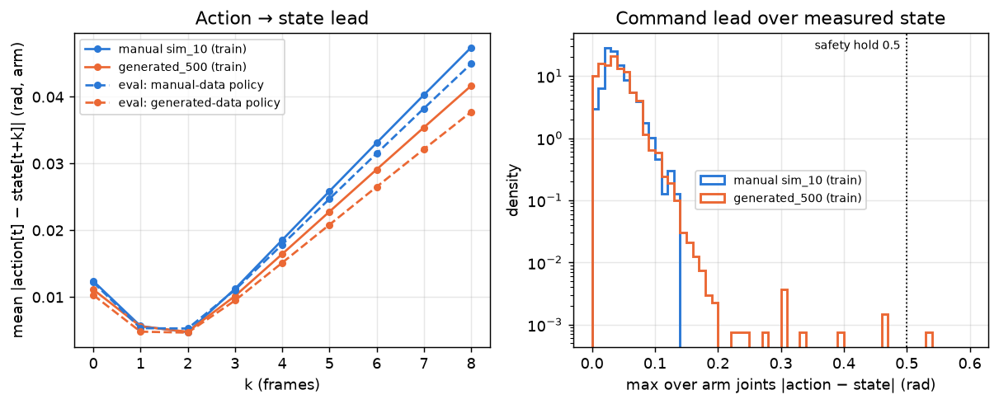
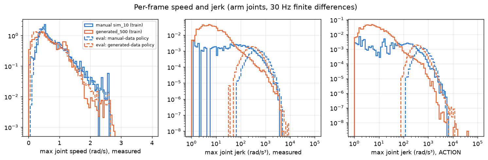

# Action-semantics audit

Scripts: `scripts/provenance_check.py`, `scripts/action_semantics.py` → `data/provenance_check.json`,
`data/action_semantics.json`, `figures/action_state_lag.png`, `figures/speed_jerk_distributions.png`.

## 1. Was `actions[t] = state[t+1]` + Gaussian smoothing used for the published 500? — **DISPROVEN**

IsaacLab `scripts/tools/convert_hdf5_to_lerobot.py` does derive actions from the next measured state and smooths
the arm with σ = 2. The published dataset was not made with it:

| hypothesis for the published `action` (all 134,418 frames) | max abs difference, median / max over episodes |
|---|---|
| = HDF5 `lerobot/joint_pos_target` through calibration.json (`mimic_to_lerobot.py`) | **3.6e-8 / 3.6e-8 rad** |
| = next measured state | 0.082 / 0.559 rad |
| = Gaussian(σ=2)-smoothed next state | 0.070 / 0.577 rad |

The schema also rules the old converter out: it writes `LJ1..8, RJ1..8` blocks, `robot_type openarm`, grippers in
0–0.044 m. The published set has interleaved `RJ1, LJ1, …, RJ8, LJ8`, `robot_type openarm_umeow`, grippers in raw
motor radians (right open −1.298, left open 1.2121, closed 0), identical to the manual set (asserted in
`common.load`). Generated `observation.state` = `lerobot/joint_pos` (pre-step) to 6e-8. **CONFIRMED.**

`lerobot/joint_pos_target` is the joint target the generation's IK action term applied during the step
(`openarm_recorders.py`). That term re-solves IK at every 1/120 s physics substep toward a fixed EEF goal; the
recorded value is the last substep's target. In evaluation one joint target is held for all 4 substeps — see §4 for
whether that difference matters.

## 2. Names, order, units, grippers

| | manual | generated |
|---|---|---|
| state/action names and order | interleaved RJ/LJ, 16D | identical |
| arm units | motor rad (calibration sign +1, offset 0) | identical |
| gripper action | binary open/closed raw: 99.5 % (R) / 99.9 % (L) of frames at an end | 98.5 % / 99.3 %; the rest is the generator's slew ramp (`OpenArmSlewedGripperAction`, 0.6 m/s) |
| gripper hold level (measured openness while holding) | R 0.69–0.78, L 0.43–0.76 | R 0.51–0.78, L 0.43–0.79 |
| index of R/L gripper | RJ8 = col 14, LJ8 = col 15 | identical |

**CONFIRMED:** same semantics and conventions; no re-indexing defect.

## 3. Action → state timing

Mean |action[t] − state[t+k]| over arm joints (rad):

| k | 0 | 1 | **2** | 3 | 4 |
|---|---|---|---|---|---|
| manual | 0.0124 | 0.0057 | **0.0047** | 0.0112 | 0.0186 |
| generated | 0.0111 | 0.0056 | **0.0048** | 0.0102 | 0.0165 |
| eval rollout, manual-data policy | 0.0122 | 0.0053 | **0.0053** | 0.0111 | 0.0179 |
| eval rollout, generated-data policy | 0.0103 | 0.0048 | **0.0047** | 0.0095 | 0.0151 |

Both datasets' actions lead the measured state by 2 frames with the same error, and both trained policies
reproduce that relationship in closed loop. **CONFIRMED: no action-lag mismatch.**

## 4. Are generated transitions valid for the evaluation's joint controller? — **CONFIRMED (consistent)**

The manual demos were recorded through the evaluation's own control path (sim server, one joint target held per
1/30 s step). A per-joint model ds[t] = α(a[t]−s[t]) + β(s[t]−s[t−1]) fitted on them predicts
generated transitions with RMSE 0.0006–0.0087 rad per step, 0.8–1.8× its own leave-one-episode-out error and the
same as on the two policies' closed-loop rollouts (`data/action_semantics.json`). The generated data's own fit has a
smaller α and larger β (more momentum — smoother, slower motion), but the residual is ~1 mrad/step. The
re-solve-per-substep difference is therefore not a meaningful label error.

| check against the evaluation robot (`OpenArmUmeow.send_action`: step cap 2.5 rad/s × wall dt ≈ 0.125 rad/step at the measured ~20 Hz; safety hold at a 0.25 rad request jump or 0.5 rad request–state gap) | manual | generated |
|---|---|---|
| frames with request–state gap > 0.5 rad | 0 | 1 frame (episode 91) |
| episodes with a request jump > 0.25 rad | 0 | 1 (episode 91) |
| frames with a jump > 0.125 rad (step cap) | 0.04 % | 0.01 % |
| p95 request–state gap | 0.076 | 0.074 |

## 5. Smoothing / timing effects on the approach and hand-over

No smoothing was applied, so smoothing cannot shift grasp or hand-over timing (**DISPROVEN**). The generated
timing *is* different, for another reason: the inserted interpolation (median +38 frames) and the generator's
hold-until-taken rule (overlap 10–17 vs 1–10 frames) — DATA_GENERATION_AUDIT §4. Both trained policies reproduce
their own data's timing in evaluation (right grasp at step 79 vs 101, left grasp 161 vs 206; data: 80 vs 102,
167 vs 195). **CONFIRMED.**

## 6. Normalization

Each checkpoint's normalizer equals its own dataset's stats (max difference 5e-8). Generated vs manual statistics
differ by ≤ 0.49 manual-std in mean and 0.80–1.21 in std per joint (`data/normalizer_comparison.json`), largest on
RJ2/RJ4/RJ6 (the farther reaches). No defect. Real/sim compatibility is unchanged from the earlier readiness
report (`research/dataset_diagnostics/`); not re-audited here.

## 7. Gripper commands at evaluation

Both policies were trained on ~binary gripper actions but emit intermediate commands (5–95 % open) on 31 % (R) /
30 % (L) of frames (manual-data policy) and 12 % / 9 % (generated-data policy). Not a label defect; it matters for
reading evaluation stages (EVALUATION_COMPARISON §3).

## Verdict

No action-label defect is proven. **Experiment D (corrected action targets) is not justified** and should not be
run. The one generated episode that would trip the evaluation safety hold (#91) belongs to the cleaning step (C).
