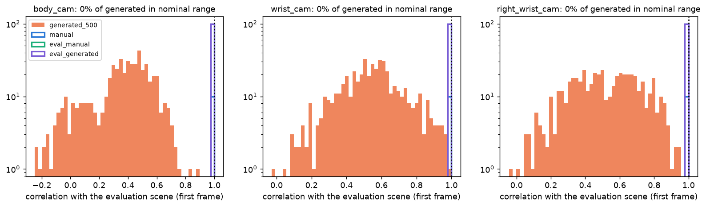
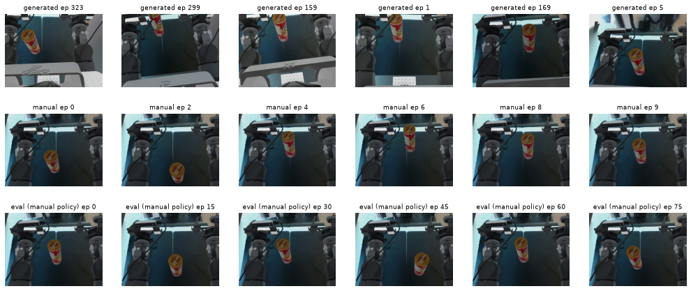
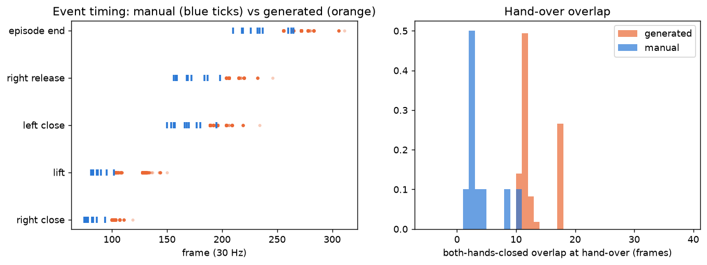
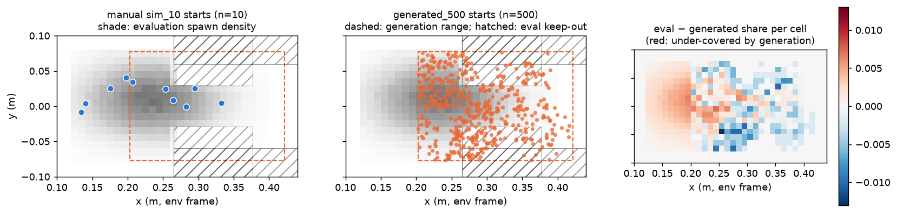
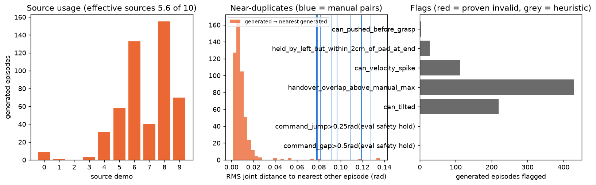

# Data-generation audit: generated_500 vs the 10 manual sim demos

Date 2026-10-27. CPU-only, read-only. Scripts: `scripts/` (run with `.venv-v2`, `env -u PYTHONPATH -u LD_LIBRARY_PATH`;
`extract_hdf5.py` with Isaac Lab's python). Labels: **CONFIRMED** (measured, mechanism shown),
**SUPPORTED HYPOTHESIS** (consistent evidence, mechanism not proven), **UNKNOWN**, **DISPROVEN**.

## 1. Provenance

| item | value | status |
|---|---|---|
| repos | lerobot_openarm `03fb1d3f` (official-lerobot-quest), IsaacLab `4aa5e026` (openarm-dev), lerobot fork `f10cbf97` (update_dev_v2); all three working trees clean | CONFIRMED |
| manual demos | `ethanCSL/openarm_pringles_lerobot_sim_10_v00` @ `b6d39dae`; = `IsaacLab/logs/demos/openarm_pringles_lerobot_sim_10_v00.hdf5` (server-recorded, `Isaac-PickUp-RedCube-OpenArm-IK-Abs-v1`, no DR); every state equal | CONFIRMED |
| generated set | `ethanCSL/openarm_pringles_lerobot_sim_10_v00_generated_500` @ `860741a2` (repo re-created 2026-10-23 04:40 UTC); local cache byte-identical (sha256 of all 19 files) | CONFIRMED |
| generation file | `IsaacLab/logs/demos/openarm_pringles_lerobot_sim_10_v00_generated.hdf5` (120 GB, written 2026-10-22 22:31 +0800, i.e. after the overshoot fix `4aa5e026` 13:47); env `Isaac-PickUp-RedCube-OpenArm-IK-Abs-Mimic-v1`, 1/120 s × 4 = 30 Hz, 4 envs | CONFIRMED |
| dataset ↔ HDF5 | 500 = 500 episodes, equal lengths; every state = `lerobot/joint_pos`, every action = `lerobot/joint_pos_target` (max diff 6e-8) | CONFIRMED |
| converter | `lerobot_openarm/mimic_to_lerobot.py` (`7175e86`), not IsaacLab `convert_hdf5_to_lerobot.py` (see ACTION_SEMANTICS_AUDIT) | CONFIRMED |
| source annotation | `..._sim_10_v00_annotated.hdf5` (`annotate_demos.py --auto --from_states`). It is a **re-simulation**: can pose differs from the recording by up to 8 mm and joints by up to 0.04 rad (actions identical) | CONFIRMED (minor) |
| exact `generate_dataset.py` command of the final run | not in shell history or any Claude transcript; the test runs recorded there used no DR flags | UNKNOWN |

The earlier 2026-10-22 03:02 UTC conversion of a pre-fix generation is **not** what is published; the Hub repo was
deleted and re-pushed from the regenerated file.

## 2. The generated frames are not the evaluation's frames

 

Correlation of each episode's first frame (downsampled grey) with the empty evaluation scene, over pixels the can never covers:

| camera | manual demos + 200 eval episodes | generated median | generated best | generated inside the nominal range |
|---|---|---|---|---|
| body_cam | ≥ 0.9997 | 0.40 | 0.88 | **0 / 500** |
| wrist_cam (left) | ≥ 0.9999 | 0.55 | 0.98 | **0 / 500** |
| right_wrist_cam | ≥ 0.9999 | 0.51 | 0.96 | **0 / 500** |

Frame 30 gives the same result (generated 0.40 vs evaluation 0.83 full-image), so it is not a first-frame artefact.
The generated episodes show moved cameras, grey/other backgrounds and other lighting, and three can sizes
(rest heights 0.374 / 0.384 / 0.394 m: 127 / 117 / 256 episodes; the manual and evaluation can rests at 0.380).

* **CONFIRMED:** generated_500 was produced with camera-pose/appearance randomization and per-env object-size
  randomization; the manual demos and both evaluations (`--domain_randomization none`) have neither.
  Not a single generated episode looks like an evaluation episode.
* **SUPPORTED HYPOTHESIS:** the profile was `--enable_domain_randomization --domain_randomization_profile full
  --randomize_object_size` (only `full` swaps the background skybox; `full` also moves the pad ±4 cm and
  randomizes object/pad colour). The command itself is UNKNOWN.

## 3. Task validity (ground truth: the can pose recorded every step)

| check (all 500 generated / 10 manual) | generated | manual |
|---|---|---|
| Mimic `success` attr (judged at the FINAL state, `generation_success_at_final_state=True`) | 500/500 | 10/10 |
| can held by the left hand at the end (closed, blocked, > 5 mm above pad) — independent check | 500/500 | 10/10 |
| can back on the pad unheld after lift / off the pad | 0 / 0 | 0 / 0 |
| right gripper releases before the left closes | 0 | 0 |
| **would trip the evaluation robot's safety hold** (request > 0.5 rad from state or > 0.25 rad jump) | **1 (#91)** | 0 |
| event detector vs `annotate_demos` signals (manual) | — | right close within 0–1 frame of `grasp_right`, left close within 0–3 of `handover` |

**Proven invalid for the evaluation controller: 1/500 (episode 91).** Everything else below is a heuristic flag,
not proof of invalidity.

Heuristic flags (threshold = beyond the manual demos' range):

| flag | generated episodes | note |
|---|---|---|
| hand-over overlap > manual max (10 frames) | 430 | generated 10–17 frames, manual 1–10 (median 2) |
| can tilt > manual max (26°) | 219 | all 133 episodes from source 6 (median 48°), source 7 (53°) |
| can speed > 1.0 m/s (manual max 0.46) | 113 | peak 8–10 frames after the right hand releases; overlap–speed r = 0.73 |
| held by the left within 2 cm of the pad at the end | 27 | all from source 7 (lowers the can) |
| can pushed > 3 cm before the grasp | 4 | |

The existing `scripts/tools/check_mimic_demos.py` agrees: **108/500 (22%) flagged** — 107 can jolt > 1 m/s,
joint windup 47/91/289, hand jolt 59. It prints the command for a `_clean` file; **that filter was never applied:
all 500 are published.** (CONFIRMED)

## 4. Motion and timing vs the source demos (`data/episode_events.csv`)

| quantity (min / median / max) | manual | generated (min / p5 / median / p95 / max) |
|---|---|---|
| episode length (frames) | 210 / 233 / 265 | 256 / 256 / 265 / 283 / 311 |
| right gripper closes | 75 / 80 / 94 | 100 / 100 / 102 / 107 / 119 |
| can lifted | 81 / 84.5 / 102 | 103 / 103 / 128 / 132 / 150 |
| left gripper closes | 150 / 167 / 195 | 189 / 189 / 195 / 209 / 234 |
| right gripper releases | 156 / 168.5 / 198 | 204 / 204 / 206 / 220 / 246 |
| both-closed overlap | 1 / 2 / 10 | 10 / 10 / 11 / 17 / 17 |
| measured joint speed max (rad/s) | 1.86 / 2.37 / 2.59 | 1.36 / 1.38 / 1.75 / 2.64 / 2.78 |
| p95 joint jerk (rad/s³) | 959 / 1231 / 1657 | 227 / 282 / 446 / 770 / 1039 |
| lowest elbow target (rad) | 0.78 | 0.30 (the limited-IK floor) |
| distance from the home pose at the end (rad) | 0.02 / 0.03 / 0.05 | 0.15 / 0.16 / 0.21 / 0.32 / 0.66 |

* **CONFIRMED:** every generated episode is its source demo delayed by a median 38 frames of inserted
  interpolation (left-arm path matches its source to 5.5 mm after the shift). Generated grasps, passes and releases
  come 20–40 frames later than in the manual demos, the motion is slower and much smoother, the hand-over keeps
  both hands shut 10–17 frames (the generator's `_hold_giving_hand_until_taken`), and episodes stop holding the can
  away from the home pose instead of returning home.

## 5. Start positions, source usage, diversity

Spawn rules (IsaacLab `openarm_task_modes.py`):

* Evaluation and recording (env without `subtask_configs`): truncated Gaussian, x ~ N(0.235, 0.07) ∩ [0.12, 0.40],
  y ~ N(0.01, 0.04) ∩ [−0.08, 0.08], minus the parked-hand keep-out boxes.
* Generation (Mimic env): **uniform** x ∈ [0.2029, 0.4217], |y| ≤ 0.0769 (`_HANDOVER_X/Y_RANGE`, derived from an
  older source set), no hand keep-out. Each episode re-anchors one of the 3 sources nearest the new can pose.

| measure (Monte Carlo of the exact evaluation sampler, 200k draws) | value | status |
|---|---|---|
| evaluation spawns at x < 0.203 (no generated start there) | **34.3 %** | CONFIRMED |
| generated starts inside the evaluation's keep-out (never evaluated) | 27.8 % | CONFIRMED |
| evaluation mass with a start within 2 / 3 / 4 cm: manual | 41 / 63 / 77 % | |
| … generated | 76 / 82 / 86 % | |
| … manual + generated | 85 / 93 / 97 % | |
| kernel effective n at 4 cm (start XY) | manual 2.8, generated 3.9 | |

Source usage (left-arm attribution, best match 5.5–6.3 mm, second best ≥ 2.6× farther):

| source demo | 0 | 1 | 2 | 3 | 4 | 5 | 6 | 7 | 8 | 9 |
|---|---|---|---|---|---|---|---|---|---|---|
| its start x (m) | 0.197 | 0.134 | 0.140 | 0.175 | 0.295 | 0.207 | 0.332 | 0.265 | 0.283 | 0.254 |
| generated episodes | 9 | 1 | **0** | 3 | 31 | 58 | 133 | 40 | 155 | 70 |

* **CONFIRMED:** the four near-base demos (x 0.134–0.197) seed 13 of 500 episodes; effective number of sources
  exp(H) = 5.6. With the left arm replayed untransformed and only the right arm's approach re-anchored, generated
  episodes are near-copies of their source: 473/500 have another generated episode within a quarter of the
  closest distance between two different manual demos (median nearest-neighbour RMS 0.007 rad vs 0.078–0.092 rad
  between manual demos), and 99.8 % of nearest neighbours share the source.
  
* **CONFIRMED:** 500 episodes ≈ 5.6 trajectory templates × a can offset, rendered under randomized cameras.

## 6. Conclusions of this audit

| claim | status |
|---|---|
| Mimic's success label can be trusted for task completion (independent check 500/500) | CONFIRMED |
| "Many generated episodes are physically invalid" | DISPROVEN (1/500 proven invalid for the eval controller; 22 % heuristic flags) |
| The generated data is visually out of the evaluation distribution (0/500 nominal) | CONFIRMED |
| The generated data does not cover the near-base third of the evaluation distribution | CONFIRMED |
| The generated hand-over differs systematically (long overlap, can jolts/tilt) | CONFIRMED |
| Generated diversity is far smaller than 500 (≈ 5.6 templates, near-duplicates) | CONFIRMED |
