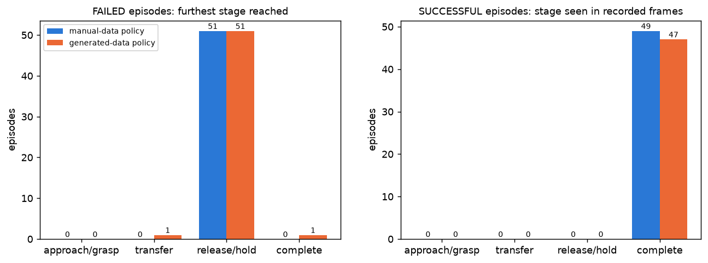
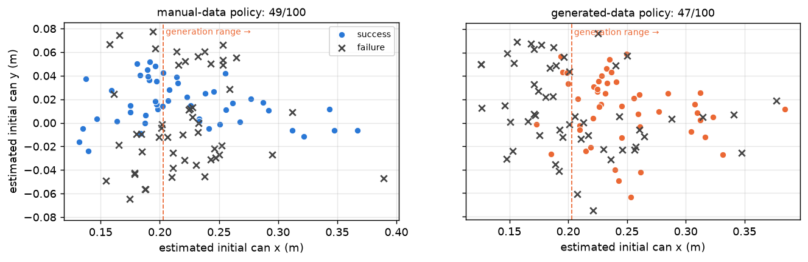

# Evaluation comparison: 49/100 (manual-data policy) vs 47/100 (generated-data policy)

Sources: `ethanCSL/eval_openarm_pringles_lerobot_sim_10_smolvla_v00` @ `a759d6ad` and
`ethanCSL/eval_openarm_pringles_lerobot_sim_10_generated_500_smolvla_v00` @ `1e482964` (local caches
byte-identical), their `meta/openarm_eval.json`, and `outputs/eval_logs/*` timing logs. Scripts:
`eval_positions.py`, `eval_analysis.py`, `eval_stability.py`, `ticks_success.py`, `contact_sheets.py`.

## 1. Identity, settings, run-to-run variation (Phase 0)

| | manual-data policy | generated-data policy |
|---|---|---|
| checkpoint (from every episode of openarm_eval.json) | `…_sim_smolvla_10_v00` (not the real one) | `…_sim_10_generated_500_smolvla_v00` |
| success (simulator label, any step) | 49/100, Wilson 95 % [0.39, 0.59] | 47/100, [0.38, 0.57] |
| Fisher exact | p = 0.89 — **no difference (CONFIRMED)** | |
| client flags (summary.json argv) | identical: async RTC, actions_per_chunk 50, threshold 0.5, latest_only, fps 30, 15 s, 1 s reset | |
| RTC active | guided 34.8 steps/chunk, delay 1.77 steps, latency 209 ms | 33.8, 1.76, 208 ms |
| control rate (lock-step) | 19.7 Hz wall | 19.7 Hz wall |
| simulated steps per episode | 274–320 (median 290.5) | 270–321 (median 299) |
| simulated time per episode | 9.1–10.7 s, not 15 s | same |
| every episode ended by | the 15 s wall clock | same |
| seed / initial can poses | **not seeded, not logged**: estimated (§2); distributions match (KS p = 0.70 x, 0.97 y) but the poses differ | |

Episodes that succeed run fewer simulated steps than failures (283 vs 314; 285 vs 308): the budget is wall-clock,
and each simulated step costs more wall time in some episodes. **CONFIRMED** that the simulated budget varies with
outcome; the mechanism (contact-rich holding steps render/simulate slower) is a SUPPORTED HYPOTHESIS.

Repeat runs of the same checkpoints (earlier, unrecorded runs; success estimated from the tick logs with the
stable-hand-over detector, which agrees with the simulator on the recorded runs at 100/100 and 99/100, and still
at 100/100 and 99/100 when their state is thinned to the unrecorded runs' 10 % read cadence):

| run | estimated success |
|---|---|
| manual-data policy, 2026-10-23 | 52/100 (vs 49/100) |
| generated-data policy, 2026-10-24 22:26 (stopped at 73) | 33/73 = 45 % (vs 47 %) |
| generated_400 policy, 2026-10-24 21:33 | 61/100 (vs generated_500 47/100, p = 0.065) |

## 2. Initial can positions (not logged → estimated)

Background-subtracted can silhouette in the first body_cam frame + homography fitted on the 20 server-recorded
`sim_20_v00` starts (same env, camera, look). **Leave-one-out RMSE 0.6 mm, max 1.8 mm** (`data/start_position_estimator.json`).
A red-colour detector was tried first and rejected (LOO 3.4 cm: it lands on different label faces). 10/200 estimates
lie up to 1 cm outside the fitted region (`extrapolated` in `data/eval_episodes.csv`).

## 3. Stage-wise outcome

Stages come from the grippers (a hand holds the can when commanded closed but held open beyond the command).
Validated on the 510 training episodes with can ground truth: per-frame precision 0.95–1.00, recall 1.00; all 510
classified complete. Agreement with the simulator label on the evaluations: 199/200 (generated episode 42: left-only hold
of 70 steps, simulator says failure).

| furthest stage | manual-data failures | generated-data failures |
|---|---|---|
| right hand never grasps | 0 | 0 |
| right grasps, left never takes it | 0 | 1 |
| both held it, left lost it within 1 s (median longest left-only hold 3 / 2 frames) | 39 | 51 |
| both held it, left grip intermittent to the end (longest hold 2–23 frames) | 12 | 0 |
| detector says complete, simulator says failure (episode 42) | 0 | 1 |

* **CONFIRMED:** both policies fail at the same place — the pass. Approach and grasp essentially always work;
  the left hand closes but does not secure the can. No failure is a near-miss on time (no failure is still passing
  at the limit; only 1 generated success completes within the last 20 steps).

Timing (median step): right grasp 79 vs 101, left grasp 161 vs 206, completed stable hand-over 197 vs 243
(max 227 vs 278). **CONFIRMED:** the generated-data policy is ~45 steps slower, as its data is.

## 4. Success vs initial position

| estimated start | manual-data policy | generated-data policy | Fisher p |
|---|---|---|---|
| x < 0.203 (no generated start there) | **25/43** | **6/37** | 0.0002 |
| 0.203 ≤ x < 0.27 | 16/46 | **30/47** | 0.007 |
| x ≥ 0.27 | 8/11 | 11/16 | 1.0 |
| y < −0.01 (no manual start below −0.009) | 3/27 | 10/27 | 0.054 |
| −0.01 ≤ y < 0.03 | 33/46 | 24/43 | 0.13 |
| y ≥ 0.03 | 13/27 | 13/30 | 0.79 |

Logistic regression (numpy IRLS, `data/eval_stability.json`), success ~ policy × x + policy × y: policy × x
interaction +1.24 per sd of x, **p = 0.006**; policy main effect ≈ 0 (p = 0.83).

* **CONFIRMED (measured), mechanism SUPPORTED HYPOTHESIS:** each policy fails where its training starts are
  missing — the generated-data policy below x = 0.20 (34 % of the evaluation distribution, where generation never
  started an episode and the 4 near-base sources were almost never used), the manual-data policy at y < −0.01
  (no manual start there). The overall tie is two opposite coverage effects cancelling.

## 5. Is the success predicate transient? — **CONFIRMED: yes**

The simulator's term (`handover_success`, IsaacLab `openarm_task_modes.py`) is true only *while* the left hand
holds after a 30-step confirmed pass, but `openarm_isaac` reports `episode_success = episode_success or success`
over every step since the scene reset — including the slow return to the start pose, which the dataset does not
record. Generation, by contrast, judged episodes at their final state.

| | manual-data policy | generated-data policy |
|---|---|---|
| success at any step | 49 | 47 |
| … left hand still holding ≥ 30 steps after the pass | 49 | 47 |
| … ≥ 60 steps | 12 | 47 |
| … at the last recorded frame | **3** | **47** |
| successes where the left hand then opens | 43 (median 56 steps after the pass) | 0 |
| absolute step at which it opens | 229–282, median 250 | — |
| training-episode length | 210–265 (median 233) | 256–311 (median 265) |

The manual-data policy opens the left hand right where its demonstrations end, ~57 steps before the evaluation
ends (spot-checked visually: `figures/manual_policy_success_end.png` — can falls in episodes 0 and 6, stays wedged in
1 and 4; model review, not human). The generated-data policy's episodes end within its own demonstrated horizon.

* **CONFIRMED:** "held at the end" would score 3 vs 47.
* **SUPPORTED HYPOTHESIS:** this is an episode-horizon artefact (the evaluation runs past the demos' end), not
  better grasping by the generated policy; with an equal 30-step post-pass window both policies keep every success.
* Reaching success during the unrecorded return phase: not observed (every success has a stable pass inside the
  recorded frames), but not excluded by the protocol. UNKNOWN in general.

## 6. Human review

`figures/contact_sheets/eval_{manual,generated}_{000,025,050,075}.png`: start/25/50/75 %/last body_cam frames of all
200 episodes with the automatic label. The stage labels are gripper-derived, not visual; they have not been
human-verified.
