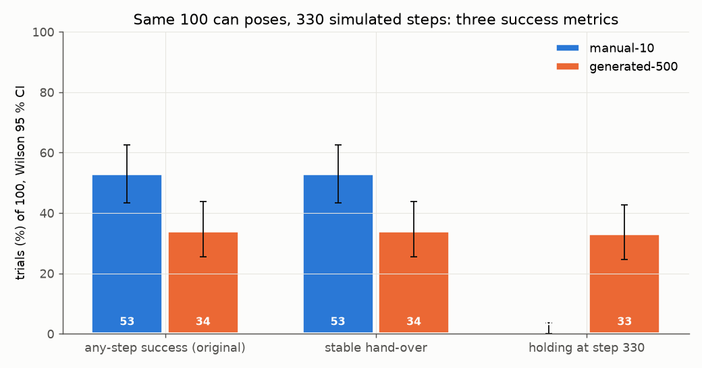
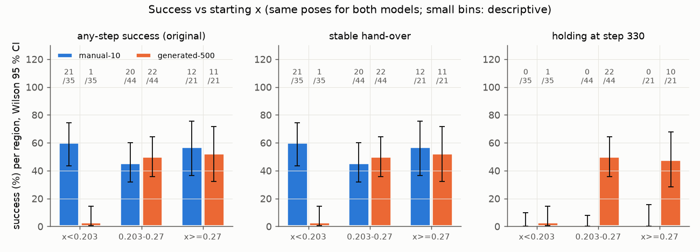
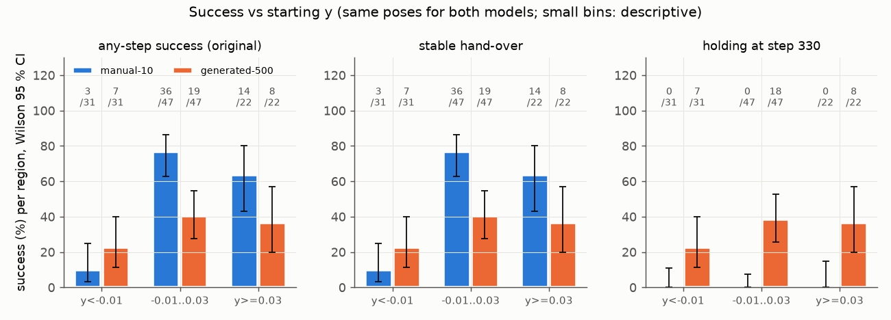
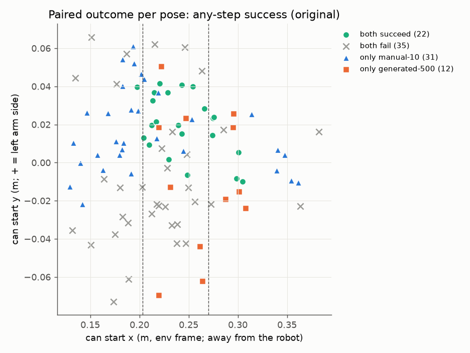
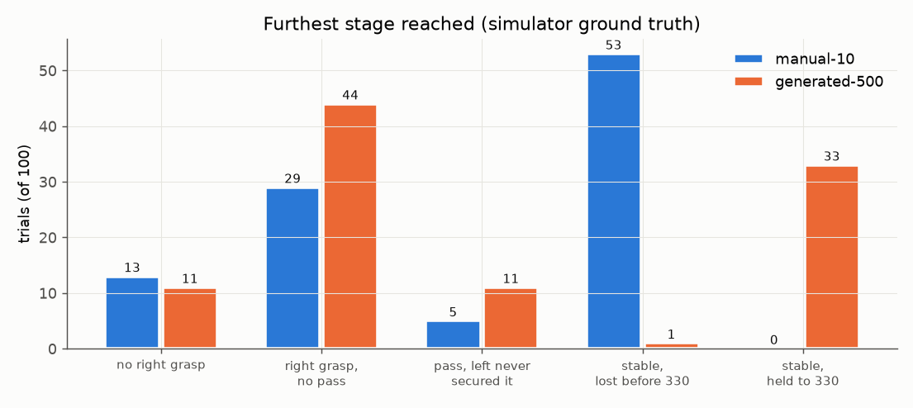
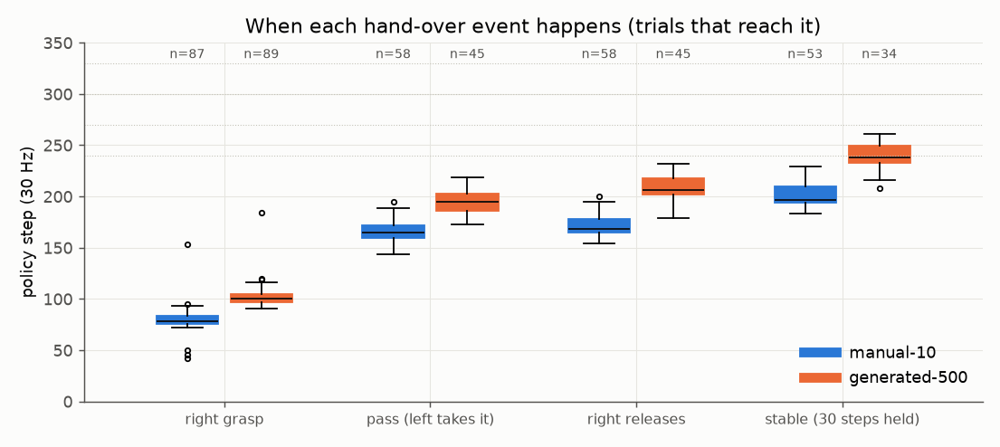
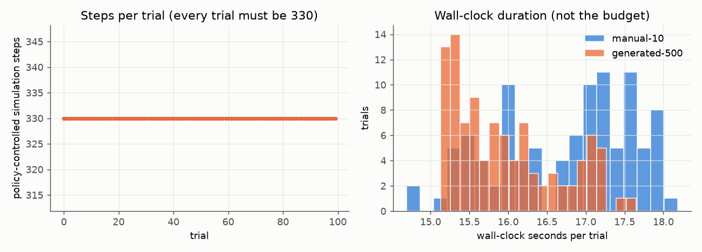

# Model comparison: manual-10 vs generated-500 on the same 100 poses, 330 simulated steps each

Data: `results_manual_10/`, `results_generated_500/` (trials.jsonl + per-step ground truth), `comparison.json`
(all numbers below), `figures/`. Script: `analyze.py`. Labels: CONFIRMED / SUPPORTED HYPOTHESIS / UNKNOWN / DISPROVEN.
"A" = manual-10 (`…sim_smolvla_10_v00@9ce7ce48`), "B" = generated-500 (`…generated_500_smolvla_v00@733c6856`).
One checkpoint (one training seed) per arm: every statement is about these two checkpoints.

## 0. Is the comparison matched? — CONFIRMED

| check (`comparison.json → checks`) | result |
|---|---|
| same pose file (SHA-256 `2b95ecf0…`), same requested pose per trial, same order | yes, 100/100 |
| pose applied (simulator ground truth after the reset) | max error 1.66 mm; A vs B actual start ≤ 2.65 mm apart (settle of the can on landing, trial-specific) |
| every trial complete, exactly 330 policy-controlled steps, contiguous sim-step counter | 200/200 |
| scene resets during a trial | 0 |
| re-homed starts (arm off the start pose before the reset) | 0 (the re-home path never fired) |
| success created by the return home | 0 (A 53 = 53, B 34 = 34 with/without the return) |
| metric 2 recomputation = the task's own stage-3 step | 200/200 |
| gripper-only detector agrees with ground-truth stable hand-over | A 100/100, B 99/100 |
| settings, simulator, git commits | identical; uncommitted code differs only by a README edit (after A started) and the re-home patch (B trials 31–99; inert, see IMPLEMENTATION_AUDIT) |
| inference | latency mean A 134 ms / B 130 ms; RTC guided 32.2 / 32.0 actions per chunk; 0 chunks dropped whole |

## 1. The three metrics

| metric | manual-10 (A) | generated-500 (B) | paired (McNemar exact) | B − A, 95 % CI |
|---|---|---|---|---|
| 1. any-step success (original) | **53** [43, 62] | **34** [25, 44] | both 22, neither 35, only A 31, only B 12; **p = 0.005** | −19 pts [−31, −7] |
| 2. stable hand-over (≥ 30 steps left-only, can up) | **53** [43, 62] | **34** [25, 44] | identical to metric 1 | −19 pts [−31, −7] |
| 3. holding at step 330 | **0** [0, 4] | **33** [25, 43] | only B 33, only A 0; p = 2e−10 | +33 pts [+24, +42] |
| holding at step 240 | 34 | 34 | 25 vs 25 discordant; p = 1.0 | 0 |
| holding at step 270 | 11 | 33 | p = 0.0009 | +22 |
| holding at step 300 | 0 | 33 | p = 2e−10 | +33 |

Wilson 95 % CIs in brackets. 

* **CONFIRMED:** on identical poses and identical simulated time, A succeeds more often than B (53 vs 34, p = 0.005).
  The historical "tie" (49 vs 47) is not reproduced.
* **CONFIRMED:** metric 2 ≡ metric 1 within the policy's 330 steps (the task's predicate *is* a 30-step stable hold;
  recomputed independently, 200/200 agree). The historical gap between them came from the return phase and the
  wall-clock horizon, not from transient one-frame successes.
* **CONFIRMED:** metric 3 separates the models completely: every one of A's 53 hand-overs is lost before step 300
  (last held step median 260, range 233–290; the can ends on the table in 31, on the pad in 22). 33 of B's 34 are still
  held at step 330 (one lost at 243). At step 240 the two are equal (34 vs 34).

## 2. By position

 

| region (n) | A any-step | B any-step | only A / only B | exact McNemar p |
|---|---|---|---|---|
| x < 0.203 (35) | **21** | **1** | 20 / 0 | < 1e−5 |
| 0.203 ≤ x < 0.27 (44) | 20 | 22 | 5 / 7 | 0.77 |
| x ≥ 0.27 (21) | 12 | 11 | 6 / 5 | 1.0 |
| y < −0.01 (31) | 3 | 7 | 3 / 7 | 0.34 |
| −0.01 ≤ y < 0.03 (47) | 36 | 19 | 21 / 4 | 0.0009 |
| y ≥ 0.03 (22) | 14 | 8 | 7 / 1 | 0.07 |

Policy × position (conditional logistic regression on the 43 discordant poses; P(B wins) =
logistic(b0 + bx·x_std + by·y_std)): b0 = −1.09 (p = 0.007), bx = +0.51 per sd of x (p = 0.11), by = −0.94 per sd of y
(p = 0.044); likelihood-ratio test of (bx, by) = 0: **p = 0.008**. Subgroups other than x < 0.203 and the central y band
are too small for significance claims; they are descriptive.

The XY map (any-step): both succeed 22, both fail 35, only A 31, only B 12. "Only A" wins sit near the base
(x < 0.203) and on the robot's centre line; "only B" wins sit at y < −0.01 and x ≈ 0.22–0.31; "both fail" cluster at
y < −0.01. `figures/xy_paired_outcomes_holding_end.png`: the same for metric 3 (only B: 33, everything else both-fail).

* **CONFIRMED:** B collapses near the base: 1/35 at x < 0.203, against 21/35 for A on the same poses (20 discordant
  poses, all in A's favour).
* **DISPROVEN (for these checkpoints):** "B better at 0.203–0.27". Matched: 22 vs 20 of 44 (p = 0.77). Historical: 30/47
  vs 16/46 on different poses.
* **SUPPORTED HYPOTHESIS:** A is weak where its 10 demos have no start (y < −0.01: 3/31) and B is relatively better there
  (7/31); the y interaction is nominally significant (p = 0.044) but rests on 10 discordant poses.

## 3. Where each model fails (simulator ground truth)

| furthest stage | A | B |
|---|---|---|
| no right grasp (gripper never closes on the can) | 13 | 11 |
| right grasp, no pass | 29 | 44 |
| … of which the can never rose > 2 cm | 19 | 40 |
| pass, left never secured it | 5 | 11 |
| stable, lost before step 330 | 53 | 1 |
| stable, held to step 330 | 0 | 33 |

By region, B's x < 0.203 failures: 29 of 34 never lift the can (24 "right grasp, no pass" + 5 "no right grasp") — **the giving hand's grasp fails near the base**, the segment Mimic re-anchors from its sources, where
generation never started an episode. B's x ≥ 0.27 failures are mostly at the pass (8 of 10 "pass, left never secured").
A's failures are mostly grasp failures in the middle band (18 of its 24 mid-band failures never lift the can) and at y < −0.01.

* **CONFIRMED:** the dominant failure is the right-hand grasp/lift, not the pass: the can never rose > 2 cm in A 32 trials (19 + 13 "no
  grasp"), B 50 (40 + 10).
* **Correction to the earlier diagnosis — CONFIRMED:** "both policies fail at the pass (51/51, 51/53)" was largely a
  detector artifact. The gripper-only detector counted a few-frame right-hand "hold" as a grasp: in the historical
  manual run, the 27 episodes at y < −0.01 had a median of 5 right-hold frames, and 19 of 100 had < 5. With the
  simulator's ground truth those are grasp failures. Pass failures exist (A 5, B 11) but are not the main failure.

## 4. Timing

| event (median step, trials reaching it) | A | B |
|---|---|---|
| right grasp | 78 (n 87) | 100 (n 89) |
| pass: left takes it | 164.5 (n 58) | 195 (n 45) |
| right releases | 168 (n 58) | 206 (n 45) |
| stable (30 steps held) | 197 (n 53; 183–229) | 238 (n 34; 208–261) |
| left lets go | 260 (233–290) | — (held to 330 in 33/34) |

* **CONFIRMED:** B is ~40 steps slower at every event, as its data is (DATA_GENERATION_AUDIT). Every B success completes
  by step 261, so the 330-step budget did not cut off any B hand-over that was under way; the old 270–321-step
  wall-clock budget was not what limited B either.
* **CONFIRMED (behaviour), SUPPORTED HYPOTHESIS (cause):** A opens the left hand ~60 steps after completing the pass, at
  steps 233–290 — the length of its demonstrations (210–265). B's demonstrations run to 256–311 and end holding.

## 5. Runtime and step verification

Every trial: exactly 330 steps (11.0 s simulated). Wall-clock per trial 14.7–18.2 s (A, median 17.0), 15.1–17.6 s (B,
median 15.9) — under the old protocol these trials would have been cut at ~290 steps by the 15 s wall clock.

## 6. Against the historical findings

| historical finding (random, unlogged poses; 15 s wall clock; success OR-ed through the return) | matched result | verdict |
|---|---|---|
| any-step success 49 vs 47 (Fisher p = 0.89) | **53 vs 34** (McNemar p = 0.005) | not reproduced: A is better. A 49→53 (p = 0.67), B 47→34 (p = 0.084): B's historical figure was on easier poses or noise |
| A better at x < 0.203 (25/43 vs 6/37) | 21/35 vs 1/35 | **reproduced**, stronger |
| B better at 0.203–0.27 (30/47 vs 16/46, p = 0.007) | 22/44 vs 20/44 (p = 0.77) | **not reproduced** |
| policy × x interaction p = 0.006 | position terms jointly p = 0.008 (x term alone p = 0.11, y term p = 0.044) | position-dependence **reproduced**; its shape is "B fails near the base", not a mid-band advantage |
| both struggle with left-hand retention (fail at the pass) | grasp/lift is the main failure; pass failures A 5, B 11; A loses every completed pass by step 290 | revised: the earlier stage attribution was a detector artifact (§3) |
| end-of-episode holding 3 vs 47 | 0 vs 33 | **reproduced** (horizon effect), now under a fixed 330-step horizon |
| success can be created during the return | 0/200 here | the risk was real in the old code (OR through the return); did not occur |

## 7. Answer to the question

*When evaluation positions and simulated time are controlled, does training on 500 generated demonstrations
improve task success or stable hand-over compared with 10 manual demonstrations?*

**No — for these two checkpoints it makes both worse** (53 → 34, paired p = 0.005, −19 points [−31, −7]). The loss is
concentrated where generation never started an episode (x < 0.203: 21 → 1), there is no measurable gain anywhere else
(0.203–0.27: 20 → 22; x ≥ 0.27: 12 → 11), and the generated model fails more passes (5 → 11). **What it does improve
is holding the can to the end of the episode** (0 → 33 at step 330) — a longer-horizon behaviour copied from its longer
demonstrations, not a better hand-over: at step 240 both hold 34.

Caveats: one training seed per arm (generated_400 scored ~61/100 historically, so checkpoint-to-checkpoint variance is
large — UNKNOWN here); 100 poses; the pose file's x-proportions differ somewhat from the historical starts (35 % vs
~40 % at x < 0.203).
