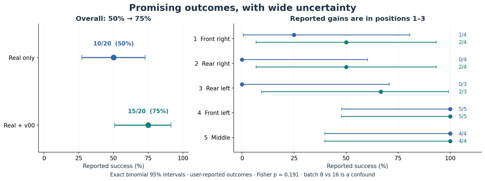
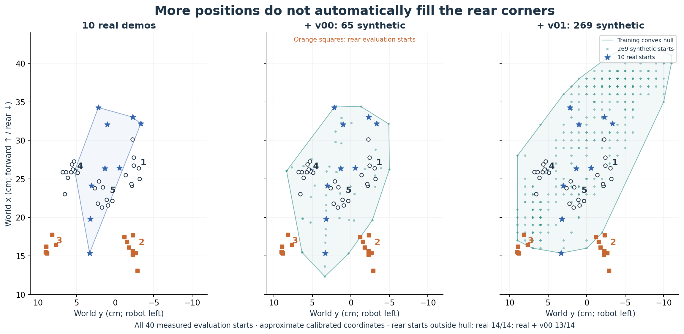
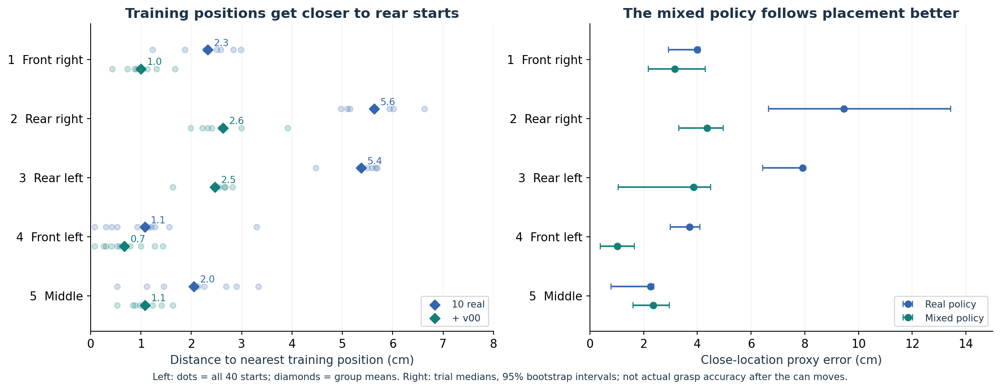
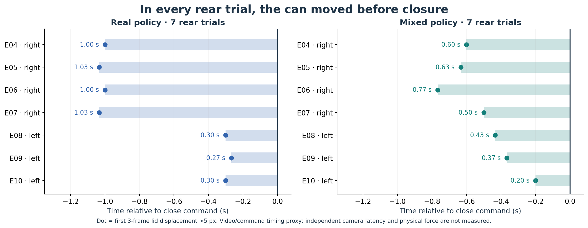
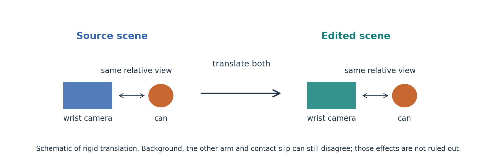
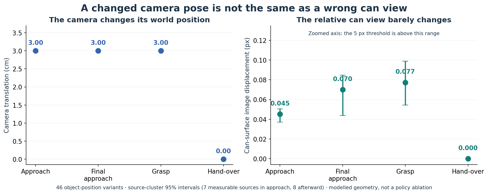
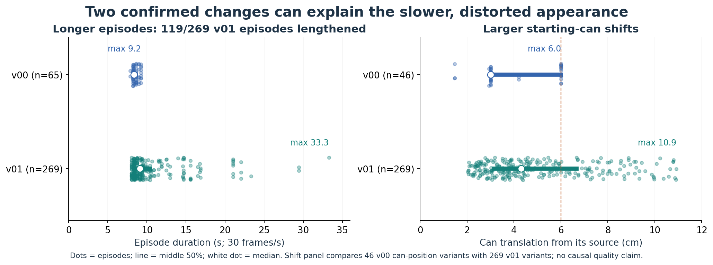
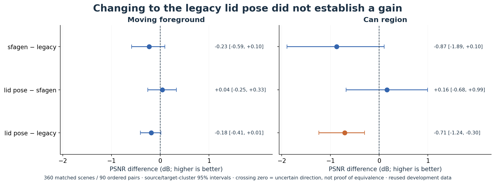
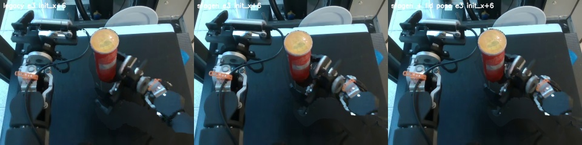

# v00 rollout diagnosis — 2026-11-12

**[Open the visual report →](index.html)** — charts, plain-language explanations,
all 40 rollout contact-sheet rows selectable by position/policy, and matched
renderer comparisons. This page keeps the detailed technical record. Figures
are also available as exportable PNG and SVG in [charts](charts).

**Finding:** sparse rear-corner coverage and movement of the can before closure
are supported by these rollouts. A direct mismatch between the copied right-wrist
can image and the translated grasp is **not supported by the kinematic audit**.
Whether copying other wrist content affects the learned policy remains unknown.

Scope: Step 1 only, based on `efda1cbe4b2e896aacb92bac34b788a91433b8d5`
plus the local analysis tools. No training, robot operations, publication or
changes to frozen study code. Protocol: [PROTOCOL.md](PROTOCOL.md), SHA-256
`b6e3d2b4aeaf6f415efe5f033f44a36d8372a585b8cca486d3fa9551d603a045`.

## Inputs and evidence boundaries

| Dataset | Exact Hub commit | Episodes |
|---|---|---:|
| real-policy evaluation | `de1bbf51fdac10218dd5602260ad65dd9da2aca5` | 20 |
| mixed-policy evaluation | `af877eb5294e1e747a0eee113e824bf888bd625e` | 20 |
| training mixture v00 | `13d7231a48866069001f4a0635259dd7d80b1e17` | 10 real + 65 synthetic |
| v01 target provenance | `1d64b8e7aeed7585b54c776f6b60e26610b37947` | 269 synthetic |

Repositories are `ethanCSL/eval_openarm_pringles_lerobot_real_smolvla_10_v00_async_rtc_smolvla_v00`,
`ethanCSL/eval_openarm_pringles_lerobot_real_and_sim_10_3cam_async_rtc_smolvla_v00`,
`ethanCSL/openarm_pringles_lerobot_real_and_sim_10_3cam_v00`, and
`ethanCSL/openarm_pringles_lerobot_real_to_sim_10_3cam_v01`, respectively.
**`13d7231a` belongs to the mixture repo, not the synthetic-only repo.**
All 130 synthetic state/action hashes match the pinned provenance.

The Hub evaluation files contain **40/40 null success labels**. Outcomes below
are the user's aggregate reports, not independently rescored trial labels:



**Read the chart:** gains are concentrated in positions 1–3, but the confidence
intervals are wide. The exposure and placement confounds below prevent a causal
interpretation of the +25 percentage-point difference.

| Placement | Trials per model | Real | Mixed |
|---|---:|---:|---:|
| 1 front-right | 4 | 1/4 | 2/4 |
| 2 rear-right | 4 | 0/4 | 2/4 |
| 3 rear-left | 3 | 0/3 | 2/3 |
| 4 front-left | 5 | 5/5 | 5/5 |
| 5 middle | 4 | 4/4 | 4/4 |
| Total | 20 | 10/20 | 15/20 |

Exact binomial 95% CIs: real **27.2–72.8%**, mixed **50.9–91.3%**;
two-sided Fisher **p = 0.19079**. The +25 percentage-point difference is
descriptive. Batch 8 versus 16 at the reported same 20k updates doubles sample
exposure; placements also differ within groups. This does not isolate the effect
of augmentation or wrist views. Evaluation checkpoint hashes are not established.

## Coverage and closure



**Read the maps:** orange squares mark rear starts. More synthetic positions do
not guarantee coverage of those corners. The shaded hull is geometric support,
not a measured policy success boundary. [Original coverage map](coverage.png).



**Read the charts:** adding v00 reduces distance to training starts (left), and
the mixed policy follows rear placements better (right). These are different
measurements; the close-location proxy is not grasp accuracy after the can moves.

All 40 initial lid detections and all 40 six-event body-camera contact-sheet rows
were visually inspected. Coordinates use one calibrated camera and a common
lid plane at z = 42.97 cm (table 19.97 cm + can 23 cm); x is forward and y is
robot-left. v00 points use exact export lid projections, checked against real
source detections; v01 points use its cached fitted pose plus published shifts.
Those reconstructions have calibration error: these are approximate placements,
not a surveyed arena. ±5 px and ±1 cm lid height changes initial x/y by at most
0.61–1.19 cm across trials; that is sensitivity, not a calibrated confidence bound.

| Rear placement/model | n | Mean nearest real / +v00 position (cm) | Median close-location error, cm [95% CI] | Can motion before close (s, range) |
|---|---:|---:|---:|---:|
| right, real | 4 | 6.0 / 3.0 | 9.45 [6.65, 13.43] | 1.00–1.03 |
| right, mixed | 4 | 5.3 / 2.2 | 4.35 [3.31, 4.96] | 0.50–0.77 |
| left, real | 3 | 5.5 / 2.6 | 7.92 [6.44, 7.93] | 0.27–0.30 |
| left, mixed | 3 | 5.3 / 2.3 | 3.86 [1.05, 4.49] | 0.20–0.43 |

Close-location error measures TCP relative to the **initial** can placement,
after subtracting the ten-source median TCP–can offset (−2.58, +4.16 cm).
It is a placement-following proxy, not instantaneous grasp accuracy after the can
has tilted or moved. Source offset residual is itself median 0.97 cm; rotating
the offset with the TCP changes rear medians to 9.14/5.70 cm (right) and
7.46/4.84 cm (left), preserving the direction but showing model sensitivity.
Intervals bootstrap trials, 2,000 draws, seed 0; very small groups remain uncertain.

**Coverage finding: reproduced.** All 14 rear starts lie outside the ten-real
convex hull; 13/14 also lie outside real+v00's hull. The +v00 nearest-neighbour
distances are substantially smaller. Front-left starts average only 0.6–1.5 cm
from a real source. The v01 target map is wider, but still leaves many measured
rear starts outside its hull; wider target count alone is not uniform coverage.



**Read the chart:** every dot is before the 0 s close-command line. Each row is
one trial; image motion is not a physical-force measurement.

**Timing finding: reproduced as an image/command proxy.** All 14 rear trials
have three consecutive lid displacements >5 px before the first right-gripper
action crossing below 0.5 openness. The sheets show leaning/pushing in the
rear-right trials and missed/off-centre approaches in the real-only rear-left
trials. Occlusion is treated as missing, never as motion. Mixed rear-right
approach-to-close delay is median 0.68 s [0.60, 0.70], n=4. The real policy never
enters the registered approach region in 6/7 rear trials, so its delay is mostly
undefined rather than zero. Commands close at 2.57–3.10 s (real) and 2.47–3.07 s
(mixed), despite differing starts. This supports insufficient spatial adaptation
and contact-aware timing; it does not prove a particular learned timing cause.

Action/state crossing, receiver closure and giver release are saved per trial.
Four mixed rear-right episodes have no measured-state crossing of the same 0.5
threshold; a grasped can can prevent full finger closure, so this is not evidence
of a stuck actuator. A command hand-over sequence is not proof of a successful
physical transfer. See [rollouts.csv](rollouts.csv), [rollouts.json](rollouts.json)
and the ten per-position sheets in [sheets](sheets).
Times use the recordings' 30 Hz alignment; independent live camera/actuator
latency was not calibrated in these evaluation sessions.

## Copied wrist views

**Copying: reproduced.** Nine deterministic source/synthetic grasp-frame checks
score **39.5–43.0 dB** against the mapped source RGB and look identical apart from
encoding. See [wrist_copied_rgb.jpg](sheets/wrist_copied_rgb.jpg).
Right-wrist validity is zero in **59.8% of all synthetic frames** (frame-weighted).

For the **46 object-position variants**, calibrated FK gives:





**Read the charts:** the camera moves in centimetres while the relative can
image moves by a fraction of a pixel. The panels deliberately use different
units. The right panel is zoomed; the 5 px threshold is above its axis range.
This is a geometric proxy, not a controlled test of policy behaviour.

| Phase | Median camera translation (cm) | Median modelled can-surface displacement (px) | Frames with measurable surface / phase frames |
|---|---:|---:|---:|
| approach | 3.00 | 0.045 [0.037, 0.050] | 404/1,202 |
| final approach | 3.00 | 0.070 [0.044, 0.085] | 1,365/1,365 |
| grasp ±5 frames | 3.00 | 0.077 [0.054, 0.099] | 506/506 |
| hand-over ±5 frames | 0.00 | 0.000 | 506/506 |

Pixel statistics are medians of episode medians; 95% CIs resample source demos,
not their correlated descendants (7 sources measurable in approach, 8 thereafter).
No measurable object-variant frame exceeds the 5 px discrepancy threshold in
these phases. All 506 grasp frames nevertheless have invalidity flags. The flags
measure changed whole-scene geometry, which is different from can-relative error.
Hand-over-location variants move the camera about 5 cm during hand-over, while
the held-can relative geometry again cancels under the rigid attachment model.

**Interpretation:** the planner translates the reach and can together while
preserving wrist orientation. Their relative transform therefore barely changes
near the grasp. This makes direct wrist–can inconsistency an unsupported primary
explanation for late closure in these v00 rollouts. Static table/background,
the opposite arm and the blend/rejoin can still be wrong in copied wrist images.
The calculation uses a calibrated proxy cylinder and assumes rigid attachment
after close+8; it does not validate slip, can tilt at contact or every RGB pixel.
Only a matched copied/rendered/masked-wrist policy ablation can establish causality.
Full phase rows, assumptions and source-cluster intervals are in
[wrist.json](wrist.json) and [wrist_frames.csv](wrist_frames.csv).

## Why v00 appears less distorted

The pinned v01 provenance independently confirms **119/269 episodes (44.2%)**
are lengthened, with time scales 1.25–6× and episode lengths 241–998 frames;
v00 is 236–277 frames. v01's median/max can shift is **4.30/10.91 cm** versus
v00's 3/6 cm can-position variants. v00 includes 9 timing and 10 hand-over-location
variants; v01's 269 episodes vary starting object position only. Fixed episode
length is different from v00's internal timing-variant source-frame warps.



**Read the distributions:** v01 contains longer episodes and larger shifts.
These confirmed differences plausibly affect appearance; they do not identify
a single causal quality defect.

**Matched render comparison: executed.** The central frame at each of R1's four
phases was rendered for all 90 ordered demo pairs: **360 scenes per method**.
Target joints, source frame and scoring masks match between methods. Fourteen
existing ±6 cm variants were also rendered three ways with the same source frame,
target joints and physical shift; these have no target RGB ground truth.

| Method | Moving-foreground PSNR (dB) | Can-region PSNR (dB) |
|---|---:|---:|
| legacy v00 pipeline | 16.32 | 14.21 |
| sfagen, own can pose | 16.09 | 13.34 |
| sfagen, legacy lid-track can pose | 16.13 | 13.50 |



**Read the intervals:** a line crossing 0 dB has an uncertain direction. The
lid-pose substitution does not establish an improvement over ordinary sfagen;
its can-region score remains below legacy. Negative results remain in the report.

Source/target-episode cluster bootstrap, 2,000 draws:

- sfagen minus legacy: **−0.23 dB [−0.59, +0.10]** overall;
  **−0.87 [−1.89, +0.10]** on the can.
- Lid-pose substitution minus ordinary sfagen: **+0.04 [−0.25, +0.33]** overall;
  **+0.16 [−0.68, +0.99]** on the can. **No established improvement.**
- The substituted version remains **−0.71 [−1.24, −0.30] dB** below legacy
  on the can ROI. Preserve this negative finding; do not adopt the substitution
  on the assumption that it is better.



Left to right: legacy / sfagen / sfagen with legacy lid pose. All three still
show some arm/gripper fragmentation. The original R1 gate and 1,080-frame result
remain unchanged: this is a **360-frame diagnostic subset on reused development
demos**, not a new untouched test. The overall mask uses image foreground; the
can ROI follows the original target reconstruction. Legacy versus sfagen also
differs in masks, camera calibration and video/state lag, so it does not isolate
renderer code alone. Pose substitution holds the sfagen components fixed and
replaces both source and target can poses, converting legacy lid/downward-axis
coordinates to sfagen base/upward-axis coordinates.

**Appearance conclusion:** smaller shifts and shorter, undilated episodes are
confirmed differences that plausibly explain the user-visible advantage of v00.
This comparison supplies no clear overall renderer winner and no demonstrated
lid-pose fix. Retain the smaller shifts/fixed-duration design; keep pose choice
conditional rather than presenting the legacy tracker as a proven improvement.
Raw scores, code identity and side-by-side images are in
[render/summary.json](render/summary.json), [render/frames.json](render/frames.json)
and [render](render).

## Reproduce and next decision

From the repository root, using the existing environment:

Rebuild **only the charts and local HTML** from saved results (CPU, no network,
no experiment rerun):

```bash
env -u PYTHONPATH -u LD_LIBRARY_PATH .venv/bin/python -B research/sim_free_augmentation/sfagen/tools/visualize_eval_v00.py
```

The original diagnostic commands are below; they are not needed to read or
rebuild the visual report:

```bash
env -u PYTHONPATH -u LD_LIBRARY_PATH .venv/bin/python -B research/sim_free_augmentation/sfagen/tools/rollout_report.py --fetch
env -u PYTHONPATH -u LD_LIBRARY_PATH HF_HUB_OFFLINE=1 .venv/bin/python -B research/sim_free_augmentation/sfagen/tools/eval_v00_wrist.py
env -u PYTHONPATH -u LD_LIBRARY_PATH HF_HUB_OFFLINE=1 OMP_NUM_THREADS=2 MKL_NUM_THREADS=2 .venv/bin/python -B research/sim_free_augmentation/sfagen/tools/eval_v00_render.py cuda:0
env -u PYTHONPATH -u LD_LIBRARY_PATH .venv/bin/python -B -m unittest discover -s research/sim_free_augmentation/sfagen/tests -v
```

The render command runs only this bounded diagnostic and requires the existing
source, lid-track and mask caches. It fails rather than regenerating legacy SAM
masks. Input hashes and exact revisions are in [run_meta.json](run_meta.json);
renderer code hashes are in [render/run_meta.json](render/run_meta.json).
Validation: all **43 CPU unit tests passed**, including five new diagnostic
checks; all 40 body episodes decoded at their declared lengths. All ten body
contact sheets and the copied-wrist sheet were inspected. All ten saved matched
render sheets and fourteen ±6 cm comparisons were also visually inspected; this
does not mean every one of the 360 rendered scenes was viewed manually.
Literature motivation is recorded in [LITERATURE.md](LITERATURE.md), including
[DemoGen](https://arxiv.org/abs/2502.16932) and
[WARP-VLA](https://arxiv.org/abs/2610.11508). They motivate measurements, not a
causal verdict about this policy. The Notion Operating Guide/current-state pages
were read as context; no Notion edits were made.

**v02 decision:** prioritise measured rear-corner targets and fixed-duration
trajectories. Preserve a matched wrist comparison as an experimental control;
do not label wrist rendering as the established cure for late grasp. A new policy
evaluation needs matched batch/sample exposure and randomised measured placements.
This report completes diagnosis only; Step 2 generation has not started.
