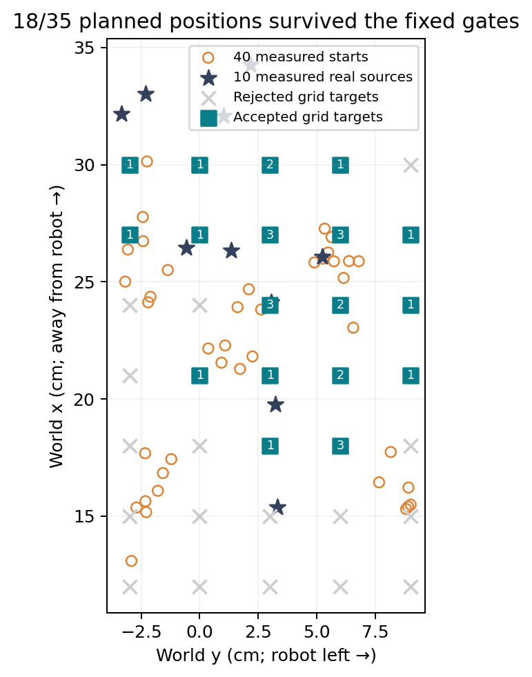
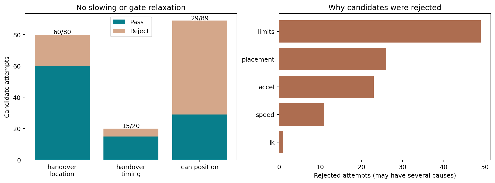
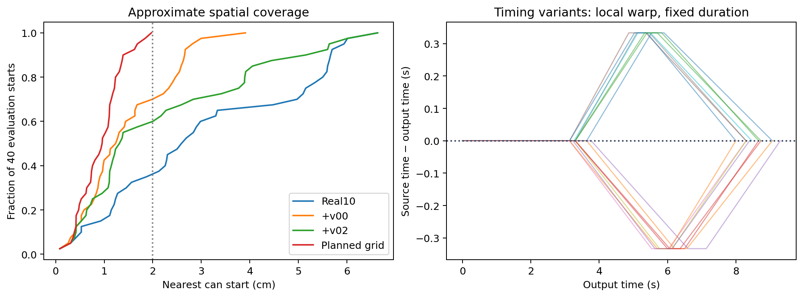
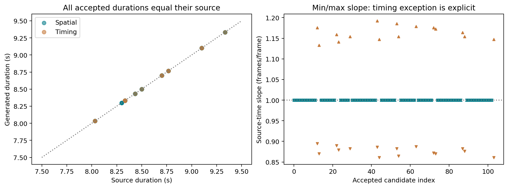

# v02 results — local, uncommitted

The bounded Step 2 batch completed generation with 104/189 passing candidates, but **only 18/35 arena grid positions survived**.
It does not establish full rear-arena coverage or policy improvement. [Visual report](index.html).

| Family | Accepted / attempted |
|---|---:|
| interaction_location | 60 / 80 |
| interaction_timing | 15 / 20 |
| object_position | 29 / 89 |

Coverage of the same 40 prior measured starts: 24/40 within 2 cm; median nearest distance 1.34 cm;
worst 6.63 cm, versus v00 3.91 cm. These are approximate geometric proxies from reused development/evaluation recordings.
The model-fitted source positions differ from the measured positions by 0.39–2.10 cm. No new held-out policy evaluation occurred.

Thirty rejected spatial attempts exceed original right-joint-6 action bounds by up to 0.97°. They were neither clipped
nor admitted; remaining necessary/full gates were not all evaluated after early rejection. [Exact records](rejected_joint_limits.json).

All 104 accepted candidates pass independent fixed-duration, monotone clock, endpoint, spatial-unit-slope,
original-source state/action-limit and nominal-label checks. The approved ±10-frame timing exception changes local
slope while keeping the initial grasp clock and unit-slope handover interval. The existing F1/F2 planners are unchanged.

## Local exports and quality

Each condition has 104 synthetic episodes / 26,781 frames and a separate mixture of 10 real + 104 synthetic episodes
/ 29,356 frames. Conditions differ only in right-wrist image reconstruction and associated wrist-validity flags.
104/104 episodes match on candidate IDs, state/action hashes, body fingerprints and wrist source clocks: PASS.

Quality status: copied: PASS; right_wrist: PASS. The independent export checks compare labels, flags and exact original/synthetic MP4 bytes.
53 CPU tests pass. Full verifier passes for both conditions, including 312 boundary/midpoint samples each.
The default TorchCodec backend additionally loads real, first-synthetic and final mixed frames with 50-action chunks in each condition.

| Condition | Max speed / real | Max acceleration / real | Max jerk / real (reported) | Body codec PSNR (dB) | Min sampled rendered-wrist codec PSNR (dB) | Gate |
|---|---:|---:|---:|---:|---:|---|
| copied | 1.226 | 1.408 | 1.917 | 43.41 | copied | PASS |
| right_wrist | 1.226 | 1.408 | 1.917 | 43.41 | 39.1906517831824 | PASS |

Thresholds remain speed ≤1.25×, acceleration ≤1.5×, decoded body/rendered-wrist PSNR ≥30 dB; all other original gates remain.
Jerk is descriptive, not an added acceptance gate. Codec PSNR compares decoded video to generated RGB, not physical truth.
The inspected images show wrist texture/background warping and body fill artifacts. The previously failed Pringles wrist
fidelity gate remains a limitation. Kinematic consistency does not establish contact force, physical replay or task success.

## Evidence and reproduction

[Protocol](PROTOCOL.md) · [Frozen hashes](FREEZE.json) · [Packaging-only amendment](PACKAGING_AMENDMENT.md) ·
[Runtime/source assets](SOURCE_ASSETS.json) · [All machine-readable results](summary.json) · [Literature](LITERATURE.md).
Chart PNG/SVG files are exportable; annotated examples are in examples/, and 10 decoded sheets per condition are saved in quality_*/sheets/.
Use the branch root README for exact commands. Failed temporary mixture outputs are retained; no gates were loosened.
No training, robot/CAN, physics, commits, pushes or dataset uploads were performed.

- copied dataset: [/home/stanley/Stanley_ws/lerobot_openarm/artifacts/sfagen_v02_run/copied/dataset](/home/stanley/Stanley_ws/lerobot_openarm/artifacts/sfagen_v02_run/copied/dataset)

- copied dataset_mixed: [/home/stanley/Stanley_ws/lerobot_openarm/artifacts/sfagen_v02_run/copied/dataset_mixed](/home/stanley/Stanley_ws/lerobot_openarm/artifacts/sfagen_v02_run/copied/dataset_mixed)

- right_wrist dataset: [/home/stanley/Stanley_ws/lerobot_openarm/artifacts/sfagen_v02_run/right_wrist/dataset](/home/stanley/Stanley_ws/lerobot_openarm/artifacts/sfagen_v02_run/right_wrist/dataset)

- right_wrist dataset_mixed: [/home/stanley/Stanley_ws/lerobot_openarm/artifacts/sfagen_v02_run/right_wrist/dataset_mixed](/home/stanley/Stanley_ws/lerobot_openarm/artifacts/sfagen_v02_run/right_wrist/dataset_mixed)
