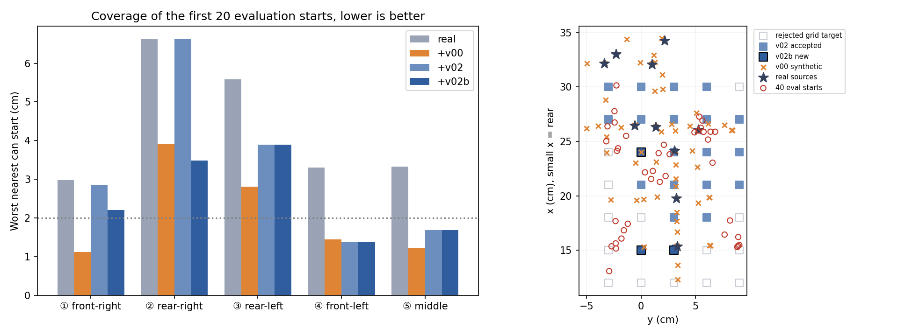
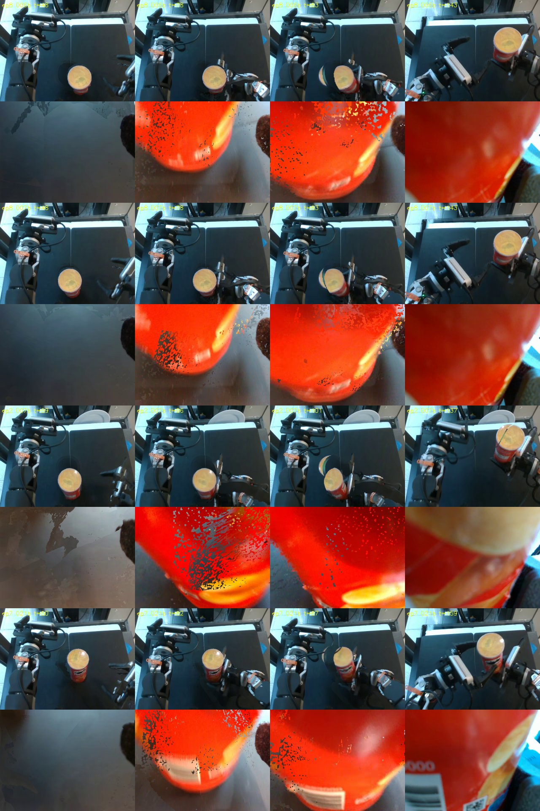

# v02b results: rear-row rerun with action-aware IK bounds (local, uncommitted, 2026-11-13, Claude)

Protocol: [PROTOCOL.md](PROTOCOL.md) (frozen before generation, [FREEZE.json](FREEZE.json); all 52 frozen hashes still
match). Audit that motivated it: [../v02/AUDIT_CLAUDE.md](../v02/AUDIT_CLAUDE.md). This is a development rerun informed
by v02's rejections, not an untouched test.

## Outcome

**4/35 new attempts pass**, at 3 new grid targets: 006 (15, 0) cm from source 8; 007 (15, 3) cm from sources 2 and 8;
021 (24, 0) cm from source 7. The stop rule (≥ 1 pass with x ≤ 15 cm) was met.

| Rejection cause, 35 attempts | n |
|---|---:|
| `limits` (v02: 30 on the same targets) | **0** |
| placement total | 23 |
| ↳ can leaves body-camera view (`in_view`) | 11 |
| ↳ robot points enter the can box (`robot_near`) | 14 |
| ↳ plate appearance (`on_table`) | 7 |
| acceleration and/or speed (1 also IK) | 8 |
| pass | 4 |

Placement sub-causes overlap. The flag removed every joint-limit rejection. The remaining failures are geometric:
- the x = 12 cm row puts the can outside the body camera's view;
- other targets make the reach pass through the can's footprint, or exceed the dynamics envelope.

None of these gates was changed.



| Worst nearest can start (cm) | ① front-right | ② rear-right | ③ rear-left | ④ front-left | ⑤ middle | all 40 | within 2 cm |
|---|---:|---:|---:|---:|---:|---:|---:|
| real | 2.98 | 6.63 | 5.59 | 3.30 | 3.33 | 6.63 | 14/40 |
| +v00 | 1.12 | 3.91 | 2.81 | 1.44 | 1.23 | 3.91 | 28/40 |
| +v02 | 2.84 | 6.63 | 3.90 | 1.37 | 1.68 | 6.63 | 24/40 |
| **+v02b** | 2.21 | **3.49** | 3.90 | 1.37 | 1.68 | 3.91 | 24/40 |

- ② rear-right improves from 6.63 to 3.49 cm, now better than v00's 3.91 cm.
- ③ rear-left is unchanged at 3.90 cm and still worse than v00's 2.81 cm: its targets around (15–18, 6–9) cm were
  rejected on placement.
- v00 still has more starts within 2 cm (28 vs 24). These are approximate geometric proxies
  ([coverage.json](coverage.json)), not policy evidence.

## Exports (local)

Each wrist condition has 108 synthetic episodes / 27,820 frames, plus a mixture of 10 real + 108 synthetic =
118 episodes / 30,395 frames. That is v02's 104 episodes unchanged plus the 4 new ones.

| Check | copied | right_wrist |
|---|---|---|
| `sfagen verify` | PASS | PASS |
| `tools/quality_report.py` gates | PASS | PASS |
| Max speed / accel vs real | 1.226 / 1.408 (≤ 1.25 / 1.5) | same |
| Body decoded-vs-rendered PSNR | 43.43 dB (≥ 30) | 43.43 dB |
| Right-wrist validity fraction | 0.43 | 0.91 (rendered) |
| Independent audit ([exports_check.json](exports_check.json)) | 0 envelope violations, 0 duration mismatches, 0 real copies, mixture synthetic = synthetic-only | same |
| CPU load test, 50-action chunks | OK | OK |

Datasets:
- `artifacts/sfagen_v02b_run/copied/{dataset,dataset_mixed}` (repo-id `..._real_to_sim_10_3cam_v02b`)
- `artifacts/sfagen_v02b_run/right_wrist/{dataset,dataset_mixed}` (`..._wristrender_v02b`)

Nothing was uploaded.

## Visual inspection



- The can appears at the new rear positions, and the lift frames look clean.
- At the grasp frame, the body camera shows a **ghost lid crescent** beside the can.
- The rendered right wrist shows **grey/black speckle holes** on the can during approach.
- Both are the known renderer artifact types from v02. Codec PSNR measures encoding only, not realism.

## Code change and reproduction

- `sfagen/plan.py`: `_retarget(..., action_bounds)`, `f1_plan(..., action_bounds)`.
- `sfagen/generate.py`: passes the config flag `plan.action_aware_bounds` (default off = v02 behaviour).
- `sfagen/target_plan.py`: optional `indices` and `id_suffix`.
- Test: `tests/test_workspace_legacy_actions.py` checks that the label stays inside the envelope, that an unreachable
  target shows as IK error, and that a zero shift is bit-identical. 53/53 tests pass.

```bash
PY="env -u PYTHONPATH -u LD_LIBRARY_PATH HF_HUB_OFFLINE=1 $HOME/Stanley_ws/lerobot_openarm/.venv/bin/python -B"
R=$HOME/Stanley_ws/lerobot_openarm/artifacts/sfagen_v02b_run
$PY -I $R/make_configs.py                                   # configs from the frozen v02 configs
$PY -m sfagen generate configs/openarm_pringles_v02b_gen.yaml --device cuda:0
$PY -I $R/merge_workdirs.py                                 # v02 work dirs (read-only renders) + new candidates
K=can_target_006b,can_target_007b,can_target_021b
$PY -m sfagen render configs/openarm_pringles_v02b.yaml --device cuda:0 --episodes 2,7,8 --keys $K
$PY -m sfagen render configs/openarm_pringles_v02b_wristrender.yaml --device cuda:0 --episodes 2,7,8 --keys $K
$PY -m sfagen build configs/openarm_pringles_v02b.yaml --device cuda:0 \
  --repo-id ethanCSL/openarm_pringles_lerobot_real_to_sim_10_3cam_v02b \
  --mixed-repo-id ethanCSL/openarm_pringles_lerobot_real_and_sim_10_3cam_v02b
# (same with _wristrender_v02b and the wristrender config) then: sfagen verify, tools/quality_report.py,
$PY -I results/v02/audit_claude/check_exports.py $R configs/openarm_pringles_v02b.yaml; $PY results/v02b/make_report.py
```

Total GPU time was about 40 min: generation ~6 min, render ~3 min, build/verify/quality ~30 min.

## Limitations

- Coverage is a development-informed geometric proxy. No policy was trained or evaluated.
- ③ rear-left and the x = 12 cm row stay uncovered.
- The renderer artifacts above remain. The right-wrist render is an ablation, and the earlier Pringles wrist-fidelity
  gate failed.
- Commands are nominal kinematics. Nothing here validates contact force or hardware replay.
