# How the synthetic OpenArm data is made: a stage-by-stage visual guide

**What this is.** A walkthrough of the pipeline (`sfagen`, commit `50832b3`) that produced the two published synthetic datasets:
- [`openarm_pringles_lerobot_real_to_sim_10_3cam_v00`](https://huggingface.co/datasets/ethanCSL/openarm_pringles_lerobot_real_to_sim_10_3cam_v00) @ `30533e67`;
- [`openarm_insertbattery_lerobot_real_to_sim_10_3cam_v00`](https://huggingface.co/datasets/ethanCSL/openarm_insertbattery_lerobot_real_to_sim_10_3cam_v00) @ `c3c571d0`.

**Update 2026-11-12 (v01, branch `research/sfagen-wrist-render`).** Stages 1–6 describe the v00 pipeline. Stages 7–9
add the latest method:
- re-rendered wrist cameras;
- an 11 cm object-shift limit;
- generation from 1, 2, 4 or 10 real demos.

The decisions log (Stage 9) records what was tried, the result, and why each choice was made. v01 datasets:
`ethanCSL/openarm_pringles_lerobot_real_to_sim_{1,2,4,10}_3cam_v01` (copied wrists with flags) and
`..._{1,2,4,10}_3cam_wristrender_v01` (rendered-wrist ablation).

**Where the images come from.** Every image here was computed from the real source data, the saved pipeline caches, and the published files. Nothing is drawn by hand or illustrative. Where an image required new computation, the run is logged in `diagnostics/run_*.json`; see "How these figures were made" at the end.

**How to view it.**
- Open [`index.html`](index.html) for the same content as one page with playable videos.
- Exact equations and code: [`TECHNICAL_PIPELINE_REFERENCE.md`](TECHNICAL_PIPELINE_REFERENCE.md).
- Numbers: [`STAGE_TIMINGS_AND_METRICS.csv`](STAGE_TIMINGS_AND_METRICS.csv).
- Weaknesses: [`RESEARCH_LIMITATIONS.md`](RESEARCH_LIMITATIONS.md).

## The original five-block slide, and what each block is now

```
Real demonstrations → Segmentation → Keypoints → Video generation → VLA dataset
```

| slide block | what the current pipeline actually does |
|---|---|
| Real demonstrations | 10 real teleoperated episodes per task: 16-D joint state/action + 3 cameras (body, left wrist, right wrist) |
| Segmentation | **SAM2.1** finds the two robot arms in every body-camera frame. Its prompts are drawn automatically from the robot's 3-D model; no human clicks. Objects are found differently: as "what disappears when it is picked up". |
| Keypoints | **No longer image keypoints.** The robot's 3-D pose is known exactly from its joint angles (forward kinematics) once the camera is calibrated, and objects are fitted with simple 3-D shapes. The old optical-flow keypoints (RAFT) were used only in the historical v1/v2 prototypes, and only to measure quality; see Stage 2. |
| Video generation | **New trajectories** (a moved object or a moved hand-over/insertion point; joint angles from inverse kinematics; replay-safety checks). Then the **body-camera video is re-rendered** by moving the real pixels of the robot and objects in 3-D. No image-generation AI, no simulator. |
| VLA dataset | LeRobot v3.0 datasets with three cameras. **Only the body camera is synthetic**; both wrist videos are the original real frames, with a validity flag. |

## Representative examples used throughout

| task | real source | published synthetic episode | what changed |
|---|---|---|---|
| Pringles hand-over | `real_10_v00` episode **0** (273 frames) | episode **6**, `interact_x+5_y+0_z+0` | the whole hand-over (both hands and the can) happens **5 cm further in +x** |
| Battery insertion | `real_10_v02` episode **1** (776 frames) | episode **14**, `battery_x+6_y+0` | the battery starts **6 cm further in +x**; the right arm reaches for it there |

---

## Stage 1: Segmentation (where are the robot arms and the objects?)

| | |
|---|---|
| **Input** | the real body-camera video; the robot's joint angles; the calibrated camera (Stage 3) |
| **Model / algorithm** | SAM2.1 (`facebook/sam2.1-hiera-small`, revision `ee5bba1d`, bfloat16, HF transformers) for the **arms**. Objects use plate difference + a fitted 3-D proxy (**not SAM2**). |
| **Why it is needed** | To move the robot in the picture, we must know exactly which pixels belong to which arm and object, and what the table looks like underneath them. |
| **What it computes** | Every 15 frames, the robot model is projected into the image. Each arm's outline becomes a "mask prompt" for SAM2, which then tracks the arm through the video in 150-frame pieces. Objects: compare the first frame with the scene after the object was picked up; what disappeared is the object. |
| **Output** | per-frame left-arm, right-arm and object masks; a clean background image ("plate") |
| **Runtime / memory** | SAM2: 14 s for 273 frames (Pringles), 31 s for 776 frames (battery), including model load; peak 4.6 GB GPU. Measured by a diagnostic re-run. |
| **Measured quality** | **No hand-labelled masks exist, so no accuracy, mIoU or Dice can be reported.** What we can measure: agreement with the projected robot model (median IoU, R/L) — Pringles 0.65/0.72, battery 0.82/0.57. Frame-to-frame stability: median IoU 0.91–0.98. A re-run reproduces the cached masks exactly (IoU 1.000). |
| **Failure cases** | Masks jump at the 150-frame chunk restarts (battery left arm: area 60k → 25k pixels at frame 150). The mask leaks over the table (battery frame 125). Fingers are lost near the insertion (battery frame 452). |
| **Code** | [`segment.py`](../sfagen/sfagen/segment.py), [`recon.py::_segment_object`](../sfagen/sfagen/recon.py#L201), [`recon.py::_masks`](../sfagen/sfagen/recon.py#L367) |
| **Visuals** | below; videos `stage_01_segmentation/*_segmentation_overlay.mp4` |

**Panels:** A real frame → B automatic prompt from the robot model → C/D SAM2 left/right-arm masks → E object mask → F final overlay. The bottom row shows how the object is found.

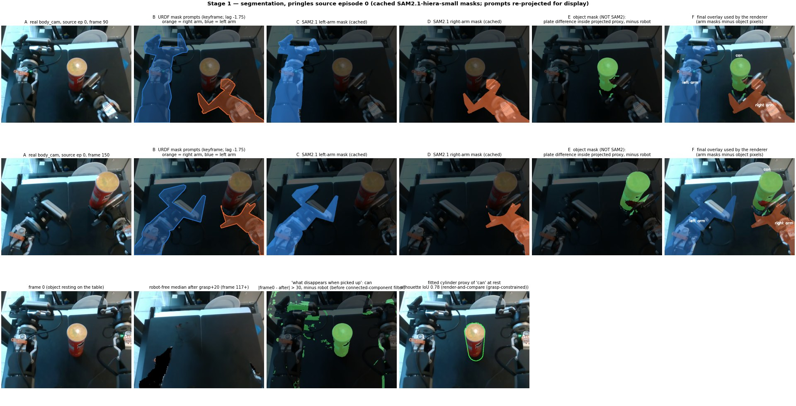
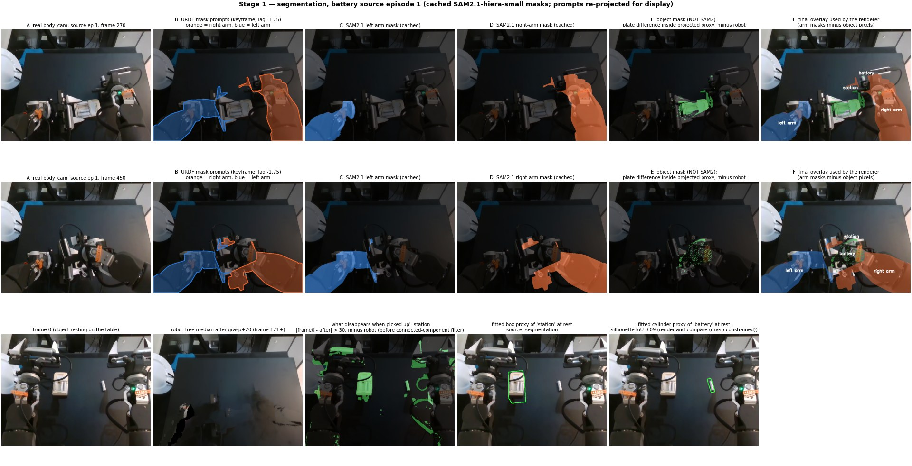

**Stability over time.** Dashed lines are the 150-frame chunk boundaries, where the masks visibly jump.

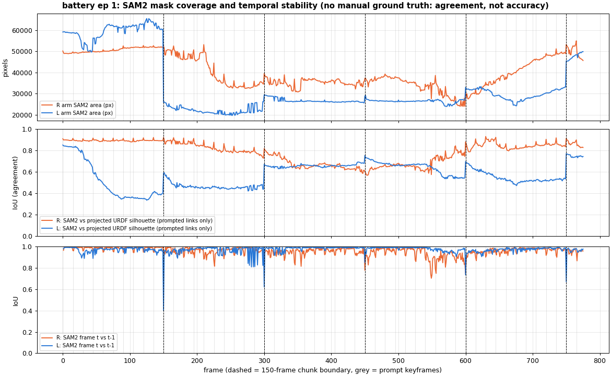
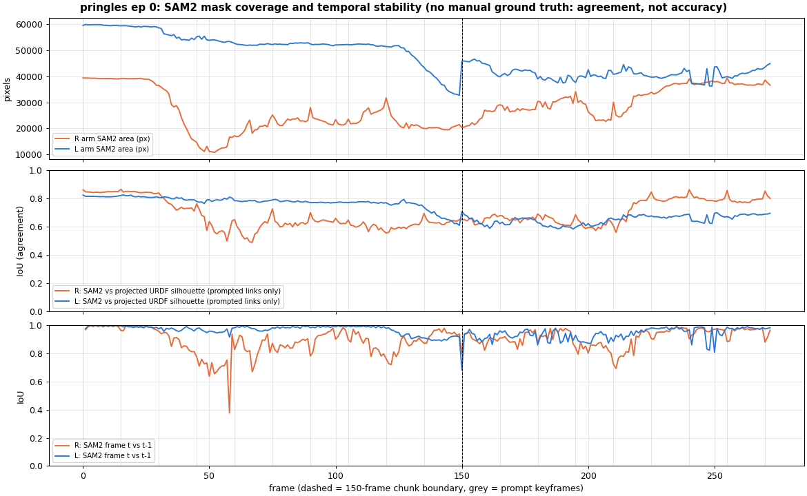

**Worst frames** (automatically selected):

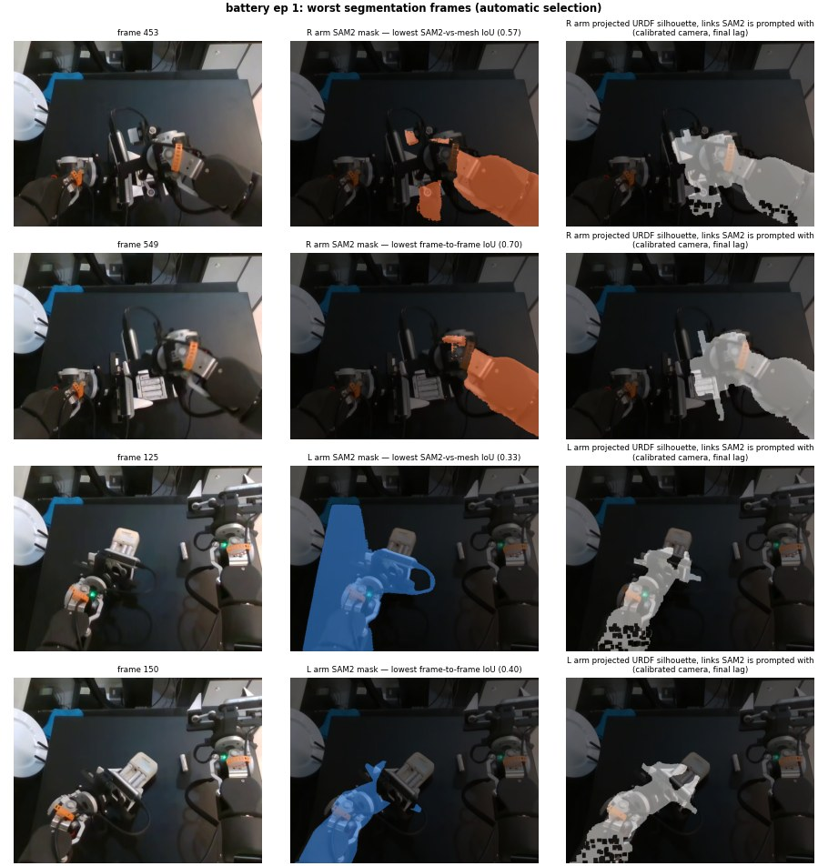
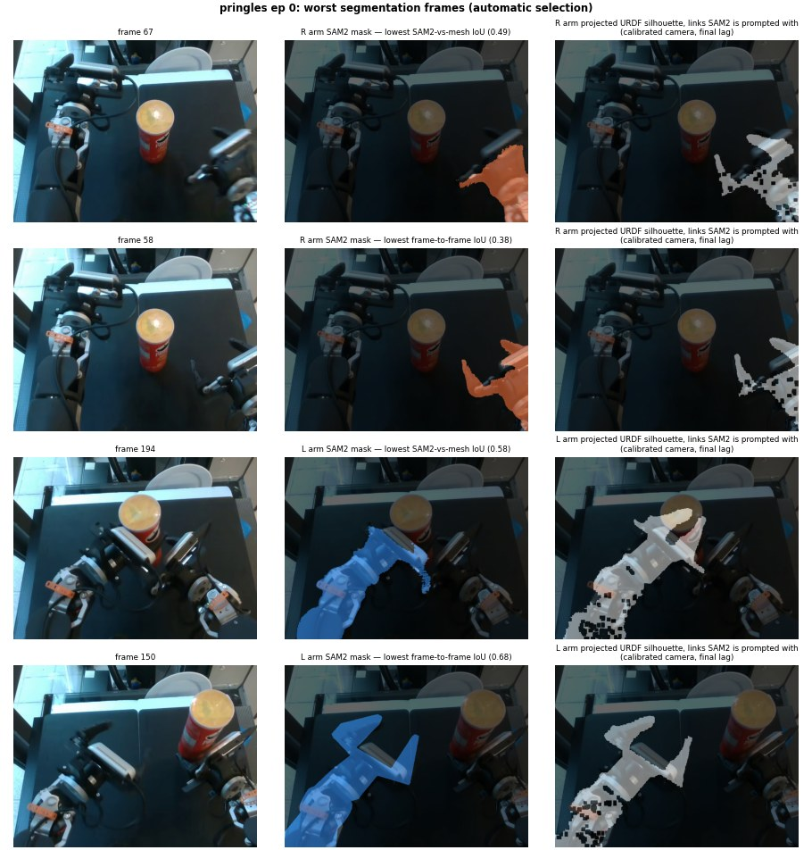

**Detail worth knowing.** SAM2's prompts were generated with the video-to-robot time offset at its default (−1.75 frames), *before* the offset was refined photometrically (−0.5 / −0.75 frames). The cached masks were reused afterwards. Re-running SAM2 at −1.75 reproduces them exactly.

---

## Stage 2: Keypoints and optical flow (HISTORICAL only, not in the current pipeline)

| | |
|---|---|
| **Status** | **Not part of sfagen.** No sfagen file mentions RAFT. RAFT was used in v1 (`e8abc26`) and v2 (`b9b7dfe`) on Pringles episodes 0/4/8, and **only for quality metrics** (temporal warp error, keypoint following). |
| **Input** | the real body-camera video (here: Pringles episode 0, the episode v1 used) |
| **Model / algorithm** | torchvision **RAFT-large**, weights `Raft_Large_Weights.C_T_SKHT_V2`, 12 refinement steps, full 640×480. Forward and backward flow between consecutive frames; points chained frame to frame; a point counts as "tracked" while the forward-backward round trip returns within 2 px and stays in the image. Frozen code `sfa/track.py`, re-run unchanged. |
| **How landmarks were initialised** | **Robot points:** automatically and geometrically, as 8 random pixels on each hand / link7 / finger region of the projected robot model. **Can:** 16 random pixels on its mask. All at the frame two-thirds of the way between the right-hand and left-hand grasps. |
| **The real landmark in v1/v2** | The 3-D can attachment came from a separate **HSV colour tracker of the Pringles lid**, started from **one human-verified click** on frame 0. Not RAFT. |
| **Runtime / memory** | 12.4 s for 544 flow fields (273 frames), 2.5 GB GPU (diagnostic replay). v1 saved 36.9 s for its three clips. |
| **Measured quality** | Points pass the 2-px check on 94.7% of point-frames (v1 saved 95.4%). Median forward-backward error 0.11 px. **Only 34% of points stay continuously tracked to the last frame** (40% back to the first). Distance from the FK-projected position of the same robot point: median 20 px, 90th percentile 185 px. **These are self-consistency numbers.** No manual tracking ground truth exists (Gate 1 and Gate 1R annotation evaluations are `PENDING`), so **no tracking accuracy is reported**. |
| **Failure case** | A "can" point drifts onto the right gripper and is lost at the image edge (FB error 31 px at frame 57). Points near the image border get stuck there. |
| **Code** | [`sfa/track.py`](../sfa/track.py) (frozen), [`scripts/diag_raft.py`](scripts/diag_raft.py) |

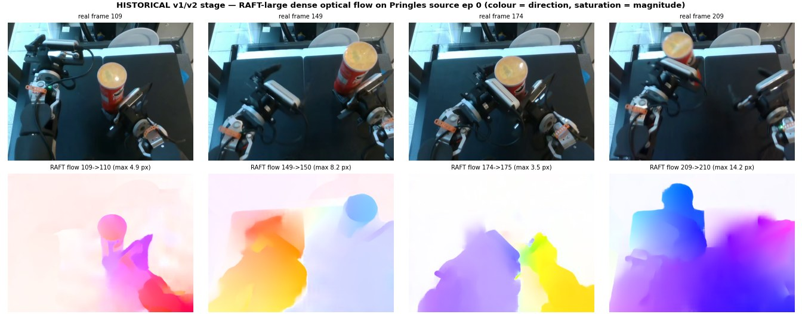
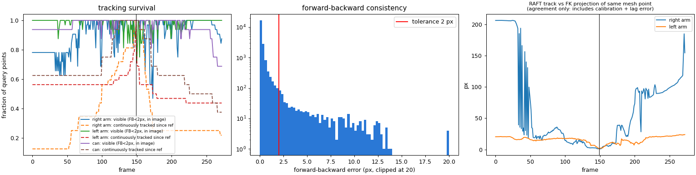
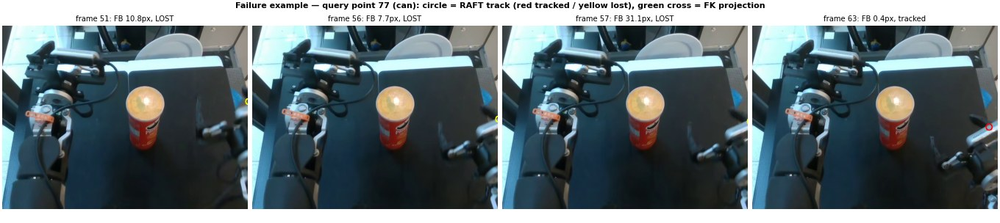

Video with point trails: `stage_02_tracking/raft_tracking_trails.mp4`.

**Why sfagen dropped it:**
- the robot's pixel positions are already given exactly by FK + the calibrated camera;
- flow-chained points drift and get lost (34% survival);
- in v2 the keypoint-following metric was circular, since its targets came from the renderer itself.

---

## Stage 3: Camera, robot and object geometry (the "3-D understanding" step)

| | |
|---|---|
| **Input** | real videos + joint angles of all 10 source demos (for calibration and table height); per demo for the objects |
| **Algorithms** | **Camera:** render-and-compare. Project the robot model and adjust 7 numbers (3 rotation, 3 position, 1 focal scale) with Powell's method to best match the moving parts of the image; held-out frames check the result. **Robot:** Pinocchio forward kinematics from the URDF. **Table:** fit of the known-size can (Pringles), or lowest arm point − 5 mm (battery, battery too small to fit). **Objects:** a 7.5 × 23 cm cylinder (can), a 1.85 × 6.5 cm lying cylinder (battery), an oriented box (station), each placed by matching its silhouette near the grasping hand. **Timing:** the video-to-joint offset that best re-renders real frames. |
| **Why it is needed** | Moving pixels in 3-D requires knowing where the camera is, where every robot link is, and where the objects are. |
| **Output** | `calibration.json`, `table_height.json`, object poses, holder timeline (table → hand → other hand / placed), time offset |
| **Runtime / memory** | Calibration 2.4 min (Pringles) and 7.2 min (battery), once per rig. Table 2.8 and 5.6 min. Full reconstruction of one demo 3.9 min (Pringles) and 6.6 min (battery), ≤ 7.5 GB GPU (clean profile). |
| **Measured quality** | Held-out silhouette IoU 0.307 → 0.361 (Pringles) and 0.248 → 0.299 (battery). **This is not metric calibration accuracy.** Can fit IoU 0.78 (Pringles ep 0); battery fit IoU 0.09 (weak). The photometric offset curve varies by 1.2–1.6 dB, while the silhouette alternative is flat (≤ 0.016 IoU). |
| **Failure cases** | The battery proxy barely matches the image (residual IoU ≈ 0.16). Box proxies are coarse. The FK overlay draws lines off-image to shoulder joints the camera cannot see. |
| **Code** | [`calibrate.py`](../sfagen/sfagen/calibrate.py), [`camera.py`](../sfagen/sfagen/camera.py), [`robot.py`](../sfagen/sfagen/robot.py), [`recon.py`](../sfagen/sfagen/recon.py) |

**Calibration before and after.** Red is the initial guess, green the fitted camera; the right panel is the image target.

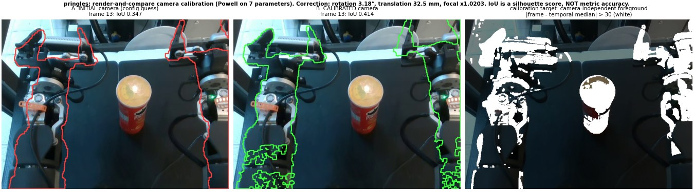
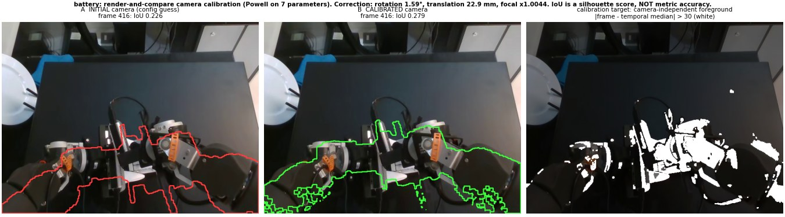

**Forward kinematics of the recorded joints, projected into the real frames** (TCP axes: x red, y green, z blue):

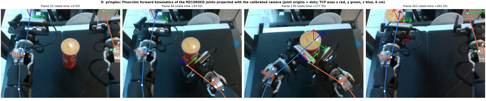
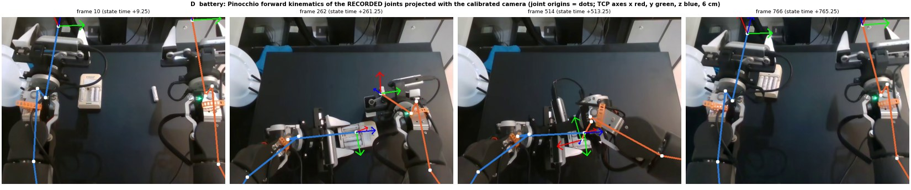

**3-D frames** (metres, robot base frame): camera, table, both arms, objects.
- Animations: `stage_03_reconstruction/*_3d_fk_animation.mp4`.

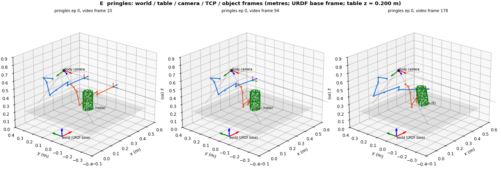
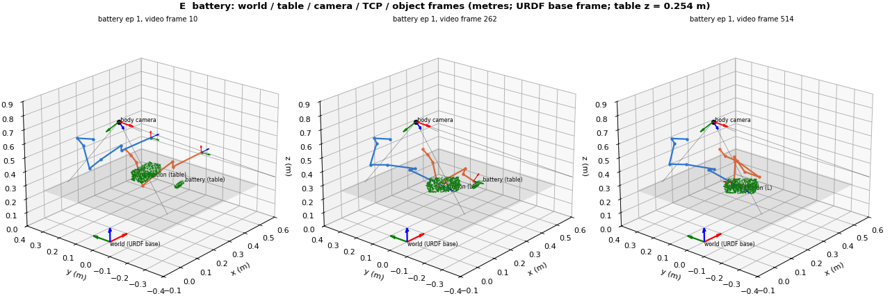

**Object position over time, residual, time-offset choice and table height:**

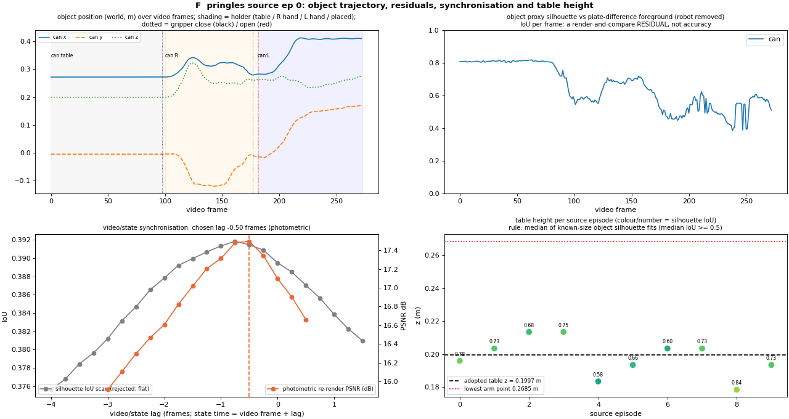
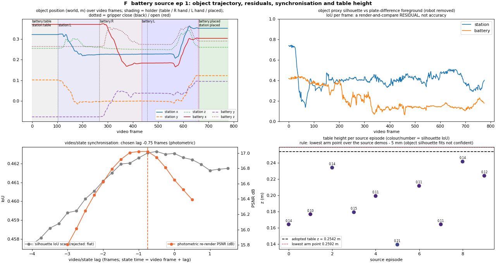

---

## Stage 4: New trajectories (move the object or the meeting point, then solve the joints)

| | |
|---|---|
| **Input** | one real demo's joint trajectory + the Stage 3 geometry |
| **Algorithm** | **F1 object position:** the object is moved by ±3/±6 cm. The grasping hand's path is shifted smoothly so that it arrives at the new place, grasps, lifts, and **rejoins the recording at the top of the lift**. **F2 interaction location:** the whole hand-over / insertion (both hands and what they hold) is shifted by ±3/±5 cm while the hands are within 20 cm of each other, with 45-frame (1.5 s) smooth ramps. Joints come from **damped-least-squares IK** (Pinocchio; damping 1e-3; within joint limits), smoothed (Gaussian σ = 3 frames), then made **exact at contact** by a second IK pass. Actions are the recorded actions plus the joint change, shifted by the measured 2-frame command lead. Grippers are unchanged. |
| **Why it is needed** | This is the "new demonstration": different object or interaction positions with physically plausible arm motion, without running a simulator. |
| **Checks (accept/reject)** | joint limits; speed ≤ 1.25× and acceleration ≤ 1.5× the real maximum; arm–arm clearance; hand distance; table; start pose; unchanged parts bit-identical; IK error ≤ 1 mm / 0.5° at contact; the moved object in view, on the table, and not passed through by the robot. |
| **Output** | per candidate: new state/action arrays, object poses, check report; 96/160 (Pringles) and 114/240 (battery) candidates pass |
| **Runtime** | 0.04–0.05 s per candidate to plan; 3.5–6.8 s to check (CPU). Re-planning reproduces the published arrays **bit-for-bit**. |
| **Measured quality** | Contact IK error ≤ 0.1 mm / 0.05° (IK stops at 0.1 mm). Pringles pair: speed 1.12×, accel 0.90× of the real maximum; clearance 27.5 mm (source 27.5 mm). **This is consistency with a kinematic model, not proof the robot could execute it.** No physics, no hardware replay. |
| **Failure cases** | Most rejections: the robot passes too close to the moved object (31 / 53), hands too close (15 / 43), too fast or too jerky. **For 88 battery candidates the source's own arm meshes touch** (clearance 0 mm), so the clearance rule cannot reject anything there. |
| **Code** | [`plan.py`](../sfagen/sfagen/plan.py), [`checks.py`](../sfagen/sfagen/checks.py) |

**Recorded (grey) vs desired (blue dashed) vs solved (orange) hand positions.** The gold band marks the frames where the hands must be exact; the bottom row shows the residual.

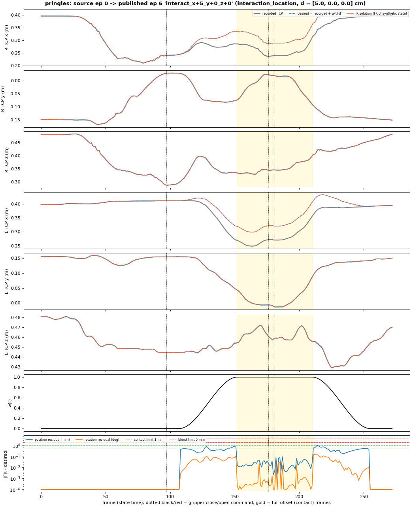
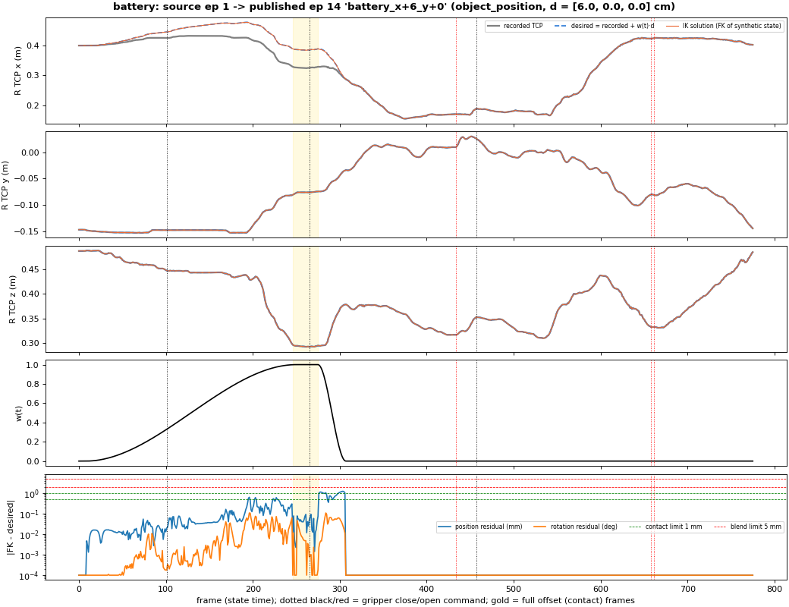

**Top view of the paths:**

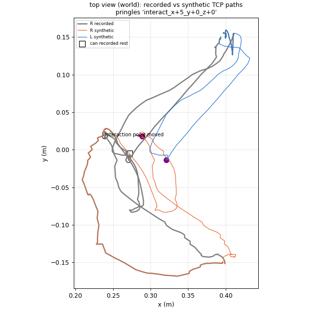
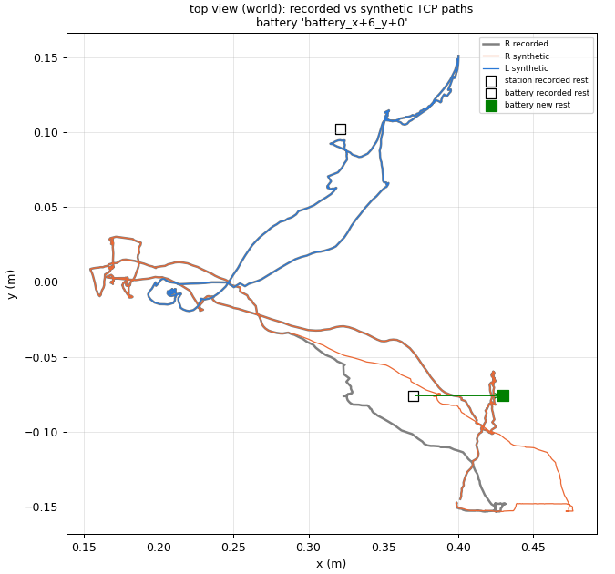

**Joint angles and actions, real vs synthetic:**

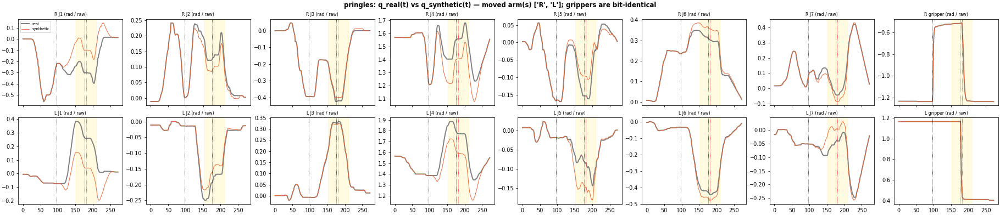
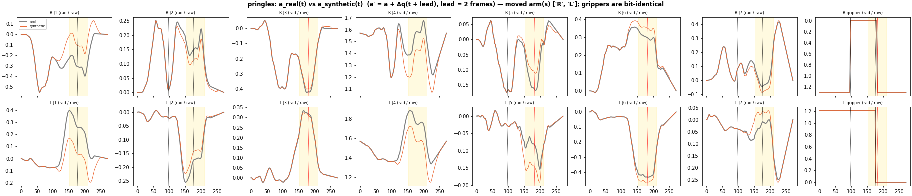
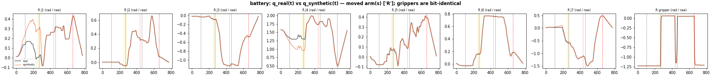
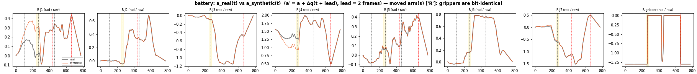

**3-D animation** (grey = recorded, colour = synthetic): `stage_04_trajectories/*_3d_recorded_vs_synthetic.mp4`.

---

## Stage 5: Video generation (move the real pixels in 3-D)

| | |
|---|---|
| **Input** | the real frame, the masks (Stage 1), the geometry (Stage 3), the new joint angles and object poses (Stage 4) |
| **Algorithm** | **Mesh-guided forward warping**, one output frame at a time: (1) the pixels of parts that move are replaced by the clean table image, re-lit to match the frame. (2) Every real pixel of a moving part gets a 3-D point from the robot/object model and is moved with its part; nearer pixels win (z-buffer). (3) Surfaces that become visible but were hidden in this frame are copied from the same 3-D point in a nearby frame (±3…±45 frames). (4) Remaining holes: Telea inpainting. (5) Speckle removal and 1-px edge smoothing. Frames where nothing changed are copied unchanged. |
| **Why it is needed** | This produces the new camera image that matches the new trajectory, using only real pixels. |
| **Output** | the synthetic body-camera video |
| **Runtime / memory** | about 16 s (Pringles) and 35 s (battery) per synthetic episode; about 3 GB GPU |
| **Measured quality** | Benchmark on held-out real frames (re-render a real later frame from an earlier one): Pringles 18.04 dB / SSIM 0.703 (vs 14.51 dB for "just copy the frame"); battery 19.21 dB / 0.709 (vs 16.28 dB). **Scope: recorded poses only. This does not prove image fidelity at the new positions**, where no real image exists. |
| **Proof the panels are real** | The diagnostic copy of the renderer reproduces the published frames **pixel-for-pixel** (6/6 frames identical). |
| **Failure cases** | Re-posed grippers near the camera or the image edge break into a smeared "ghost" with dark Telea patches (worst battery frames: 5,500–6,300 inpainted pixels). Cables and shadows move rigidly or not at all. |
| **Code** | [`render.py`](../sfagen/sfagen/render.py), [`render_stage.py`](../sfagen/sfagen/render_stage.py) |

**A: real → B: masks → C: re-lit clean plate → D: moving parts removed → E: 3-D-warped real pixels → F: hole map → G: after borrowing + Telea → H: final.**

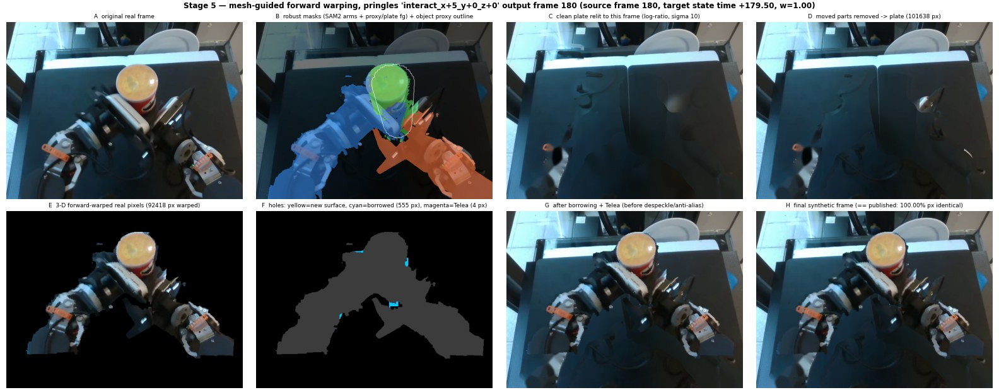
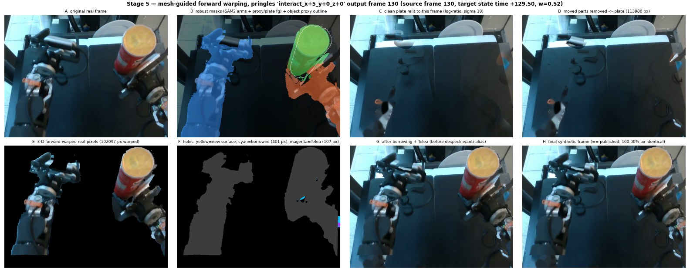
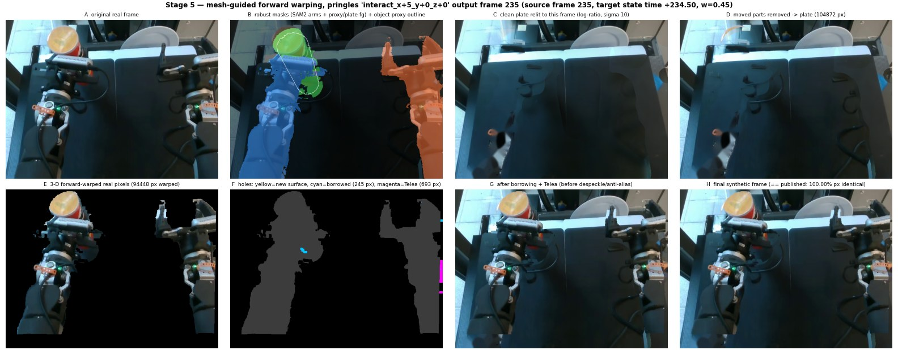
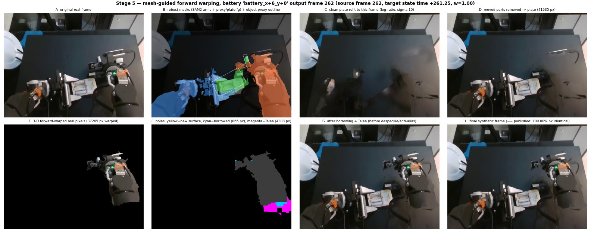
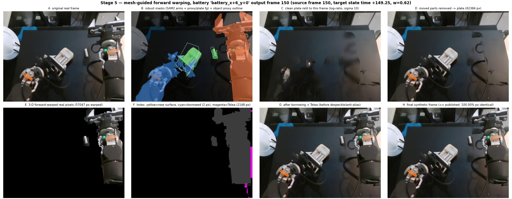
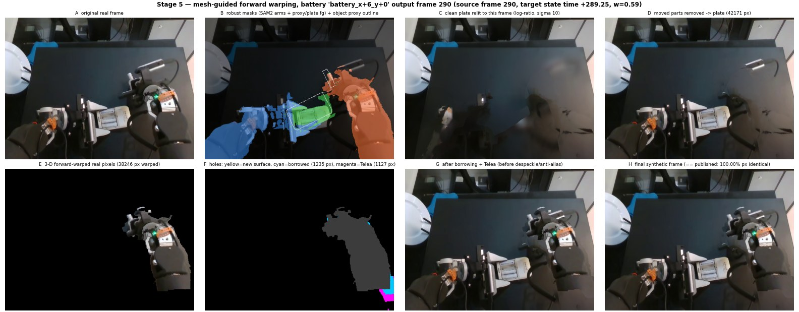

**Honest failure frames** (largest inpainted areas across the published renders):

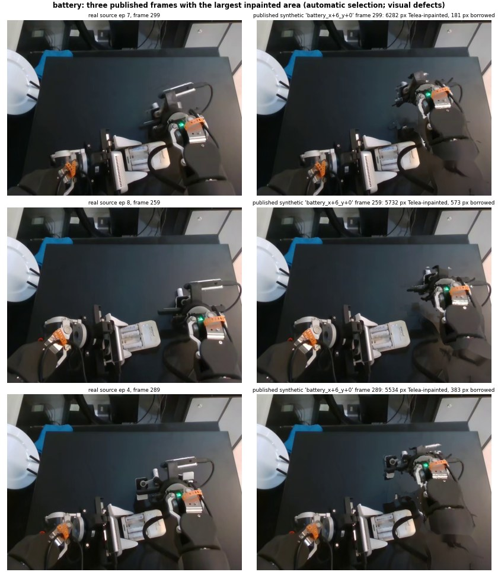
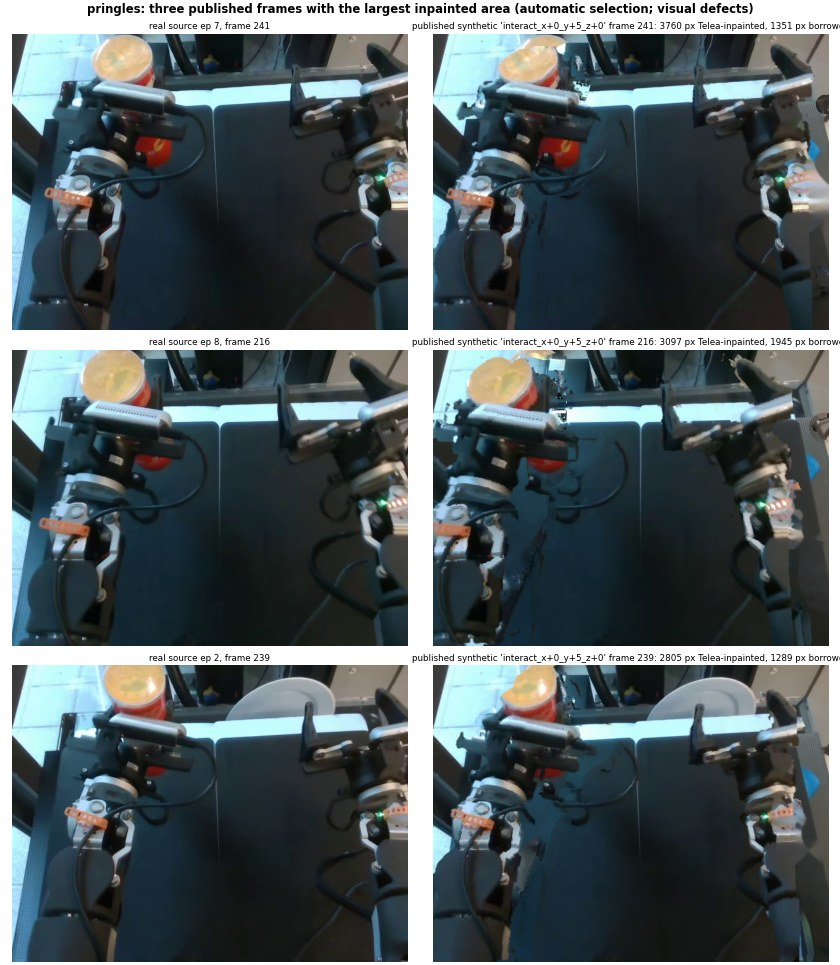

**Videos:**
- **Annotated comparison** (real | synthetic | difference ×3, with per-frame warp/borrow/inpaint counts): `stage_05_rendering/*_pair_annotated.mp4`.
- **All episodes side by side** (existing, on the Hub): `comparison_videos/pringles_unified_highlights.mp4` and `battery_unified_highlights.mp4`, plus `*_unified_all_2x.mp4`, in each dataset repo. Local copies: `~/Stanley_ws/sfa_hf_export/sfagen/configs/work/<task>/video_*.mp4`.

---

## Stage 6: Three cameras in the published dataset

| | |
|---|---|
| **What is synthetic** | **only `body_cam`** |
| **What is reused** | `wrist_cam` (left) and `right_wrist_cam` are the **original real wrist frames** at the same time index. They are **not** re-rendered. |
| **Flags** | `wrist_view_valid` = 1 only where the whole scene equals the recording. A single flag is shared by both wrists. `wrist_view_pose_offset` = how far (cm, rad) each synthetic wrist is from where the reused image was taken. |
| **Measured** | Published wrist frames differ from the real source frames only by encoding (mean 1.3–1.4 grey levels). Pringles ep 6: 147 of 273 frames have a moved arm but an unchanged wrist image (offset up to 5.0 cm). Battery ep 14: 307 of 776 frames (right wrist offset up to 6.0 cm). The left wrist's arm did not move there, yet it is flagged invalid too. |
| **Defect found** | In the published **battery** datasets, synthetic episode **91** (= episode 101 of the mixed repo) lost one left-wrist frame in the video encoder. From that point the left-wrist image runs one frame (33 ms) ahead, and its last frame shows episode 92's first frame. Details: [`diagnostics/battery_wrist_cam_frame_deficit.md`](diagnostics/battery_wrist_cam_frame_deficit.md). Not modified (no authorization). |

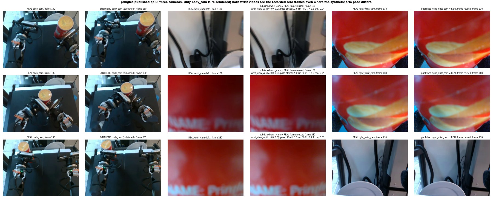
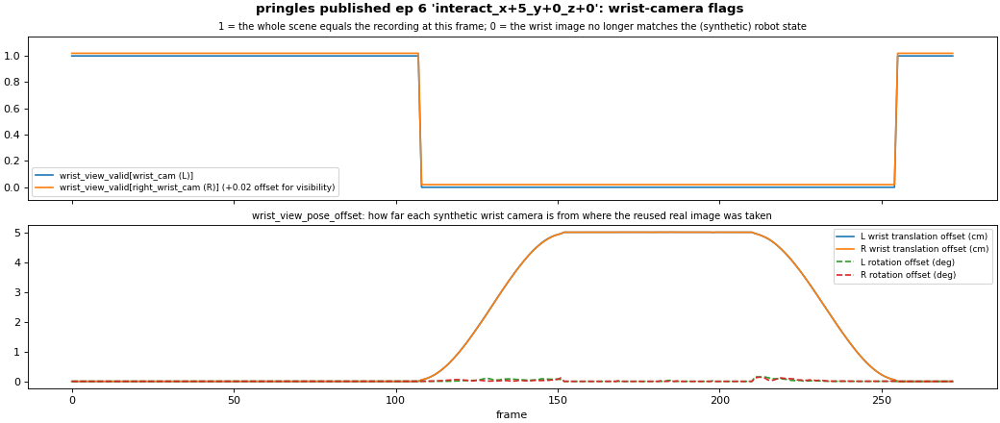
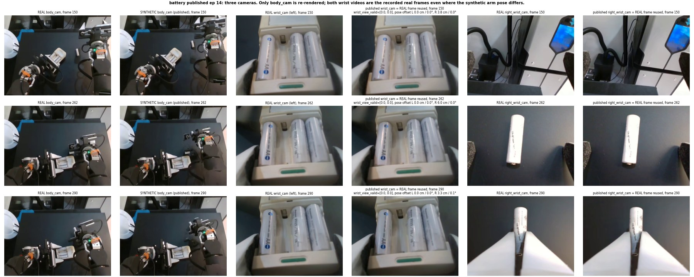
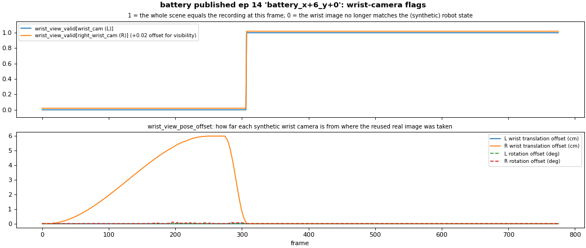

---

## Stage 7: Re-rendering the wrist cameras (v01, new)

**Why:** copying the source wrist frame is wrong whenever an object or the camera changes position relative to the
hand, for example a battery going into another slot. In v00, at least 49 % of synthetic wrist frames were therefore
flagged invalid.

**How (`sfagen/wrist.py`, task-agnostic):**
- The wrist camera pose is FK(link7) · mount.
- Every pixel of the source wrist frame gets an element from the robot and object geometry seen by that camera: own
  hand, other arm, object, or static world.
- Each pixel moves rigidly with its element, P' = C'⁻¹ M'ₑ Mₑ⁻¹ C P. Parts rigid with the camera (fingers, the held
  can) stay still automatically.
- **Depth:** geometry for modelled parts, and RAFT two-view triangulation for the room. Depth Anything V2 and a plain
  table plane were tested and lost.
- **Pixels the projections miss at close range:** a colour test (does the pixel stay put, or move like the world?)
  assigns them to the hand.
- **Filling:** revealed areas come from the nearest-pose source frames, and the rest is inpainted. Every pixel is
  labelled (green warped, yellow other frame, red inpainted).

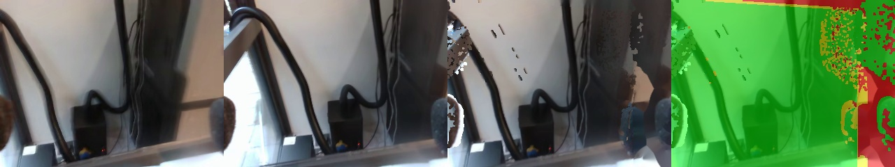

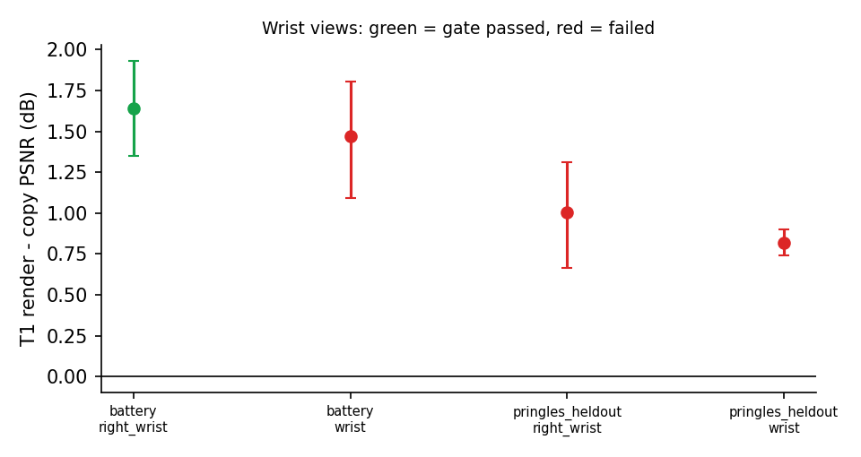

**Result (frozen protocol, `sfagen/results/wrist/RESULTS.md`):**
- **Within an episode the render beats copying in 4 of 4 task–camera cells:** +0.8 to +1.6 dB, all CIs above 0.
- **Across episodes at camera moves of 3 cm or more, it often loses** (disocclusions, the other episode's arm).
- **Registered gate:** passed only for the battery right wrist.
- **So the primary v01 datasets keep copied wrists with validity flags.** A rendered-wrist ablation is published next
  to them, so that policy training can decide.

---

## Stage 8: Fewer real demos (v01, new)

1. **R1, how far can the object move?** Re-render one real episode with another episode's real arm motion and can
   position, and compare with that episode's real frame.
   - Up to **11 cm** the image stays within 0.5 dB of small moves.
   - Beyond 11 cm it fails, so F1W targets are capped at 11 cm.
2. **Which demos to record?** A rule frozen before any evaluation: k-center over the demos' can positions. It picks
   demo 3, then 8, 5, 1.
3. **Coverage of 40 unseen real recordings** (can within 2 cm):
   - 1 demo → 16;
   - 2 demos → 24, as many as the published 10-demo v00;
   - 4 demos → 27;
   - 10 demos → 31.
   - Randomly chosen pairs reach a median of only 8: **which** demos you record matters more than how many.

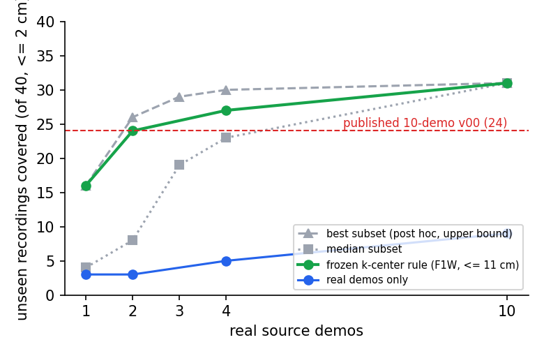

---

## Stage 9: Decisions log (what we tried, what happened, what we decided, why)

| # | Question | Tried | Result | Decision | Why |
|---|---|---|---|---|---|
| R1 | How far can the can move? | cross-episode pose transfer, 90 pairs, frozen rule | r* = 11 cm; the can region falls 14.9 → 11.5 dB | cap F1W at 11 cm | larger moves fail the frozen −0.5 dB rule |
| R2/C | How few demos? | F1W candidates for all 10 demos, frozen k-center selection | 1/2/4/10 demos → 16/24/27/31 of 40 | publish 1/2/4/10-demo candidates | 2 rule-chosen demos match v00 coverage |
| A | Fix the moved can's look | grow the object mask (ghost lid), fill the silhouette edge, per-point colour atlas | registered cross-episode test −0.16 dB (fail); same-can lift test +0.53 dB | keep the published body renderer | frozen rule; the residual error is 1–2 cm object **pose**, not rendering |
| B | Render the wrist cameras | moving-camera warp; 3 depth options; mount refinement | T1 better than copy in 4/4; T2 gate fails 3 of 4 | copy + flags in v01; rendered wrists only as an ablation | frozen gate; disocclusions across episodes |
| B2 | Refine the wrist mounts? | bounded photometric search on dev | dev +1.0/+1.1 dB, held-out +0.3/+0.5 dB | adopt | the pre-registered rule passed |
| D | Is the data fit to train? | gate recomputed from the exported files | all hard gates pass (`sfagen/results/datasets_v01/`) | push to the Hub | |

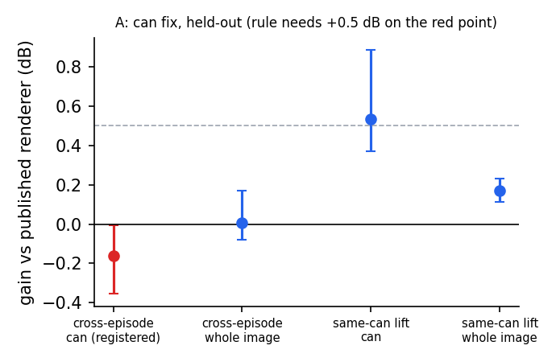
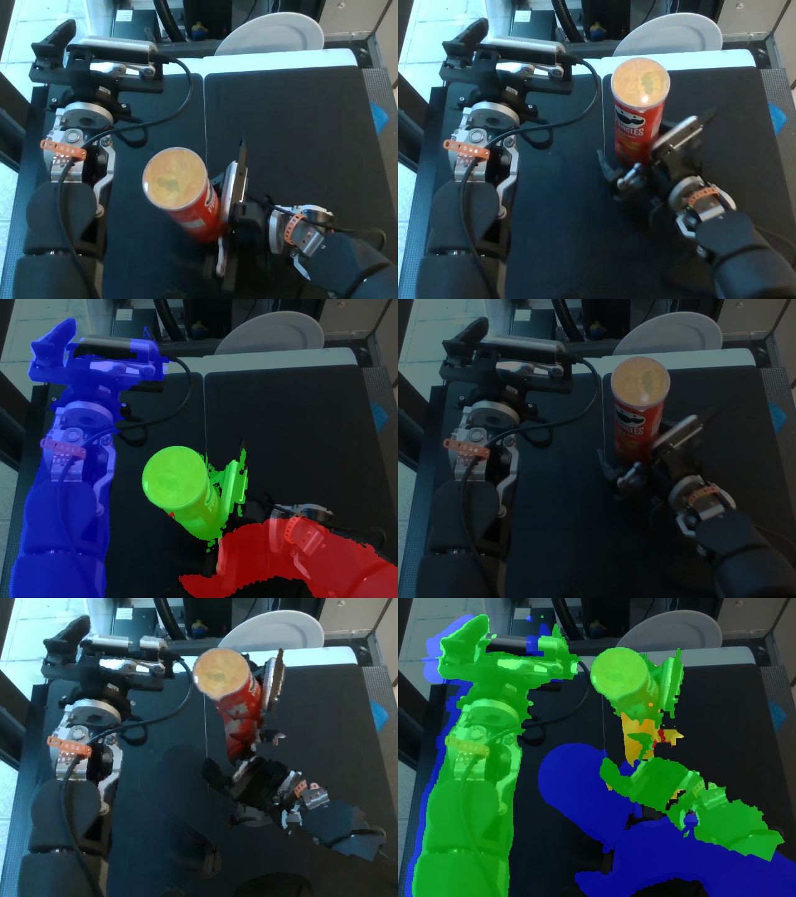
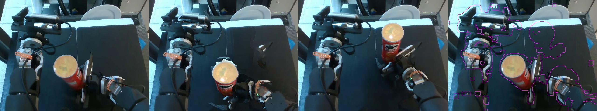

---

## How these figures were made (execution record)

**Inputs used (read-only):**
- the saved sfagen caches (`recon_ep*.npz`, `sam2_ep*.npz`), `calibration.json`, `table_height.json`;
- candidates and `checks.json`, render arrays and per-frame logs;
- profiles and the built datasets. Their Hub `v3.0` files have the same SHA-256.

**New diagnostic computation:**
- source episode 0 only for Pringles and episode 1 only for battery;
- the SAM2 re-run and the RAFT replay;
- prompt projection, object-segment replica, one re-plan + re-check per pair, and the instrumented render of 3 frames per pair.

Each run's command, Git SHA, GPU, peak memory, wall time and input/output SHA-256 are in `diagnostics/run_*.json`; the totals are in [`ARTIFACT_PROVENANCE.json`](ARTIFACT_PROVENANCE.json).

**Not touched:** no dataset regeneration, no training, no robot or CAN, no simulator, no Hub writes, and no frozen study files. No v4A withheld wrist streams were read. The v4A records 10/17/24/31/38/45 belong to the Pringles `real_v00` pool, which was not opened. Real data read:
- body_cam of `real_10_v00` episode 0 and battery `real_10_v02` episode 1;
- the wrist frames of those two source episodes;
- for the defect diagnosis only, the left-wrist video of battery source episode 8.

Large videos are kept locally and listed with SHA-256; they are not committed to Git.
