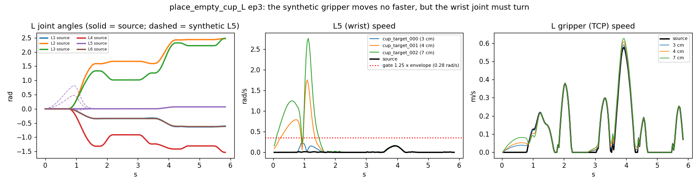

# R01 — RoboTwin 2.0 data-only pilot (SIM_BENCHMARK_PLAN step S1)

Date 2026-11-15 · executor Opus 5.5 · branch `research/sfagen-simbench` (from 49957aa; sfagen code unchanged) ·
first-party result, pending independent review. Local HTML view: `R01_robotwin_data_only.html` (same folder).

## Verdict in one paragraph
The S1 stop rule **"yield < 10 %" fired**: on `place_empty_cup`, **0 of 439** synthetic candidates pass
(object-position family 0/339). I stopped the pipeline at once; `handover_block` was stopped during
reconstruction (6/10 episodes) and `stack_blocks_two` never reached generation, so nothing was rendered, built, verified
or turned into videos. The cause is specific and measured: the v03 "wide blend" starts moving the object at frame 0,
while RoboTwin's arm still rests in its folded start pose (all joints 0, near-singular). There, a few-cm sideways shift
forces the wrist (joint 5) to swing up to 0.8 rad and back, and RoboTwin's planner never moves joint 5 that fast, so
the per-joint speed gate rejects it. The gripper itself does **not** move faster (TCP peak speed ratio median 1.00).
Fixing this is a method change, so the choice is yours (options below).

## What ran (M0) and what did not
| Stage | handover_block | place_empty_cup | stack_blocks_two |
|---|---|---|---|
| subset (10 demo_clean episodes, `split_dataset`) | done | done | done |
| `calibrate --search` (held-out IoU initial → fitted, adopted?) | 0.242 → 0.496, adopted | 0.208 → 0.477, adopted | 0.382 → 0.632, adopted |
| `table` | 0.736 m (fallback rule) | 0.783 m (fallback rule) | 0.724 m (fallback rule) |
| recon + frozen source positions | 6/10 (stopped) | 10/10 | not started |
| generate | — | 439 candidates, **0 pass** | — |
| render / select / build / verify / video | — | nothing to render | — |

OpenArm reference for calibration: 0.307 → 0.361 held-out IoU (v03r2). Guard at S0: 58/58 tests, 28/28 candidates and
4/4 body renders bit-identical (`results/guard/base_49957aa.json`); no sfagen file changed since, so it still holds.

## Problem 1 (stop rule) — zero yield on place_empty_cup from the joint speed gate
**Symptom.** 0/439 pass; the first failed gate is `speed` for 314/339 object-position candidates.

**Evidence.**
| task | family | candidates | pass | first failed gate (count) |
|---|---|---|---|---|
| place_empty_cup | object_workspace (3 cm grid) | 339 | 0 | speed 314, accel 16, mesh_clearance 5, object 4 |
| place_empty_cup | interaction_location | 80 | 0 | no_schedule 80 (not applicable: hands never come within 20 cm) |
| place_empty_cup | interaction_timing | 20 | 0 | no_schedule 20 (same) |
(`results/r01/yield.json`; first failed gate in the order of the `checks.py` pass formula.)

| shift | n | median max joint-speed ratio (gate 1.25) | ≤ 1.25 | median gripper (TCP) peak-speed ratio |
|---|---|---|---|---|
| 0–4 cm | 51 | 1.88 | 19 | 1.00 |
| 4–8 cm | 134 | 4.47 | 6 | 1.01 |
| 8–12 cm | 154 | 7.10 | 0 | 0.99 |
(`results/r01/speed_gate_diag_cup.json`, `tools/speed_gate_diag.py`.)

* The joint that sets the maximum is the wrist joint 5 in 275/339 candidates (R5 189, L5 86).
* The replay envelope for joint 5 is 0.26–0.28 rad/s; for the other joints it is 1.8–3.6 rad/s.
* For 308/339 (91 %), the worst frame lies before the source motion onset + 0.5 s. Every episode leaves its start pose at 0.77 s.
* Manipulability of the arm at the start pose (all joints 0) is 1.2e-3, against 1.7–2.4e-2 during the reach (σ_min 0.044 vs 0.15): `results/r01/manipulability_cup_L_ep3.txt`.
* Figure `results/r01/speed_gate_cup_L_ep3.png`: the synthetic L5 swings to 0.8 rad during 0–1 s, unwinds at up to 2.7 rad/s around 1.1 s, and then follows the source. The TCP speed curve stays on top of the source.



**Scope.**
* Measured on place_empty_cup (L and R groups, all 10 episodes, all shift sizes; even 3 cm shifts fail).
* Expected on every RoboTwin aloha-agilex task, because every episode starts from the same all-zero pose (verified: all 30 pilot episodes have max |joint| = 0.0000 at frame 0). Not measured on the other two tasks, which were stopped.
* Not expected on OpenArm, whose demos start from a bent, well-conditioned pose.
* Failure classes: T10 (gate validity), plus P8 (scripted demos have no idle time). The window from motion onset to "10 cm from the object" is only 14 frames (0.77 → 1.23 s).

**Cause (file:line).**
1. `sfagen/workspace_plan.py:136-138`: the wide blend (v03 Amendment 4) sets `t_motion` to frame 0 when no earlier gripper event exists, so the shift is ramped in while the arm is parked at a near-singular pose.
2. `sfagen/plan.py` `_retarget` (IK, called from `workspace_plan.py`) keeps the source gripper orientation, so a lateral move at that pose is absorbed by the wrist.
3. `sfagen/checks.py:151` compares per-joint speed with the per-joint maximum over the group's 4–6 source demos, and joint 5 is almost unused in them.

**Options.** Each one changes outputs, so each is a method change under §7 and needs your choice, a pre-registered hypothesis, and an OpenArm regression.
| | Option | Generality | Cost | Risk |
|---|---|---|---|---|
| A | **Conditioning-aware blend window**: start the wide blend only once the moving arm is well conditioned (e.g. Jacobian σ_min ≥ ½ of its median over the pre-grasp motion), and let the ramp run through the approach up to `t_grasp − 3`, not stop at "10 cm from the object". One fixed rule for every robot; never retimes. | general (any robot or demo that starts in or near a singular pose) | ~1 day: code + tests + OpenArm regression; cup re-generate ≈ 2 min | Shorter or later ramp raises TCP speed (the speed_similarity gate decides); tilting the approach may cost mesh clearance; OpenArm output likely changes slightly (blend start moves) |
| B | **Robot-level speed envelope**: the per-joint gate uses the p95 over many demos of the same robot (here 11 000 demos of 22 other RoboTwin tasks: joint 5 p95 1.9 rad/s), not just the 4–6 sources | general where such data exist; not on a real robot with 10 demos | hours | Changes a registered gate after seeing data; admits the 0.8 rad wrist swing, which is a real but unnatural motion; breaks the "10 demos only" premise. Counterfactual: 190/339 pass speed + accel (downstream gates not evaluated) |
| C | **Report as not expressible**: keep v0 and report RoboTwin object-position yield 0 % (T1/T10) | — | none | Removes RoboTwin from the paper's benchmark set, or reduces it to a negative result |

The counterfactual for a per-arm scalar envelope (the maximum over the arm's joints) is 49/339 passing speed + accel.
I list it but do not recommend it: it has the same objection as B.

**Recommendation.** **A.** It removes the cause, the shift applied at a singular pose. B only hides the symptom
by allowing the wrist swing. Before implementing A, I would:
* run the literature check (blend timing and singularity handling in data-augmentation retargeting);
* pre-register the hypothesis: cup object-position yield ≥ 10 % with TCP peak-speed ratio ≤ 1.25, OpenArm guard differences reported, OpenArm v03r2 yield not lower.

**Not checked.**
* Handover and stack generation.
* Whether downstream gates (mesh clearance, table, object, speed similarity) would pass after a fix.
* Whether the IK's wrist swing also occurs mid-episode on other tasks.

## Problem 2 — camera fit is adopted but still far from truth (P1)
**Evidence.**
* Held-out IoU improves in all three tasks: +0.25 / +0.27 / +0.25, all adopted, with overlays in `results/r01/calib_overlay_*.jpg`.
* Against simulator truth (evaluation only; `artifacts/simbench_runs/s1/camera_error.txt`), fitted vs initial:
  * reprojection median 35 / 26 / 16 px (initial 81);
  * p95 60 / 44 / 30 px;
  * rotation error 5.2 / 8.8 / 6.1° (initial 8.0);
  * centre error 12.9 / 8.3 / 6.7 cm (initial 8.0);
  * focal ratio 0.947 / 0.941 / 0.962.
* The fit improves the image overlap but trades rotation, centre and focal length against each other. In cup and handover it moves the centre or rotation further from truth than the start.

**Scope.** All three tasks. This is far above the M2 5 px level; it will cause misplaced renders once anything passes.

**Likely cause [A, not verified].**
* `calibrate.py` uses frame-minus-median foreground. In RoboTwin the arms start outside or at the edge of the view and move fast, with few near-static frames.
* The robot's large table shadows (visible in `results/r01/source_contact_sheet.jpg`) enter the foreground.

**Options (plan P1).**
* (a) Fit on SAM2 arm masks instead of frame-minus-median. General; ~1 day; risk: SAM2 prompt quality.
* (b) fps-relative static-frame rule. General; small; may not fix shadows.
* (c) `calibration: given` when the dataset ships extrinsics. Exact for simulation, but not usable on the real robot, and it uses simulator truth, so it is allowed only as an oracle arm (O), never for S.

**Recommendation.** (a) after Problem 1, because Problem 1 blocks everything downstream.

**Not checked.** Fitting with shadows masked out; whether a single shared camera over all 30 episodes fits better than per-task fits.

## Problem 3 — table height falls back to "lowest arm point − 5 mm"; cup is 4.3 cm too high (P4)
**Evidence.**
* `table` found no confident object-silhouette fit in any task (`fits: []`), so it used the fallback rule.
* Truth is 0.74 m: `envs/_base_task.py:121` at RoboTwin ea8b211, with `random_table_height: 0` in `demo_clean.yml`.
* Errors: handover −0.4 cm, **cup +4.3 cm**, stack −1.6 cm (`artifacts/simbench_runs/s1/table_error.txt`).
* In the cup demos the gripper never goes low (it grasps the cup's side), so "lowest arm point" is not the table.
* The stack estimate is below the true table, which hints at a ~1 cm finger or mesh mismatch in my URDF conversion [A].

**Options.**
* (a) Per-object support height from the grasp TCP and proxy size (plan P4). General.
* (b) Debug why the silhouette fits are not confident (calibration error from Problem 2 is the likely reason).
* (c) Accept with a disclosed error.

**Recommendation.** (b) together with Problem 2's fix, then (a) if it still fails.

## Problem 4 — the grasping arm changes per episode (T8; manual step)
RoboTwin picks the arm from the object's side. sfagen fixes `grasped_by` per config, so I split each task into groups
from the gripper close events: cup R [0,1,2,4,6,7] / L [3,5,8,9]; stack LL/RR/RL/LR. This is a reported manual step.

**Options.**
* (a) Detect the grasping arm per episode from the close events and the TCP-to-object distance. General method change (A13).
* (b) Keep groups. They work, but split the replay envelope, so each group has fewer demos (this tightens Problem 1).

**Recommendation.** (a), bundled with A when you approve method work.

## Smaller notes
* **Interaction families (F2)** need the two hands within 20 cm (`plan.py:162`). They are "not applicable" on cup (100 candidates); count them separately from yield.
* **Subset videos** were re-encoded by `split_dataset` (AV1 CRF 30). This is a second-generation loss in the source frames and may matter for M2.
* **Object at the image edge**: the handover block sits at the top edge of the head camera, partly cut off. Not yet a blocker.
* **Arm shadows**: they are not modelled by the renderer and will be wrong in re-posed renders (T9/P5).
* **Task strings**: sfagen writes one task string per dataset (row 0); stack has 9 language variants in the source.
* **Tooling bug fixed**: my `s1_task.sh` used the bash special variable `GROUPS`, so the first launch failed instantly. Renamed to `GRPS`; no data were affected.
* **Real2Edit2Real released code** (Apache-2.0; S0 finding). It can now be a run baseline instead of a cited one. That changes §9; your call.

## M4 (effort) so far
* GPU stage time: table 124.6 min, calibrate 29.4 min, reconstruct ≈ 35 min per task (via `source_positions.py`), plan + check < 1 min. Total ≈ 3.2 GPU-h.
* Wall time ≈ 5 h, including setup.
* Config: `configs/robotwin/make_configs.py`, 79 lines. Per task, only `objects`, the arena, and the episode groups change.
* Manual steps: the episode groups (Problem 4); the URDF TCP frames and DAE→STL conversion (separate venv); the camera guess = truth + seeded offset (8°, 8 cm, seed 0).
* Knobs changed from the v0 recipe: none.

## Reproduce
```
cd ~/Stanley_ws/lerobot_openarm_simbench   # branch research/sfagen-simbench
PY="env -u PYTHONPATH -u LD_LIBRARY_PATH HF_HUB_OFFLINE=1 ~/Stanley_ws/lerobot_openarm/.venv/bin/python -B"
$PY research/sim_free_augmentation/simbench/tools/robotwin_subset.py            # 10 demo_clean eps x 3 tasks
$PY research/sim_free_augmentation/simbench/configs/robotwin/make_configs.py artifacts/simbench_runs/s1
(cd research/sim_free_augmentation/sfagen; $PY -m sfagen calibrate ../simbench/configs/robotwin/<task>_base.yaml --search; $PY -m sfagen table ../simbench/configs/robotwin/<task>_base.yaml)
research/sim_free_augmentation/simbench/tools/s1_task.sh <task> <gpu> artifacts/simbench_runs/s1
$PY research/sim_free_augmentation/simbench/tools/s1_yield.py artifacts/simbench_runs/s1 research/sim_free_augmentation/simbench/configs/robotwin results/r01/yield.json
(cd research/sim_free_augmentation/sfagen; $PY ../simbench/tools/speed_gate_diag.py OUT.json ../simbench/configs/robotwin/place_empty_cup_{L,R}.yaml)
```
Run dir: `artifacts/simbench_runs/s1/` (logs/, `<task>/rig`, `place_empty_cup/{L,R}/candidates`). Nothing was deleted or overwritten.
