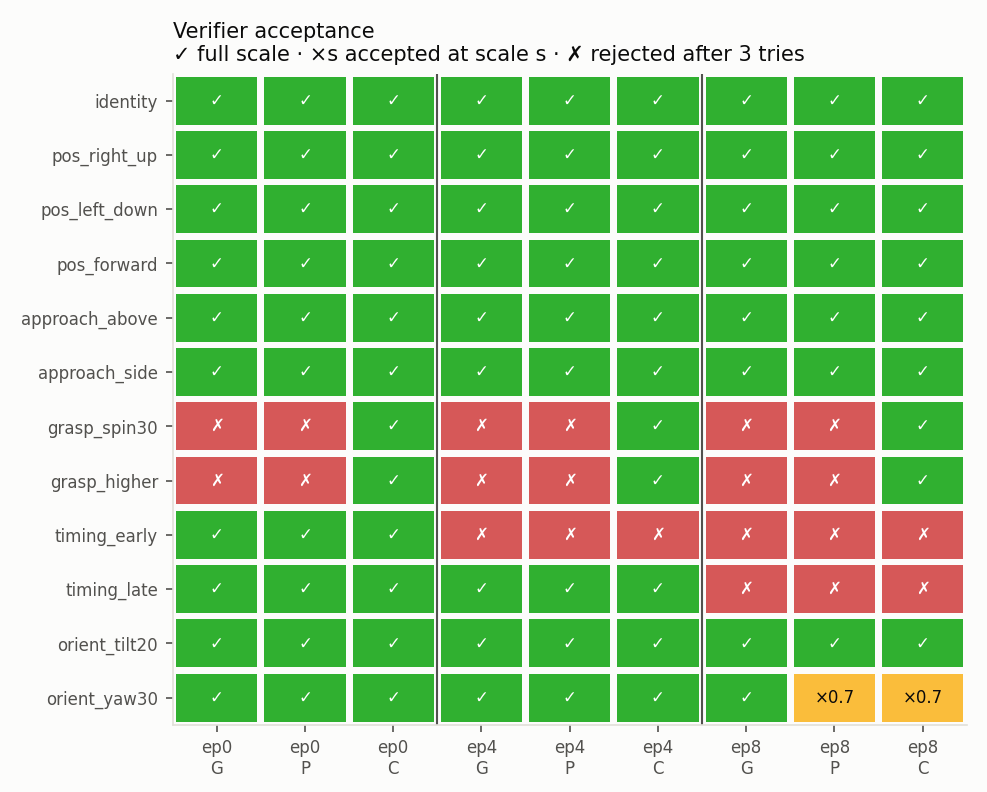

# Simulation-free, contact-aware augmentation — v2 results

Real Pringles hand-over episodes 0 (development), 4 and 8 (test). Source data: `ethanCSL/openarm_pringles_lerobot_real_10_v00@cebdee98`. Only the body camera is generated.

No simulator, physics engine or physics-engine rendering was used. Nothing commanded the robot, and nothing was pushed to the Hub.

Every number below comes from the committed `outputs/` files, which were produced by the commands at the end. The code and config were frozen in commit `b9b7dfe` before episodes 4 and 8 were processed. Every `results.json` records that head with `repo_dirty: false`, plus the config sha256 (`39622498d81b…`) and the source-tree sha256 (`f5a165635951…`).

## 1. Verdict

* **The comparison is now fair, and it narrows the contact claim.**
  * The three conditions share the same desired targets, inputs, solver and repair budget.
  * G is tuned, not handicapped: its time width was chosen to maximise G's own acceptance on episode 0.
  * Under these conditions, **phase coordination (P) adds nothing to acceptance over a tuned geometry baseline (G)**. Both accept 24/33.
  * **Grasp-relative SE(3) constraints (C) matter only when the hand–object relation changes.** On the two receiver-regrasp variations C is accepted 6/6, while G and P are 0/6.
  * Everywhere else C matches P, and on the approach and timing variations the two are bit-identical.
* **Geometric consistency is checked by an independent verifier.**
  * It reads only the exported arrays and the source reconstruction. It infers contact from gripper state, and compares each hand's 6-D object drift with the source's drift at the matching source time.
  * It accepts the unmodified source and the identity control on all episodes.
  * It flags all object-rotation and gripper-timing corruptions: 15/15 across three episodes.
* **RGB, state and action are synchronized, and this is measured end to end.**
  * On every accepted clip (78/78), the command lead is exactly the source's 2 frames.
  * On the same clips, the image-to-state lag recovered from the image is within 0.5 frames of the source's measured lag.
  * The same detectors flag delayed actions, delayed states and source labels swapped in, 12/12.
  * They still pass after LeRobot AV1 encoding and decoding: 78/78 exported episodes.
* **The pipeline produces a training-compatible prototype.** It writes a local, single-camera LeRobot v3 dataset for each condition: C has 30 episodes and 7,633 frames; G and P have 24 episodes and 6,111 frames each. Each passes schema validation, an exact state/action round trip and the decoded-replay synchronization checks.
* **Not established:**
  * whether the data helps any policy (no training run);
  * real-world executability, force or grasp stability;
  * a novel algorithm (section 9).
  * Image fidelity is limited by the inherited camera model and by disocclusions. The frozen image-QA rule turned out to fail even the unmodified source on episodes 4 and 8 (section 6).

## 2. What changed relative to v1 (`e8abc26`) and the Codex review

| Codex finding | v2 response |
|---|---|
| Geometry-only baseline unfair | G receives the **same** desired targets (both hands) and the same repair budget. Its time width σ was selected on episode 0 to maximise G's own acceptance (σ = 20 frames: 10/12, against 3–9/12 for the other widths) and frozen. |
| A shared-direction G also passes the contact checks | Confirmed. With shared targets, G and P accept the same candidates on every position, approach and orientation variation. |
| An incorrect object rotation may pass | The 6-D drift test catches it. Rotating the object 90° (and also 20°) after the receiver grasps is flagged on all 3 episodes. |
| Delayed actions may pass | A signed command-lead detector (`sync.action_lead`) recovers −4 for actions delayed 6 frames (2 − 6). The command-to-state relation is now an exported, measured semantic, not only a safety envelope. |
| Export rows not synchronized to image time | The row convention is explicit and measured. Image *i* depicts state time *i* + lag, exactly as in the source. Unsupported boundary rows are trimmed, never padded. A per-row time map is written to the provenance file. |
| 3-camera export incomplete | Single-camera dataset only. The wrist views are omitted and documented as not generated. |
| Attachment partly guaranteed by construction; source closure unchecked | Measured: the independent giver and receiver can estimates disagree by 43–65 mm and 28–37° (§3). A joint fit with a closure constraint reduces this to 15–39 mm and 0.4–0.5°. The verifier is source-relative, so the remaining reconstruction artefacts cancel. |
| Warp error ignored its region mask | Fixed and regression-tested (`test_warp_error_respects_region`). The edited region and the background are now reported separately. |
| `make_plan` exported failed plans | Every candidate has `accepted` and `tries` fields. Only candidates that are accepted and pass synchronization are exported. Rejected candidates are kept as labelled diagnostics. |
| Caches not keyed; provenance thin | SAM2 masks are cached under a sha256 of every input. Results record the config, source-tree and git hashes. A clip manifest lists every MP4's sha256. |

## 3. Reconstruction (per episode, CPU+GPU, no physics)

The video-to-state lag and the attachment are fitted on the source's own frames (in-sample). They are reconstructions, not validated calibration.

| | ep0 | ep4 | ep8 |
|---|---|---|---|
| frames; events (R close, L close, R open) | 273; 97/176/181 | 250; 87/163/168 | 249; 83/160/164 |
| video-to-state lag (frames) / command lead | −1.75 / 2 | −1.75 / 2 | −1.0 / 2 |
| v1 independent fits: closure distance / axis tilt in the dual-closed window | 43.4 mm / 37.2° | 64.8 mm / 27.9° | 58.4 mm / 27.9° |
| v2 joint fit: closure distance / axis tilt | **14.6 mm / 0.4°** | **18.6 mm / 0.5°** | **38.9 mm / 0.4°** |
| lid reprojection RMS, giver/receiver: independent → joint (px) | 5.7/2.4 → 6.5/3.0 | 4.5/5.7 → 4.7/8.2 | 3.5/4.4 → 4.2/5.1 |
| source passes the verifier | yes | yes | yes |

A hard, rigid closure (weight 30,000) brings the closure distance to about 1 mm. However, it raises the receiver's reprojection error to 11–34 px. With the inherited camera, a single rigid can is therefore inconsistent with the image evidence at the 1.5–4 cm level. The cause is camera/FK error, regrasp slip during the transfer, or both; this experiment cannot tell which. The balanced fit (1,000 px/m) was frozen.

## 4. Matched conditions and variations

The frozen configuration is `configs/frozen_v2.json`: 12 variations, each × G/P/C, on every episode. Five variation types are covered, plus an identity control:
* **New hand-over position:** right-up (0, −4.5, +4 cm), left-down (0, +4, −3 cm), forward (+5 cm).
* **Receiver approach direction:** a 7 cm detour from above or from the side, zero at capture.
* **Receiver grasp pose:** regrasp rotated 30° about the can axis, or 2.5 cm higher on the can.
* **Hand-over timing:** ±15 frames, applied with a piecewise-linear time warp that also moves the gripper events.
* **Object orientation:** tilt 20° about x, or yaw 30° about z, both about the lid at the pass.

Each variation is turned into a single `Spec` of targets shared by the three conditions: a giver pose at the pass, a receiver pose at capture, an approach waypoint and a time warp (`sfa2/planner.py`).

* **G:** per-hand world deltas with a phase-blind Gaussian profile. The object follows its source holder.
* **P:** the same deltas with phase-aware profiles. The giver offset is zero until the lift, held through the dual contact, and released when the giver's gripper state reports open. The receiver ramps in over the approach, is held through the transfer and returns to the source carry.
* **C:** the giver as in P. The can is carried by the giver. The receiver is planned in the carried can's frame (its source can-relative pose plus the regrasp). After release the can follows the receiver with the regrasped attachment.

All conditions share the same IK, warm start, joint margins and repair budget: the whole variation is scaled 1.0 → 0.7 → 0.49 until the verifier accepts. Achieved targets are recorded.

Desired targets, inputs and initial conditions are identical across conditions, and every condition gets the same three tries. G is not weakened: its single parameter was tuned for G.

## 5. Results — acceptance (independent verifier)



| condition | ep0 | ep4 | ep8 | accepted | at full scale |
|---|---|---|---|---|---|
| G | 9/11 | 8/11 | 7/11 | 24/33 | 24/33 |
| P | 9/11 | 8/11 | 7/11 | 24/33 | 23/33 |
| C | 11/11 | 10/11 | 9/11 | **30/33** | **29/33** |

The full per-variation table is in `outputs/tables/acceptance.md`, with every try and every failed check in `outputs/ep*/results.json`.

* **Regrasp variations (the only place the conditions separate):**
  * **grasp_spin30:** G and P fail the 6-D spin test at release, with a 14.6° spin jump even after shrinking to 0.49 (`motion6d_ep*_grasp_spin30.png`). C passes with a 0.0° excess.
  * **grasp_higher:** G and P fail the 6-D translation test (12 mm at scale 0.49). C passes with a 0.3 mm excess.
  * In G and P the object model has no way to know that the hand–object relation changed.
* **Approach variations:** G, P and C are all accepted. G reaches the receiver's capture target only to within **8.5–10.5 mm**, because its Gaussian approach detour leaks into the capture frame. P and C reach it to within 1 mm. G passes only because the frozen grasp-feasibility tolerance is 10 mm. This is the one measurable benefit of phase coordination, and it is small.
* **Position and orientation variations:** all three conditions are accepted on all episodes, except P and C on ep8 yaw30, which needed shrinking to 0.7.
* **Timing variations:** rejected in **all** conditions on ep4 (early: joint speed 2.515 rad/s against a 2.5 limit) and on ep8 (both directions: joint limits). On ep8 the source's right-joint-6 command already sits exactly at its URDF limit, and the warped command exceeds it by 0.1–0.2 mrad. The frozen zero-tolerance limit check rejects it. This is a limitation of the variation, not of any condition.
* **Bit-identical plans:** P and C are identical on the approach and timing variations, and G equals P on timing. That accounts for the 28 unique renders per episode out of 36 candidates.

## 6. Results — generated clips (image-level, independent cues)

`outputs/tables/clip_metrics.md` has the per-clip numbers. The medians below are over accepted, non-identity clips.

| condition | n | keypoint follow, R / L / can median (px) | lid error, receiver hold (px) | can-axis 2-D error, receiver (°) | ghost fraction (background noise 0.01) | flow-warp error, robot region (original 2.79–2.88) | lag ok | lead ok |
|---|---|---|---|---|---|---|---|---|
| G | 24 | 2.3 / 2.8 / 4.2 | 3.5 | 9.0 | 0.06 | 2.95 | 24/24 | 24/24 |
| P | 24 | 2.4 / 2.6 / 4.8 | 3.5 | 9.6 | 0.06 | 2.92 | 24/24 | 24/24 |
| C | 30 | 2.0 / 2.5 / 2.3 | 3.6 | 9.4 | 0.06 | 2.91 | 30/30 | 30/30 |

* **Background:** the flow-warp error is 1.40–1.50 for every clip, equal to the original. Edits do not add background flicker.
* **Keypoint follow is circular.** Its targets come from the renderer's own homographies, so it measures whether the warped texture follows the control, not whether the camera or geometry is correct. Coverage is reported with it (0.88–1.00).
* **Lid error and can axis use independent image cues.** The lid is found with the Gate 1 HSV tracker and the can axis with an HSV red-body principal axis; neither uses robot state, SAM2 or the renderer's masks. The can-axis cue is weak: on the unmodified source it is already off by 9–17° in the receiver hold and 20–83° in the giver hold, because the can is seen from above and occluded. Treat orientation errors as relative to the identity clip.
* **Ghost fraction** is the share of pixels the robot left that still differ from the background plate: 0.06 against a background noise of 0.01. Ghosts remain, mostly unsegmented finger tips and cables.
* **Generation yield (frozen image-QA rule):** G 11/33, P 8/33, C 10/33. The frozen rule (lid coverage ≥ 0.5 and median error ≤ 12 px in both hold windows) fails the **unmodified identity clip** on ep4 (receiver coverage 0.29) and ep8 (0.49). In those source carries the can leaves the image, so the rule is not a valid absolute criterion there.
* **Post-hoc yield (source-relative rule, defined after seeing that):** coverage at least 80% of the identity clip's, median error ≤ 12 px. G 23/33, P 18/33, C 24/33. P and C fall below G on position shifts in ep0 and ep8: they keep the shifted can near the top image edge longer (G's offset decays sooner), so the lid tracker loses it (`ep8_IMAGE_QA_FAIL_…` clip). This is a camera-coverage effect, not a contact effect.

**Representative clips** (`outputs/clips_selected/`):
* all 12 four-panel comparisons (original | G | P | C) for ep0, plus 6 each for ep4 and ep8;
* successful clips with overlays, which draw the target keypoints and the independently detected lid as a green cross;
* failed clips: P on grasp_spin30 (spin discontinuity), C on ep4 timing_early (joint speed), and a G approach that was accepted but missed its target;
* still frames in `outputs/figures/still_*.jpg`.

**Visual artefacts that remain:**
* finger and cable ghosts;
* dark smears where the arm always covered the table (no clean background);
* disocclusions: parts of the can hidden behind the source receiver hand cannot be recovered when that hand rotates. This raises the receiver-hold lid error for C grasp_spin30 to 10.6/11.4 px on ep4/ep8;
* link seams;
* the can leaving the view on upward shifts.

## 7. Synchronization and corruption controls

The row convention is the source's. Row *i* contains:
* `observation.state[i]`: the candidate state at frame *i*. It is **planned**, not measured;
* `action[i]`: `q_new(i+2) + r_src(τ(i))`, where `r_src` is the recorded command-to-state residual, transported along the time warp. Gripper commands are the source's, under a zero-order hold of the warp;
* the body-camera image, rendered to depict the state at time *i* + lag.

Rows `ceil(−lag) … T−1−lead` are kept (`sync.export_range`), and the per-row time map is in `meta/sfa_provenance.json`. Image *i* is rendered from source frame `round(τ(i+lag) − lag)`; a boundary bug in this map was found by a unit test and fixed.

| control (base candidate: pos_right_up/C) | detector | ep0 | ep4 | ep8 |
|---|---|---|---|---|
| intended labels | lead = 2, lag within ±0.5, verifier ok | pass (2, −1.75) | pass (2, −2.0) | pass (2, −1.0) |
| actions delayed 6 frames | signed lead | −4 ✔ | −4 ✔ | −4 ✔ |
| state delayed 3 / 6 frames relative to images | lid lag scan | 1.25 / 4.25 ✔ | 1.0 / 4.0 ✔ | 2.0 / 5.0 ✔ |
| object rotated 90° / 20° after the receiver grasps | 6-D tilt / translation | ✔ / ✔ | ✔ / ✔ | ✔ / ✔ |
| receiver closes after the giver opens | release order | ✔ | ✔ | ✔ |
| giver closes 15 frames early / late | unsupported object motion, release order, 6-D | ✔ / ✔ | ✔ / ✔ | ✔ / ✔ |
| source labels paired with generated video | lag-scan error and pose discrimination | ✔ | ✔ | ✔ |

All 27/27 corruptions are detected and the intended candidate passes on 3/3 episodes. `outputs/figures/sync_ep*_pos_right_up__C.png` shows the lag-scan and lead curves.

These detectors test the internal consistency of the exported arrays and the rendered pixels. Because the renderer uses the same lag, they do not validate the real camera's timing.

## 8. Dataset export (Task 5)

`scripts/export_dataset.py` writes **local** LeRobot v3 datasets to `outputs/lerobot/` (git-ignored; never pushed). The validation reports and manifests are committed in `outputs/dataset_export/`.

* **Features:** `observation.state` (16, float32), `action` (16, float32) and `observation.images.body_cam` (480×640×3, AV1 via libsvtav1, crf 30, g 2, as in the source). Names, fps 30, robot_type `openarm_umeow` and the task string all match the source.
* **Wrist cameras:** deliberately absent. They were not generated, and the source wrist frames would contradict the edited arm motion.
* **Provenance** (`meta/sfa_provenance.json`):
  * per episode: source episode, variation, condition, scale, candidate hash, config and source-tree hashes, achieved targets and the per-row time map;
  * dataset-level: state/action semantics, and `force_validity: unknown`.

| dataset | episodes | frames | schema | state/action bit-exact | frame index and timestamps | decoded vs raw PSNR | replay sync (lead and lag from decoded video) |
|---|---|---|---|---|---|---|---|
| C | 30 | 7,633 | ok | 30/30 | ok | 38.1–41.3 dB | 30/30 |
| P | 24 | 6,111 | ok | 24/24 | ok | 38.1–41.3 dB | 24/24 |
| G | 24 | 6,111 | ok | 24/24 | ok | 38.1–41.0 dB | 24/24 |

Export takes 20–25 s per dataset and validation (LeRobot read-back with AV1 decoding) 77–91 s. The G/P/C datasets are matched: same sources, variations and row ranges. They are ready for a later policy-training ablation, which was **not run** here.

Wrist-camera generation was not attempted. A wrist camera moves with the edited arm, so its view needs novel-view synthesis of the whole scene, which homography warping cannot provide.

## 9. Research assessment

* **Supported claims:**
  * A monocular, simulation-free pipeline generates synchronized RGB, state and action hand-over variations from real demonstrations, across three episodes.
  * The independent source-relative verifier and the corruption-tested synchronization detectors work as intended.
  * Grasp-relative SE(3) constraints are necessary, and sufficient within our checks, when the receiver's grasp changes.
* **Not supported:**
  * that contact or phase modelling helps for whole-hand-over translations, rotations or approach changes (a tuned geometric baseline is equivalent there);
  * that the data improves a VLA (untested);
  * any real-world or force validity.
* **Diversity:**
  * Accepted candidates span 4–6 distinct pass points per episode, pairwise up to 11 cm apart, against 1.7–4.4 cm between the three source demonstrations (`handover_diversity.png`).
  * Approach, regrasp and timing variations add variety in hand paths, grasps and timing, not in pass positions.
* **Novelty:**
  * The mechanisms are established: shared object-relative transforms (DemoGen, R2RGen), IK re-targeting with rigid attachment (R2R2R), and edited video with edited actions (Real2Edit2Real).
  * What v2 adds is a careful, matched ablation, a verifier that is not the planner's own constraint set, and measured synchronization on a lightweight RGB compositor.
  * That is an engineering and evaluation contribution, not algorithmic novelty.

## 10. Limitations

* **Calibration:** the camera is inherited from IsaacLab calibration and about 20–40 px off in absolute terms. The lag and attachments are fitted in-sample. A rigid single-can model leaves a 1.5–4 cm closure gap.
* **Grasp model:** the URDF jaw model is not consistent with the reconstructed can (a source finger "penetrates" it by about 30 mm). Grasp checks are therefore source-relative, not absolute.
* **Spin:** spin about the can axis is model-internal and not observable in the images.
* **Coverage:** one camera; three episodes; 11 variations; no held-out calibration landmarks; no policy training.
* **Frozen rules:** the image-QA rule was invalid on episodes 4 and 8 (reported, with a post-hoc alternative). The timing variations are blocked by the zero-tolerance joint-limit rule at saturated source commands.
* **Appearance:** visual realism is limited by background-plate holes, ghosts and disocclusions. No generative refinement was used.

## 11. Next improvements (ordered)

1. **Policy ablation:** train the same policy on source only versus source + G/P/C (the datasets are ready), evaluated offline on held-out real episodes. This is the only way to test usefulness.
2. **Calibration:** use independent landmarks (wrist and tag corners) to re-fit the camera and lag, keeping held-out frames, then re-measure the closure floor.
3. **Disocclusion and ghosts:** mask corrections for the transfer region and a generative inpainting pass (a learned prior instead of the median plate), measured with the same ghost and lid metrics.
4. **Camera coverage:** a visibility constraint in the planner, rejecting targets that push the object out of view. A principled fix for the coverage failures in P and C.
5. **Timing variations:** a small joint-limit tolerance or a time-optimal retiming for saturated source commands, re-evaluated as a new frozen configuration.

## 12. Runtime

Episodes 0, 4 and 8 ran concurrently (2 RTX 4090, 7 CPU workers each); all three finished in about 15 min of wall-clock time.

| stage | ep0 | ep4 | ep8 |
|---|---|---|---|
| SAM2 (cached, keyed) + reconstruction | 12 + 26 s | 12 + 24 s | 13 + 24 s |
| 36 plans with verifier and repair | 10.7 s | 11.6 s | 11.3 s |
| render 28 clips (CPU) + RAFT flows, keypoints and metrics (GPU) | 844 s | 634 s | 796 s |
| corruption tests / comparison videos | 6.6 / 24 s | 6.2 / 25 s | 5.2 / 23 s |

* **First run:** an uncached SAM2.1-small pass takes about 14 s per episode.
* **Per plan:** about 1.5 s median.
* **Per clip render:** about 46 s median (CPU), including overlays and CPU metrics.
* **Other steps:** figures 60 s; unit tests 10 s (11 pass); dataset export and validation about 2 min per condition.

## 13. Exact commands

```bash
cd research/sim_free_augmentation/v2
PY="env -u PYTHONPATH -u LD_LIBRARY_PATH HF_HUB_OFFLINE=1 ../../../.venv/bin/python"
# per episode (dev 0, then test 4 and 8 with the frozen config); here run concurrently on two GPUs
$PY scripts/run_episode.py --config configs/frozen_v2.json --episode 0 --workers 7 --device cuda:0
$PY scripts/run_episode.py --config configs/frozen_v2.json --episode 4 --workers 7 --device cuda:1
$PY scripts/run_episode.py --config configs/frozen_v2.json --episode 8 --workers 7 --device cuda:0
$PY scripts/make_figures.py --episodes 0 4 8
for c in C G P; do $PY scripts/export_dataset.py --episodes 0 4 8 --condition $c; done
CUDA_VISIBLE_DEVICES= $PY -m unittest discover -s tests -v
```

Development-only steps (episode 0, before the freeze): G's σ grid, the joint-fit weight comparison, and the two fixes that followed visual inspection (receiver returns to the source carry; split lid/body can warp). They are described in the code docstrings and in commit `b9b7dfe`.
