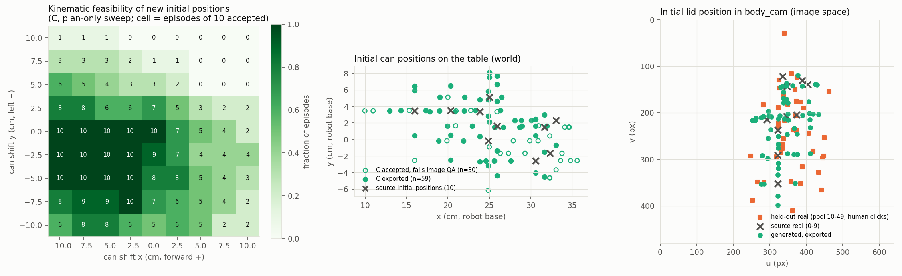
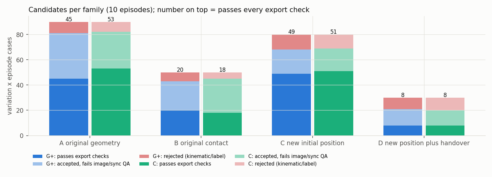
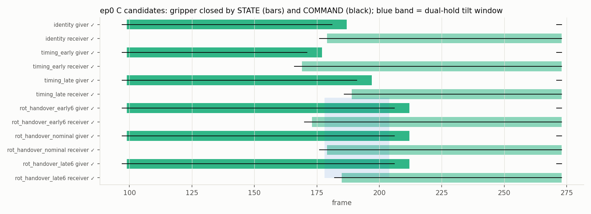
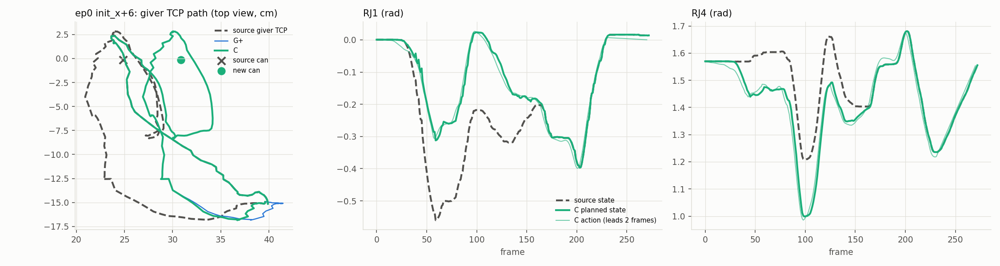
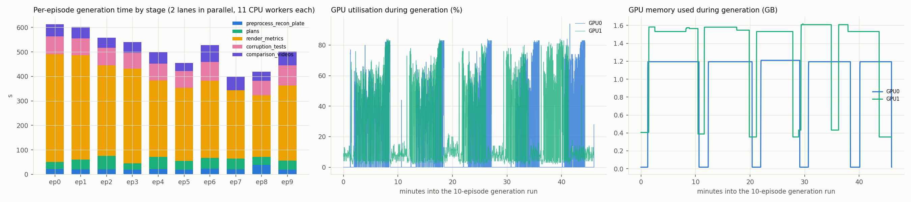
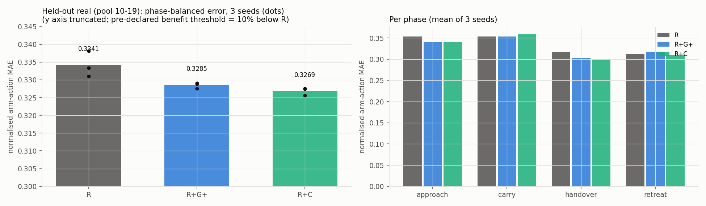

# Simulation-free, contact-aware augmentation — v3: 10 episodes, new initial can positions, SmolVLA screen

## Scope and provenance

* **Source data:** all 10 episodes of `ethanCSL/openarm_pringles_lerobot_real_10_v00@cebdee98`.
* **Held-out data:** external real recordings, `ethanCSL/openarm_pringles_lerobot_real_v00` pool episodes 10–19.
* **Fingerprint check:** pool episodes 0–9 are the same recordings as `real_10` (state fingerprints are identical). Episodes 10–49 share no fingerprint with any source episode.
* **Not used:** simulator, physics engine, physics rendering, robot motion, CAN/motor commands, Hub pushes.
* **Earlier work preserved:** the v1/v2 code and results are untouched, and the v2 test suite still passes.
* **Episode seal:** Gate 1 had sealed episodes 1/2/3/5/6/7/9. Gate 1 is closed, and this task explicitly uses all 10.

### Commits

| commit | content |
|---|---|
| `6c5e831` | Stage-1 corrections, G+, new-initial-position generator, preprocessing benchmark, plan-only sweeps. Freeze before the 10-episode run. |
| `fcaa982`, `e0c2ead` | Run-script fixes before the final run: peak-VRAM call; finite labels in trimmed rows; render cache. |
| `68eedca` | Pre-declared training-screen protocol, committed before any training. |
| final commit | Results. |

Every `results.json` records the config sha256, `d9bf3f37…`. The generator code at run time is `e0c2ead`. Its `repo_dirty` flag reflects untracked files that played no part in generation (the screen config and output folders).

---

## 1. Verdict

1. **New initial can positions work end to end.**
   * The standing can is relocated in RGB (shifts of 3–6 cm). The right arm reaches the new location along the demonstrated hand–can approach.
   * It grasps with the same hand–can relation, then lifts, hands over and releases with the source command timing. 16-D actions and temporally consistent body-camera video are produced.
   * 89 new-position cases were accepted by C (families C and D) and 59 passed every export check.
   * In image space, the human-clicked initial lid positions of the 40 held-out real episodes are covered as follows:

     | radius | sources only | sources + generated |
     |---|---|---|
     | 20 px | 22.5% | 67.5% |
     | 40 px | 62.5% | 85% |

   * The generated positions sit a median 1.9 cm (maximum 6.0 cm) from the nearest source position, so most of this coverage fills gaps between sources; it does not extend the workspace.
2. **Scale-up to 10 episodes:**
   * 828 proposed candidates, every condition × variation × repair scale attempted.
   * Accepted at their own scale: G+ 213 / 250, C 216 / 250 (non-identity).
   * 113 matched pairs pass every export check for both conditions.
   * Six local LeRobot v3 datasets pass schema checks, bit-exact round trips, episode-boundary checks and decoding checks (PSNR ≥ 37.8 dB).
   * The held-out leakage check passes.
3. **The corrected label validation closes every false negative Codex reported.** 26 controls per episode, detected 26/26 on 9 episodes, 234/234 in total. On episode 7 the base candidate was rejected, so no suite ran there. The intended candidate passes on 9/9.
4. **G+ (geometry with waypoints and a regrasp-aware attachment) and C are equivalent for most variation types.** C differs only where the hand–object relation must be maintained continuously:
   * receiver spin regrasp: C passes every export check on 9/10 episodes, G+ on 1/10;
   * the late-closing rotating handover: G+ needed a smaller scale.
   * The label false-positive bias described in §6 works against C.
5. **The bounded SmolVLA screen does not meet the pre-declared benefit rule.** On 10 held-out real episodes, adding augmentation lowers the phase-balanced action error relative to real-only training:
   * R+G+: −1.7%;
   * R+C: −2.2%.

   The rule required at least 10%, so **augmentation_helps = false** for both arms and **contact_helps = false**. The improvements are small but consistent across 3 seeds (sd 0.001–0.003). Gripper timing does not get worse.

---

## 2. Stage 1 — corrections (all regression-tested)

| # | Codex item | v3 implementation | test |
|---|---|---|---|
| 1 | per-joint action validation | `labels.construction`: exact per-joint construction check at every valid row, `a = q(t+2) + r_src(τ)` within 1e-6 rad. `labels.per_joint_check`: sub-frame per-joint lead within 0.75 frame of the source joint's. | `test_single_joint_delay`: all 14 single-joint 6-frame delays are detected on 9/9 episodes. |
| 2 | command-only gripper corruption | `labels.gripper_check`: command and planned-state transitions paired per gripper; latency must match the source within ±1 frame; commands must land at the warped source times. | `test_gripper_command_only_delay`, plus "receiver command delayed 3" and "giver command opens 3 early" (9/9 each). |
| 3 | source-action substitution | caught by the construction check | `test_source_actions_substituted` (9/9) |
| 4 | export-time hash check | `labels.candidate_hash`, recomputed in `export3.check_job`; a mismatch blocks export; one changed value changes the hash | `test_hash_changes_with_one_value`, `tampered_hash_differs` (9/9) |
| 5 | true zero-order hold | gripper command `a_src[floor(τ(t))]` | `test_true_zero_order_hold` |
| 5b | consistent sampling | renderer uses the candidate's planned gripper state at depicted time *i* + lag, not the source frame's | — |
| 5c | warp contract | time warps keep slope 1 around every gripper event, so command→state latencies stay the source's. The dual-hold variant inserts a pause in source time; it does not stretch the gripper closing. | `test_warp_keeps_gripper_latency` |
| 6 | cylinder/table geometry | `verify3.cylinder_min_z = min(z_lid, z_lid + h·a_z) − r·sqrt(1 − a_z²)` | `test_cylinder_support_height` |
| 6b | collision coverage | every-frame collision statistics, plus a signed inside-hull test for hand–hand penetration | — |
| 7 | G+ baseline | waypoint interpolation through the shared contact waypoints (zero detour at capture); post-release receiver attachment updated for the regrasp exactly as in C | `test_regrasp_aware_attachment` |
| 8 | common tolerances | every condition must reach every contact waypoint within 2 mm / 1° | `test_common_tolerance_on_approach` |
| 8b | matched magnitudes | the matched set uses the common scale (largest scale both conditions accept) | — |

* **Tests:** 12 v3 tests pass (`outputs/logs/unit_tests_v3_stage1.log`), and the 11 v2 tests still pass (`unit_tests_v2_regression.log`). `test_v2_tree_unchanged` guards the v2 code, config and results.
* **Integer leads were unstable (fixed during development):**
  * The first per-joint lead check compared integer leads. The true per-joint lead is about 1.5 frames, so the integer argmin flipped between 1 and 2 on valid candidates and caused 105–122 false rejections in the initial-position sweep.
  * Replaced by a parabolic sub-frame lead; the sweep's label-only rejections fell to 2.
* **A residual false-positive source remains;** see §6.

---

## 3. Stage 2 — new initial positions

* **Rendering:** the standing can's pixels are moved by the lid and body homographies from the source table pose to `Δ0 · table`. The vacated table comes from the background plate.
* **Giver reach (C):**
  * The world shift ramps in over the reach.
  * It must be complete once the source hand comes within an 18 cm standoff of the can. After that the hand–can relative path is exactly the demonstrated one.
  * The ramp lasts at least 30 frames.
  * The shift is held through closing, grasping and lifting, then blended into the hand-over transform by the pass.
* **G+:** receives the same reach-end, grasp and lift waypoints.
* **Development iterations:** three plan-only sweeps (9×9 grid of ±10 cm shifts, 10 episodes, both conditions), all kept in `outputs/`.

| sweep | change | G+ accepted / 810 | C accepted / 810 | dominant failure |
|---|---|---|---|---|
| v3a | reach ramp ends at close − 10 | 264 | 275 | the giver's hand sweeps through the moved can mid-reach (can penetration) |
| v3b | + 18 cm object-relative standoff | 316 | 216 | C's ramp squeezed to 5 frames on some episodes → joint speed |
| v3c | + ≥ 30-frame ramp | 316 | 278 | per-joint lead false positives (integer leads) |
| final | + sub-frame lead | **419** | **398** | can penetration: the waiting **receiver arm** occupies the new can location (left shifts); speed; IK reach |

Remaining failures are genuine obstacles within these checks. On left (+y) and far-forward shifts the lifted can passes through the receiver's links 5–7, and some reaches leave the IK workspace. These positions were not "fixed", because doing so would mean moving the receiver's initial pose.

**Novel-position coverage vs hand-over changes:**
* Families A and B move only the pass point: the median pass-can displacement is 0 mm for all except the position shifts, which reach up to 60 mm. Their initial position is the source's.
* Families C and D move the initial position.
* `initial_position_coverage.png` shows the kinematic feasibility map, generated initial positions in world coordinates, and image-space coverage of the held-out initial positions.



---

## 4. Stage 3 — 10-episode generation (G+ vs C, 25 variations, repair scales 1.0 / 0.7 / 0.49)

`outputs/tables/counts.md`, `per_variation.md` and `outputs/ep*/results.json` record every proposed and rejected candidate.

| family | condition | cases | accepted (own scale) | full scale | passes export checks | matched pairs |
|---|---|---|---|---|---|---|
| A, original geometry | G+ / C | 90 | 81 / 82 | 72 / 70 | 45 / 53 | 46 |
| B, original contact (regrasp, rotating hand-over) | G+ / C | 50 | 43 / 45 | 25 / 36 | 20 / 18 | 10 |
| C, new initial position | G+ / C | 80 | 68 / 69 | 54 / 54 | 49 / 51 | 50 |
| D, new position + hand-over | G+ / C | 30 | 21 / 20 | 16 / 16 | 8 / 8 | 7 |
| all | G+ / C | 250 | 213 / 216 | 167 / 176 | 122 / 130 | **113** |



### Where G+ and C differ (per-variation grid in `per_variation.md`)

* **Same results:** for position, approach, orientation, timing and new-position variations, G+ and C accept and export nearly the same cases.
* **grasp_spin30:** G+ is mostly accepted only at scale 0.49, then fails image QA. It is rejected at full scale for can penetration, consistent with the residual Codex found after correcting the attachment. C passes every export check on 9/10 episodes.
* **rot_handover_late6 (the receiver closes 6 frames after the dual-hold tilt starts):**
  * At full scale G+ fails the 6-D tilt drift check on ep0, because waypoint interpolation does not keep the hands rigidly related between waypoints. It is accepted at scale 0.7.
  * C passes at full scale.
  * On other episodes the outcomes are mixed, and several C candidates fail receiver-window image QA.
* **Interpretation:** with corrected bookkeeping, object-centric continuous planning matters only for a small part of the interaction space (rotating spin regrasps, hand-overs that are moving at closure). For rigid retargeting the strong geometric baseline is equivalent.

### Export-time rejections among accepted candidates (453 re-checked)

| reason | count |
|---|---|
| image QA (frozen v3 rule), mostly receiver-hold lid coverage | G+ 66, C 70 |
| receiver-window image-lag mismatch | 51 |
| receiver lag "unknown": no evidence; counted, not treated as validated | 100 of 453 |

* The QA failures mostly come from position, orientation and +x shifts that push the carried can to the top image edge, where the lid tracker loses it.
* At small initial shifts, the old-location red-residual metric is contaminated by calibration error (the moved can's own pixels fall outside its predicted silhouette).




---

## 5. Stage 4 — generation speed (measured; no R2R2R comparison is claimed)

| stage | measurement |
|---|---|
| one-time preprocessing, 10 episodes, 2 GPUs (lid track, SAM2.1-small, joint attachment fit, plate) | **175 s** wall-clock uncached; 106 s cached |
| SAM2 | 12.0–14.5 s per episode, peak VRAM 7.9–9.2 GB |
| planning | 0.07 s median per IK trajectory; verifier 3.7 s median per candidate; labels < 0.01 s |
| rendering (CPU) | 41 s median per clip, 484 unique clips |
| encoding | 3.6 s median per MP4 |
| CPU clip metrics | 6.1 s median per clip |
| RAFT (GPU, half-resolution) | 6.3 s per clip, 3,047 s total, 0.5 GB VRAM |
| end-to-end generation, 10 episodes (2 GPU lanes × 11 CPU workers) | **2,756 s (46 min)**: 828 proposed, 429 accepted, 252 pass every export check |
| export: re-check 453 candidates + write and validate 6 datasets (95k frames) | 775 s |
| training screen, 9 × 1,000 updates, 2 GPUs | 503 s (about 100 s per run, 2.4 GB) |
| held-out evaluation, 9 checkpoints × 405 chunks | 268 s |

**Throughput:**
* 9.3 kinematically accepted candidates per minute of generation (G+ + C);
* 5.5 export-valid episodes per minute;
* from uncached raw data to validated datasets (preprocess + generation + export, 3,706 s): **4.1 valid episodes per minute**.

**Cost per valid episode:**
* about 0.49 GPU-minutes;
* about 5.9 CPU-core-minutes (24 cores × 61.8 min / 252).

**Bottleneck:** rendering is CPU-bound, and the GPUs average only 23–28% utilisation.



---

## 6. Stage 5 — training-compatible datasets (local LeRobot v3, body camera only)

| dataset | episodes | frames | schema | episode boundaries | state/action bit-exact | decoded PSNR min / median |
|---|---|---|---|---|---|---|
| R (10 real, body cam) | 10 | 2,575 | ✓ | ✓ | ✓ | 41.3 / 41.9 dB |
| G+ matched | 113 | 28,595 | ✓ | ✓ | ✓ | 37.8 / 40.2 dB |
| C matched (same source, variation and scale pairs) | 113 | 28,595 | ✓ | ✓ | ✓ | 37.8 / 40.2 dB |
| C all (full-data generation) | 130 | 32,940 | ✓ | ✓ | ✓ | 37.8 / 40.3 dB |
| R+G+ / R+C (training) | 123 | 31,170 | ✓ | ✓ | ✓ | 37.8 / 40.3–40.4 dB |

* **Policy features:** state (16), action (16) and visual `(3, 480, 640)`, via `lerobot.utils.feature_utils.dataset_to_policy_features`. Training through `lerobot-train` with SmolVLA (`body_cam` → `camera1`) worked unchanged.
* **Joint names and order:** the source's 16 interleaved `RJ1, LJ1, …, LJ8` names.
* **Per-joint actions:** the construction check is recomputed for every exported candidate.
* **Gripper commands:** zero-order-hold source commands with the source latency.
* **Frame/action synchronization:** giver-window image lag within 0.5 frame for every exported candidate. Receiver-window lag "unknown" status is recorded per episode in `export_checks.json`.
* **Wrist cameras:** not exported (not generated).
* **Provenance:** source episode, variation, condition, scale and candidate hash for every episode (`*_manifest.json`, `meta/sfa_provenance.json`).
* **Leakage:** held-out pool 10–19 shares no state fingerprint with any source, and every synthetic descendant comes from episodes 0–9.

**Known conservative bias.** Label validation is the sole reason for 66 of 828 rejections (C 43, G+ 23). Almost all of these are a sub-frame lead mismatch on LJ7, the receiver wrist roll, which spin and rotation variants change strongly. All of them pass the exact construction check. The per-joint lead heuristic therefore rejects some valid candidates, and it hits C more often than G+. The rule was frozen before the run and was not relaxed.

---

## 7. Stage 6 — SmolVLA training screen (pre-declared in `configs/train_screen.json`, committed before training)

* **Arms:** R (10 real episodes), R+G+ (+113 matched G+), R+C (+113 matched C, same pairs).
* **Training:** 3 seeds × 1,000 updates, batch 16, `lerobot/smolvla_base@5e8d12a6`. VLM frozen; action expert and state projection trained. No image augmentation. Identical preprocessing.
* **Evaluation:** open-loop 50-step chunks every 5th frame of 10 external real held-out episodes (405 chunks), using bf16 inference autocast for every arm.

| arm | phase-balanced error (mean ± sd) | vs R | skill vs persistence | gripper precision / recall | transition timing (frames) |
|---|---|---|---|---|---|
| R | 0.3341 ± 0.0029 | — | 0.528 | 0.932 / 0.943 | 3.09 |
| R+G+ | 0.3285 ± 0.0007 | −1.7% | 0.536 | 0.935 / 0.940 | 3.03 |
| R+C | 0.3269 ± 0.0009 | −2.2% | 0.536 | 0.937 / 0.943 | 2.91 |

* **Per phase:** both augmented arms improve the approach (0.353 → 0.340) and handover (0.317 → 0.300–0.303) phases, not the carry. The persistence baseline error is 0.733.
* **Decision (pre-declared):** augmentation_helps is false for both arms (the threshold was −10%); contact_helps is false (C is 0.5% better than G+).



**What this does and does not show:**
* It is a 1,000-update, open-loop, single-camera screen on 10 held-out episodes.
* It does not show closed-loop success, and it is not a convergence study.
* The small, seed-consistent gain localised to approach and handover suggests the augmented data is not harmful and adds some signal. That is below the declared bar for scaling.

---

## 8. Limitations

* **Inherited calibration:** the camera is the IsaacLab-inherited calibration (20–40 px off). The rigid-can closure floor is 2–39 mm depending on the episode. Episode 6's receiver attachment comes from closure alone: its lid is never tracked after the transfer.
* **Source-relative checks:** contact checks compare against the source reconstruction and are calibration-limited. No force, friction or grasp-stability validation was done.
* **Appearance:**
  * The relocated can has no shadow, and a darker plate patch remains where it stood.
  * Finger and cable ghosts and disocclusion holes persist.
  * The carried can leaves the frame on upward and forward shifts.
* **New-position range:** 3–6 cm. Larger shifts are mostly blocked by the receiver arm or the reach workspace within these checks.
* **Image QA:** the frozen v3 rule is relative to each episode's identity clip and depends on an HSV lid tracker. It cannot evaluate windows where the identity clip itself loses the lid.
* **Training screen:** bounded, open-loop, one camera, 10 held-out episodes; no closed-loop robot evaluation was authorised or run.
* **Novelty:** the mechanisms remain established ones (object-centric retargeting with rigid attachment). v3's contribution is engineering and evaluation.

## 9. Next steps

1. Replace the per-joint lead heuristic with an amplitude-weighted residual test, so wrist-rotation variants stop being falsely rejected, and re-run the matched set.
2. Add a visibility-aware planner constraint (keep the carried can inside the frame), and move the receiver's initial pose when it blocks a new can position.
3. Re-calibrate the camera on independent landmarks before tightening the contact tolerances.
4. If a larger training study is approved: longer training, the 40-episode held-out pool, and phase-specific analysis. The decision rule stays as declared.

## 10. Exact commands (from `research/sim_free_augmentation/v3`)

```bash
PY="env -u PYTHONPATH -u LD_LIBRARY_PATH HF_HUB_OFFLINE=1 ../../../.venv/bin/python"
CUDA_VISIBLE_DEVICES= $PY -m unittest discover -s tests -v          # Stage-1 regressions
$PY scripts/preprocess_all.py uncached && $PY scripts/preprocess_all.py cached
$PY scripts/init_sweep.py                                           # plan-only feasibility sweep
$PY scripts/run_all.py                                              # 10 episodes, 2 GPU lanes
$PY scripts/export3.py                                              # export-time re-validation + 6 datasets
$PY scripts/train_screen.py && $PY scripts/eval_screen.py           # bounded SmolVLA screen
$PY scripts/make_figures3.py
```

**Outputs:**
* `outputs/ep*/results.json`: every candidate, with all checks.
* `outputs/ep*/candidates/*.npz`: the accepted and rendered candidates.
* `outputs/clips_selected/` (47 clips): original vs G+ vs C comparisons, including new initial positions; C overlays; rejected and QA-failed examples.
* `outputs/clip_manifest.json`: sha256 of all 957 generated MP4s.
* `outputs/figures`, `outputs/tables`, `outputs/bench`, `outputs/dataset_export`, `outputs/train_screen_*.json`, `outputs/logs`.

The datasets, checkpoints and raw caches (`outputs/lerobot`, `outputs/train`, `outputs/cache`, 107 GB) are local and git-ignored.
